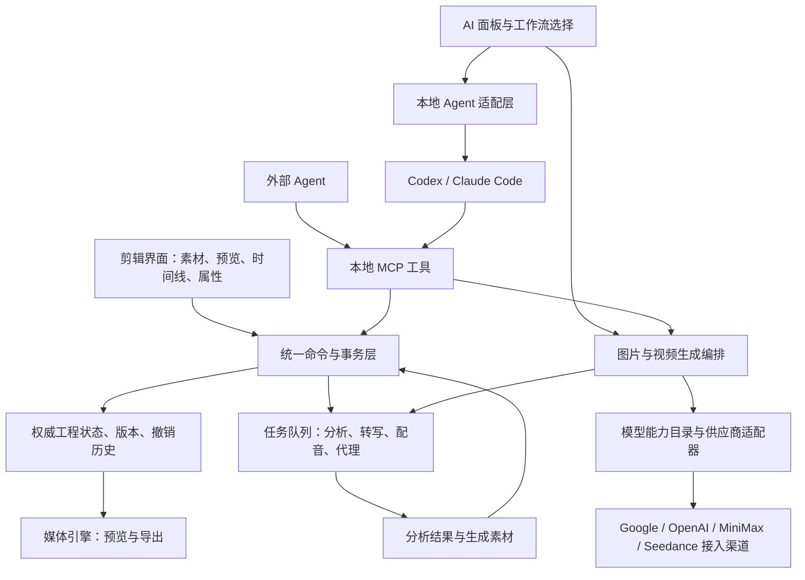

# 总体架构与工程模型

归档日期：2026-10-24。实施更新：2026-10-25，P0/P1 进行中。

关联需求：FW-R01、FW-R02、FW-R03、FW-R06、FW-R07、FW-R09、FW-R10、FW-R11、FW-R14、FW-R15、FW-R16。当前架构为待验证建议；UI、MCP 与工作流共用工程命令，模型输出经素材库进入时间线。

2026-10-24 后续更新：用户已确认 Wails + Go 客户端方案，后续明确使用 v3 最新版；2026-10-26模块/CLI/runtime已同步v3.0.0正式版，项目工具链Go1.27.3。前端当前推荐 React + TypeScript + Vite，见 [前端展示层框架评估](../research/前端展示层框架评估.md)；该建议与媒体引擎、具体视觉参数尚未最终确定。

依据：[完整调研与规划快照](../archive/2026-10-24-竞品调研与实现规划-v0.2.md)。文中“建议”“候选”“待验证”不表示已经完成技术定型或功能实现。

实施映射：`internal/editor` 承担权威工程与事务，`internal/projectstore` 当前保存原子 JSON 快照，`internal/application` 统一桌面/开发接口，`internal/media` 承担离线软件合成，`internal/jobs` 与 `internal/localmedia` 管理任务和素材访问，`frontend/` 展示工作区。SQLite 仍是候选；MLT/原生实时已有实验实现和局部证据，完整双端、资源与发行门槛尚未通过，不能用已有代码替代这些验收。详见 [首轮实现记录](../implementation/2026-10-25-首轮实现与验收.md)。

`internal/projectversions`新增独立具名版本存储，完整工程快照去除会话地址、摘要有界分页、恢复前保存当前状态并更换引擎/源实例。仍只有当前Engine为活动权威，旧版本是不可变恢复资料；不把它等同于SQLite或持久Undo，媒体不复制。详见[版本恢复验收](../implementation/2026-10-26-工程版本快照与恢复验收.md)。

`internal/projectrecovery`进一步提供dirty工程的5秒滚动点及全局恢复中心，周期读取Engine身份/修订/保存基线后合并捕获，文件I/O在编辑锁外单写。普通保存/切换通过退役标记避免迟到旧写复活，恢复复用工程解析器，强制未保存路径并保留当前工作。具名版本、恢复点和收集副本分别保留各自用途，不另建活动工程权威；详见[恢复验收](../implementation/2026-10-26-自动恢复副本与恢复中心验收.md)。

`internal/snapshotstorage`集中管理版本/恢复资料的身份检查、回收站移动、还原及已知文件清理；各存储仍拥有自己的锁与预算，应用层绑定当前scope、保护点和工程/素材路径，不经MCP授予任意删除能力。资料管理不改变活动Engine或Undo，详见[回收站验收](../implementation/2026-10-27-版本与恢复资料回收站验收.md)。

生成链路已增加 `internal/connections`、`internal/generation`、`internal/generationjobs` 和 `internal/statefilelock`：凭据、供应商协议、付费请求持久状态和进程单写入者分别拥有清楚边界。模型返回的文件先落盘，经应用层校验后以统一命令加入原工程素材库。`internal/localagent` 已具备独立 CLI 检测、结构化规划与副本校验基础，尚未接通真实账户和 MCP 全流程。具体状态见 [生成任务与凭据验收](../implementation/2026-10-25-生成任务与凭据验收.md)。

语音链路由 `internal/speechjobs` 保存任务、分块意图及原始响应，`internal/media` 准备真实音轨覆盖，`internal/application/speech.go` 核对结果来源并接到工程；源转写与接受修订进入 editor，前端不直接声称任意 ASR 对象有效。音色查询和全部任务共同参与数据目录关闭生命周期，详见 [语音应用验收](../implementation/2026-10-25-语音应用与音轨准备验收.md)。

内部 CLI 执行使用独立第一方 MCP 会话，仍由同一核心逐批提交；人工模型请求许可与传输生命周期分开。生成候选经 `internal/replacements` 编译后端预览，`replace_visual` 在一次事务内替换画面并迁移原讲话到真实音频来源，原转写不改写。应用层持有原工程实例、版本与文件证据；界面只能应用后端预览ID，不能提交伪造载体。具体证据见 [执行与替换验收](../implementation/2026-10-25-CLI执行与候选替换验收.md)。

## 核心架构：所有入口操作同一工程

当前实现补充：`internal/exporter`将独立playback离线会话与media流式编码、AAC封装和原子提交组合，自动/明确方式由统一ExportVideo解析，MCP准备时固定实际方式。Go工程快照与交互预览分开持有，RGBA/PCM按帧背压，不经WebView生成成片，详见[原生导出验收](../implementation/2026-10-25-原生合成与一致导出验收.md)。这不代表完整媒体SDK分发或双端已通过。

以下是建议架构，不是对 ChatCut 内部实现的描述。

### 工程模型

2026-10-27实施：schema v5增加独立序列。根Settings/Tracks/Clips/Transcripts是当前编辑序列，OtherSequences只存非当前序列，SequenceOrder稳定保存顺序；每个序列数据只存一份，Assets/VisualAnalyses仍全工程共享。源词接受版本及字幕派生属于各序列，复制后可独立改写。导航不进入编辑历史，以归一的全部序列内容计算dirty；普通projectHash仍包含当前上下文供任务核对。Bootstrap和规划上下文只发当前只读投影并显式标记，文件保存/完整Engine创建拒绝投影，避免其它序列丢失。完整快照用于保存、版本、恢复与收集，见[规格](../specs/2026-10-27-多序列工程.md)。

建议实体包括 Project、Sequence、Track、Clip、Asset、Effect、Text、Transcript、Caption、Voice、Job、EditTransaction；生成能力增加 GenerationRequest、GenerationAttempt、GenerationRecipe、AssetVariant、ShotBrief、ModelCapability。

Clip 至少保存稳定 ID、素材 ID、所在轨道、时间线起点、源入点、源出点、速度及效果引用。切出的两个片段仍引用同一源素材，保持非破坏编辑。

工程内部使用整数时间基准或有理数，不靠浮点秒反复累加。帧率要支持 `30000/1001` 等有理数；源素材保留 PTS 信息，音频按采样计时，手机可变帧率素材需显式映射到工程时间。

建议以本地 SQLite 保存权威工程状态、事务和任务元数据。可另行导出 JSON 快照给 Agent 阅读或交换，但不要让数据库和可手改 JSON 同时成为权威状态。媒体文件留在原位置或按用户选择收集到工程包，代理和缓存可以重建。

项目必须支持素材重定位；使用稳定 ID、文件指纹及媒体元数据匹配素材，不能仅靠文件名。工程包应能携带生成音频、LUT、必要字体等资源。

2026-10-26实施：`internal/projectcollect`现已收集当前工程全部登记媒体/LUT，内容命名与去重、相对路径工程、文件清单和后台取消；普通保存/版本/收集复用`projectstore.Encode`。人工字幕、源相位和真实音频区间保持，工程文件最后提交，不把收集当作活动工程保存。字体、账户/生成历史和独立版本库不随目录复制，详见[收集验收](../implementation/2026-10-26-工程素材收集副本验收.md)，完整可移植资源和发行目标继续。

实拍与生成媒体共用 Asset/Clip 模型，使用来源信息区分。生成请求、供应商尝试、实际输出、候选关系和时间线使用位置分别保存。远程生成结果导入本地后作为普通媒体使用，不要求播放或导出时重新访问模型服务。

### 命令、事务与并发

拖动片段、点击分割、运行口播 Skill，最终都应调用相同命令：分割、移动、修剪、删除区间、波纹删除、修改字幕、设置效果等。

AI 任务可以包含多个命令，但应有一个用户可理解的撤销分组。底层仍应逐步记录，以便诊断部分失败。短事务原子提交；长时间转写、配音、导出放在事务之外运行。

命令请求建议携带 `projectId`、`sequenceId`、`baseRevision` 和 `idempotencyKey`。如果用户在 AI 思考期间改动了同一区间，旧计划应重新校验或重新生成，不能覆盖新编辑。任务重试不能重复插入配音、字幕或片段。

轨道锁定、音画链接、分组、字幕绑定和后续片段波纹策略由核心层执行，不能仅依赖提示词要求 Agent 遵守。

### 时间映射与字幕

源转写描述“原素材哪个时间说了什么”；片段映射描述“原素材哪部分在成片何处播放”；字幕描述“播放时显示什么”。字幕纠错、翻译和样式是可独立保存的编辑。

对固定正向速度，源时刻 `S` 映射到时间线：

`T = 片段时间线起点 + (S - 源入点) / 播放速度`

只保留落在片段有效源区间内的词，再生成字幕卡。倒放、变速曲线以后需要分段时间映射，不能继续套用这一简单公式。

原始 ASR 结果应保留，人工纠错形成接受版本。剪切、移动、复制和变速后，从映射重新派生字幕，再应用用户保存的文本和样式覆盖。不能把最初生成的 SRT 当成永久不变的字幕轨。

当前已支持带真实字符时间的配音源词和多词阅读组：origin 明确 asr/tts，timingSource 分开原文和朗读文本，原始完整对齐留任务证据。CaptionLayout 控制确定性分句，CaptionBinding.WordIDs 保持真实连续词引用；保护组不静默拆散。布局预览在应用前核对原工程、版本、源文件和人工修改，详见 [配音时间与阅读字幕规格](../specs/2026-10-25-配音时间与阅读字幕接口.md)。

分割派生的音视频片段另有可选 `SourcePhase`：保存原完整处理输入及当前输出帧窗；手动、工作流、复制和镜头替换共用命令传播，JSON 快照与 Undo 深拷贝。视频从原首有效 PTS 处理后裁输出，音频从原完整重采样/atempo 结果裁输出，不逐段重置相位。契约见 [剪切取样相位](../specs/2026-10-25-剪切取样相位.md)。

## 媒体预览与导出的实现路线

### 桌面壳与媒体引擎分别选型

桌面方案采用 Wails + Go，前端推荐 React/TypeScript 与 Vite，具体依赖按 WebView 和组件兼容性锁定。Wails v3 已按用户要求实施，当前固定3.0.0正式版；macOS 原生文件、关闭保护及多轨实时已验证，Windows 原生和商业交付继续验收。Go 应用层组织项目、任务和本机 CLI，独立原生媒体服务负责重计算。桌面壳的选择不会自动解决实时解码、混音和同步问题。

对于你偏常规剪辑的需求，媒体核心建议优先做 **MLT 原型验证**。MLT 是面向多轨音视频编排的现有框架，具有源、过滤器、转场及消费者等结构。[MLT 官方介绍](https://www.mltframework.org/)、[框架文档](https://www.mltframework.org/docs/framework/)

建议将其封装成独立原生媒体服务，通过受控接口接收工程图；预览和导出尽量使用同一套滤镜、文字、合成与音频逻辑。如何向 Wails 或备选壳传递预览画面是首个技术验证点，需比较原生画面嵌入与共享缓冲等实现。逐帧 PNG/Base64 通过 JSON 传输只能用于低频检查画面，不能作为正式实时预览方案。

FFmpeg/ffprobe 负责媒体探测、代理生成、抽取音频及编码等任务。单独拼接 FFmpeg 命令可以做离线处理，却仍需要自行实现实时播放调度、缓存和时间线语义。

若后续愿意投入 Rust 核心，可提高 Tauri 的优先级；若 Web 壳的原生预览难以达标，可单独评估 C++ + Qt/Qt Quick。两者均需计入团队成本。自行构建完整解码与 GPU 合成引擎应在现有框架验证不满足需求后再决定。

### 首版边界

建议先验收 1080p、SDR、常用恒定工程帧率，以及受控的图形和音频效果。输入格式范围必须实测后公布；遇到不适合直接预览的素材，建立代理或转换工作流。

文字需要预览和导出共用布局规则与字体资源。不能仅用浏览器 CSS 预览，再用另一套默认字体和排版规则烧录字幕。LUT、音量、转场和速度也应比较导出结果。

复杂 HTML 动态图形可作为后续素材类型：保留模板代码与参数，按需渲染成缓存或透明视频供时间线播放，修改后失效重渲染。借鉴 OpenFilm 时，要同时保留可编辑源，避免只留下烘焙后的视频。

### 模块职责和扩展边界

| 模块 | 拥有的数据和责任 | 扩展方式 |
| --- | --- | --- |
| 编辑工作区 | 选择、面板、预览与用户操作 | 共用上下文和生成面板组件 |
| 工程与剪辑核心 | 轨道、片段、时间映射、事务和撤销 | 所有编辑入口调用同一命令 |
| 素材与参考管理 | 本地文件、指纹、缩略图、候选及关联 | 实拍、上传和生成素材共用模型 |
| 生成编排 | 镜头任务、请求校验、模型选择、版本关系 | 以任务类型组织图片和视频能力 |
| 模型与供应商适配 | 鉴权、能力描述、参数转换、上传、提交与查询 | 新增适配器和能力契约 |
| 任务基础设施 | 排队、持久状态、轮询、恢复、下载及消耗记录 | 供生成、ASR、TTS 等模块共用 |
| 素材分析 | 转写、镜头、画面描述和语义索引 | 增加分析器及缓存版本 |
| Agent 与 Skills | 用户意图理解和跨模块工作流组织 | 通过稳定 MCP 工具调用领域服务 |
| 媒体引擎 | 解码、合成、混音、色彩和输出 | 不依赖具体生成模型名称 |

采用模块化单体加必要的媒体/任务进程起步，先把代码依赖和数据所有权分清；当前没有依据拆成大量独立服务。长耗时媒体处理与 UI 隔离，后续如需云端队列再替换执行基础设施。

关键依赖约束：供应商适配器返回生成结果，不直接写轨道；生成编排输出素材，不自行改变剪辑；应用结果由工程命令层完成。Skills 调用稳定任务接口，模型专有请求留在适配器内部。界面不会因每增加一家模型服务而新增整套工作区。

## 2026-10-26 工程格式v2与分析记录

该轮SchemaVersion=2，新增VisualAnalyses保存用户接纳的结构化文字、类别/标签、提交来源和离散帧证据。读取v1只做已知无损迁移，返回保存兼容性提示；原文件不自动改写，明确保存后为v2，旧客户端会拒绝。分析接纳/移除走统一命令与Undo/Redo，不参与时间线或字幕重建；候选不能通过普通编辑参数伪造。保存的是分析记录，不是对模型文字的事实认证。见[接纳规格](../specs/2026-10-26-画面分析接纳与检索.md)与[验收](../implementation/2026-10-26-画面分析接纳与检索验收.md)。

## 2026-10-27 v3工程字体

该轮SchemaVersion=3，font Asset保存静态字体元信息和指纹，TextStyle.fontAssetId按资源引用。v1/v2无新字体数据的工程只在内存迁移，原文件不改，明确保存后旧客户端会拒绝v3。字体逻辑引用与编辑仍归核心，读取/字形/容量与实际字体证明归[projectfonts模块](../../internal/projectfonts/README.md)和原生媒体层；默认字体行为保留但不冒充跨机固定。

通用收集流程已包含字体，真实移走全部原字体后全90帧RGBA/PCM一致。字体文件内声明保留供人核对，完整附带许可资料不自动推断；模型历史、独立版本库、双端复杂排版和完整发行仍按原边界推进。见[本轮验收](../implementation/2026-10-27-工程字体资源验收.md)。

## 2026-10-27 v4音频输出包络

当前SchemaVersion=7（音频淡化自v4引入），Clip.audioFade以微秒端点时长和帧范围/偏移表示原包络及当前保留窗。核心负责迁移、校验、克隆/Undo与剪辑继承，渲染在输出采样时钟逐路应用，不缓存带淡化的源PCM。v1–v3无淡化工程只读打开迁移，明确保存才写v4；旧版本夹带有效新字段拒绝。原生能力audioFades显式声明，FFmpeg精确裁窗后计算，浏览器近似，见[淡化链路](../../internal/media/AUDIO_FADE.md)。

## 2026-10-28 v6本地OCR来源

VisualAnalysis新增apple-vision来源及apple-vision-ocr-v1方法，工程为v6。v1–v5仅内存迁移、明确保存才重写，旧版本夹带新来源拒绝；CLI分析与本机OCR的方法/来源不能互换。源帧证据、人工接纳/检索、Undo及全工程资源共享沿既有核心，OCR进程只处理JPEG，不写工程。具体边界见[规格](../specs/2026-10-28-本地源画面文字识别.md)和[适配器](../../internal/ocr/README.md)。

## 2026-10-28 v7 Windows系统OCR

当前工程为v7，v1–v6读取后仅内存迁移，Windows系统OCR以windows-media-ocr/windows-media-ocr-v1保存来源，不伪装Apple或CLI。临时识别契约支持未知置信度，Windows模型修订0仅表示未提供；接纳后的人工文案仍不保存旧置信度。Windows身份和原生helper齐备才提供入口，单独准备MSIX目录不代表支持已验证。见[规格](../specs/2026-10-28-Windows系统OCR与MSIX交接.md)。
