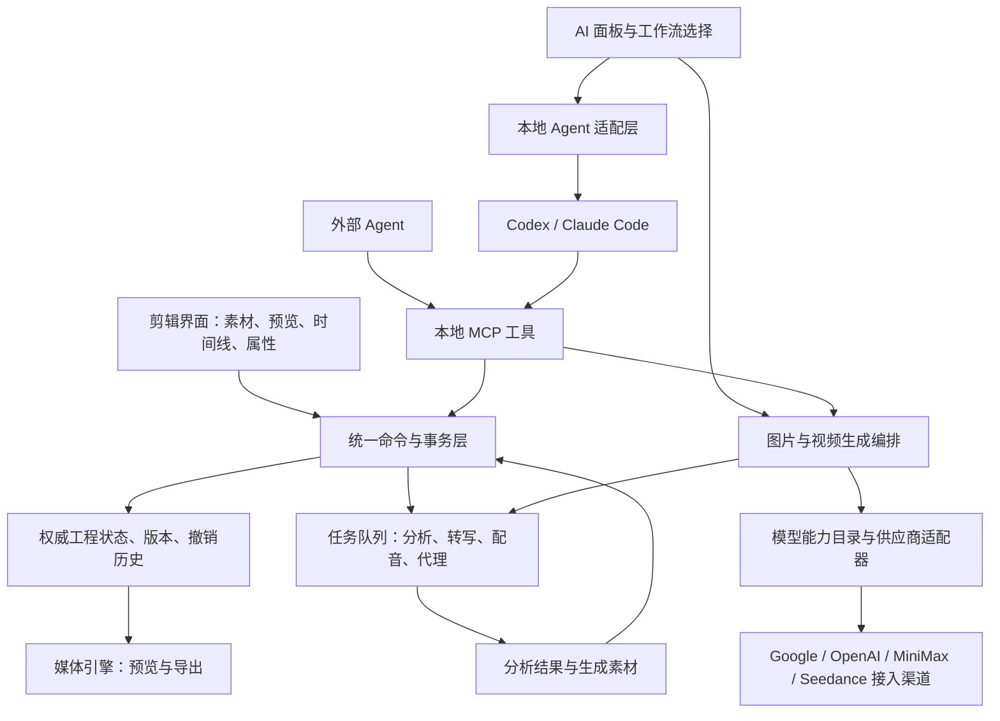

# OpenFilm、ChatCut 调研与 AI 视频剪辑客户端实现建议

调研日期：2026 年 10 月 24 日。

规划版本：v0.2，2026 年 10 月 24 日补充图片与视频生成，并将通用化、模块化和摄影剪辑工作流纳入设计约束。

本报告依据官方产品文档、公开插件仓库及 OpenFilm 源码静态阅读。OpenFilm 源码基线为 `619c163d2632e6e87e989049fec04dfc22188cd1`，该基线桌面包版本为 `0.2.5`。没有安装运行两款产品或使用真实素材做性能测试，因此不对播放流畅度、识别准确率和稳定性作实测结论。下文明确区分产品事实与开发建议。

## 1. 建议的产品定位

建议定位为：**面向已有剪辑基础的用户，以可编辑多轨工程为中心，结合素材分析、图片与视频生成、可复用工作流和本地 Agent，减少重复剪辑并补齐创作素材的桌面软件。**

用户应该始终能预览、拖动和修剪 AI 产生的片段，修改字幕、音频和效果，并撤销一次自动剪辑任务。AI 的产物应是可继续编辑的工程，而不仅是最终 MP4。

产品交互重点参考 ChatCut；本地 Agent 接入、工程可读性和生成式动态图形重点研究 OpenFilm。主工程建议使用有明确类型、时间基准和版本号的结构化模型；HTML 场景可以作为以后的一类动态图形素材。

首个重点场景建议选口播、教程或讲解类素材。它能同时验证你的主要要求，且容易评估是否真的节省时间。普通手动剪辑能力仍作为共同底座保留。

图片和视频生成进入正式功能范围。首批接入目标包含 Google Nano Banana 系列、OpenAI GPT Image 系列、MiniMax H3、Seedance 2.5；具体可用版本、接入渠道及能力以账号权限和实际 API 校验为准。产品先组织用户要完成的任务，再提供模型选择。完整生成工作流和模块边界见第 12 节。

## 2. 两款产品分别如何工作

### 2.1 OpenFilm：编程 Agent 编写影片，Studio 提供可视化编辑

**已确认的工程设计：**

- `film.html` 描述剪辑编排，影片页面绘制具体镜头，`assets/` 保存媒体。
- 时间线的每个 `<section>` 表示一条轨道。规范中的轨道不限定视频、音频类型；片段可引用页面、视频、图片或声音。
- 片段记录素材区间、时间线位置、速度、音量和样式。页面通过 `window.film` 暴露协议，由 `frame(t)` 绘制指定时刻。

来源：[工程介绍](https://openfilm.dev/docs/)、[影片格式规范](https://openfilm.dev/spec/)。

**操作逻辑：**用户提出要求 → Agent 阅读手册并编写工程 → Studio 展示结果 → 用户在预览、属性面板或时间线上修改 → Agent 继续读取同一工程。Studio 有素材、图层、预览、属性和时间线面板，支持移动、修剪、分割以及撤销。可视化修改页面元素时，Studio 将覆盖项保存到对应片段，保留页面原始代码。[Studio 文档](https://openfilm.dev/docs/studio/)

**已确认的技术实现：**桌面壳使用 Electron，界面使用 React/TypeScript；桌面 Agent 模块通过 ACP 适配器启动本机 Claude Code、Codex 等程序，以标准输入输出交换 JSON-RPC 消息。影片导出会调用浏览器绘制画面，再使用 FFmpeg 编码、混音和封装。

代码依据：[桌面依赖](https://github.com/openfilm/openfilm/blob/619c163d2632e6e87e989049fec04dfc22188cd1/apps/desktop/package.json)、[Agent 接入](https://github.com/openfilm/openfilm/blob/619c163d2632e6e87e989049fec04dfc22188cd1/apps/desktop/src/agents.mjs)、[渲染实现](https://github.com/openfilm/openfilm/blob/619c163d2632e6e87e989049fec04dfc22188cd1/packages/openfilm/src/render.mjs)。

它还提供 `look` 命令输出检查画面和接触表，并检查相同时刻的绘制是否一致；`get` 命令通过用户连接的服务获得配音、转写等内容。[CLI 文档](https://openfilm.dev/docs/cli/)

OpenFilm 也有字幕实现：素材旁的 WebVTT 保存转写及词时间信息，字幕根据片段保留的源时间和速度派生，随剪切、移动、修剪和变速变化。不能把它简单理解成只会生成网页动画。[字幕源码](https://github.com/openfilm/openfilm/blob/619c163d2632e6e87e989049fec04dfc22188cd1/packages/openfilm/studio/server/captions.mjs)

**对你的启发：**Agent 擅长生成代码时，可以生成丰富的标题和动态图形；工程可读性和自动画面检查很有价值。但这不直接证明它适合作为长素材、多层实时剪辑的全部底座。本次未确认 OpenFilm 是否具有完整的 `.cube` 导入工作流，也未确认其专业色彩管理范围；这些属于待验证项，不能记为“不支持”。公开项目标注 MIT，可作为原型或模块研究对象。[官方仓库](https://github.com/openfilm/openfilm)

### 2.2 ChatCut：可视化时间线与 Agent 共同编辑

ChatCut 的界面把 AI、素材、预览和时间线放在同一工作区，也提供转写文本和版本功能。用户可以先手动放置素材，再选中片段、时间点、预览区域或转写文本，附带精确引用向 Agent 发出指令。[编辑器布局](https://chatcut.io/docs/editor-overview)、[选择引用](https://chatcut.io/docs/selection-mode)

其时间线有视频轨和音频轨，支持移动、修剪、分割、变速、锁轨和音频分离等操作。一个项目可以包含多个时间线。转写文本是另一个剪辑入口：删除文字会切除对应时间区间；字幕卡则有独立的内容和样式编辑能力。[时间线](https://chatcut.io/docs/timeline)、[转写和字幕](https://chatcut.io/docs/transcript-and-captions)

官方文档明确区分两条桌面 Agent 路径：

1. 在 ChatCut Desktop 内选择检测到的本地 Claude Code、Codex CLI 等 Agent。
2. 在外部 Agent 中聊天，通过本地 MCP 操作选定的 ChatCut Desktop 工程。

Desktop 支持直接读取本地媒体和本地视频导出；部分 AI 服务仍依赖网络。本地 CLI 也可能调用其提供商的在线服务。[Desktop 文档](https://chatcut.io/docs/desktop-app)

它还提供三类可复用上下文：Skills 描述工作方法，Design Styles 描述视觉偏好，Voices 描述声音选择。Skills 可以附加到当前请求，也能从已验证的剪辑过程保存。[Skills 文档](https://chatcut.io/docs/skills-overview)

在你的其他关键要求上，文档确认：

- 可试听预置声音、保存个人克隆音色，并用脚本生成配音。个人声音有单独的创建和预览流程。[声音库](https://chatcut.io/docs/voice-library)、[AI 配音](https://chatcut.io/docs/ai-voiceover)
- Desktop 可导入 `.cube`、`.3dl` LUT，形成跨项目复用的库，应用到片段并调整强度。[AI 效果与 LUT](https://chatcut.io/docs/ai-effects)
- 可撤销近期操作，也可保存命名版本供恢复。[撤销与版本](https://chatcut.io/docs/versions-undo-redo)

本次核查到的公开源码包括 Agent Plugin，其职责是连接 Agent、提供插件配置及工作流技能。没有取得完整桌面编辑器源码，因此不能据此断定 ChatCut 内部使用哪一种 UI 框架、媒体引擎或数据库。[公开插件仓库](https://github.com/ChatCut-Inc/agent-plugin)

### 2.3 对本项目的参考价值

| 维度 | OpenFilm | ChatCut | 对本项目的建议 |
| --- | --- | --- | --- |
| 工程表达 | HTML 编排与可绘制页面，有公开规范 | 用户面对可编辑时间线，内部格式未确认 | 自有结构化工程模型 |
| 常规剪辑 | 已有 Studio 和时间线操作 | 文档覆盖较完整的剪辑工作区 | 以手动剪辑能力作为 AI 的共同底座 |
| Agent 接入 | 可研究桌面 ACP 实现 | 内置本地 Agent 与外部 MCP 两条路径 | 分开设计“调用 Agent”和“被 Agent 调用” |
| 生成图形 | 网页技术表达丰富 | 提供动态图形工作流 | 作为独立素材类型，后续扩展 |
| 字幕 | 源转写派生到时间线 | 文本剪辑、字幕编辑及翻译 | 建立源时间与时间线映射 |
| LUT | 本次未确认完整导入流程 | 官方确认导入与共享库 | 首版覆盖明确范围的 3D `.cube` |
| 可复用流程 | 手册、Skills、可读工程 | Skills、风格与声音上下文 | 工作流、参数预设和内容模板分别管理 |
| 直接复用 | 有完整公开工程可评估 | 公开插件有参考价值 | 不把接口行为推断成其内部源码设计 |

上表是对前述证据的归纳与产品判断，不是两款产品的性能排名。

## 3. 建议的客户端操作逻辑

工作区建议保留素材库、预览、属性面板、时间线和 AI 面板。用户收起 AI 面板后，仍能完成基本剪辑。

素材面板增加“生成”入口；时间线空档、选中片段和预览当前帧提供相应上下文操作，统一打开同一个生成面板。用户可生成配图、补充镜头、将图片转成视频或生成替代版本，再使用熟悉的预览、拖放和替换操作纳入成片。

轨道至少在用户层面区分：视频、音频、普通文字、字幕。普通文字包含标题和说明文字；字幕通常与语音时间关联。二者可以共用底层文字渲染，但编辑行为应有区别。

典型流程：

1. **导入。**读取媒体信息，生成缩略图、波形和必要的代理文件。后台分析的状态应可见，媒体可播放后即允许开始手动剪辑。
2. **理解素材。**按需生成转写、静音区间、镜头边界、画面描述和索引。用户能纠错，并定位回原素材。
3. **选择范围和方法。**选择整条时间线、部分片段或转写段落，再选工作流或输入要求；需要新素材时，在同一上下文创建生成任务。
4. **执行。**Agent 读取当前状态，生成剪辑决策；确定性工具验证并执行。预期效果、任务进度和失败原因显示在界面中。
5. **检查与精修。**自动结果仍是轨道和片段。生成图片和视频先成为可预览素材或候选版本；按任务选择添加、替换或保留在素材库。可快速比较修改前后，也可撤销整次剪辑任务；低风险的日常操作可直接执行，避免每个剪切都弹出确认。
6. **导出。**导出使用明确的工程版本；用户继续修改时，不改变已经开始的导出任务。

适合首版的例子：导入一段讲解视频，运行“口播粗剪”，压缩长停顿并标记重复表达；生成可编辑字幕，应用指定 LUT；用户试听后选择音色，为新增引导语生成配音；最后手动精修并导出。

这里必须区分三种请求：**把原话转成字幕、根据素材写新文案、把文案合成新音频。**改写摘要不能直接冒充原话字幕；文字纠错也不应自动改变原录音。

## 4. 核心架构：所有入口操作同一工程

以下是建议架构，不是对 ChatCut 内部实现的描述。

### 4.1 工程模型

建议实体包括 Project、Sequence、Track、Clip、Asset、Effect、Text、Transcript、Caption、Voice、Job、EditTransaction；生成能力增加 GenerationRequest、GenerationAttempt、GenerationRecipe、AssetVariant、ShotBrief、ModelCapability。

Clip 至少保存稳定 ID、素材 ID、所在轨道、时间线起点、源入点、源出点、速度及效果引用。切出的两个片段仍引用同一源素材，保持非破坏编辑。

工程内部使用整数时间基准或有理数，不靠浮点秒反复累加。帧率要支持 `30000/1001` 等有理数；源素材保留 PTS 信息，音频按采样计时，手机可变帧率素材需显式映射到工程时间。

建议以本地 SQLite 保存权威工程状态、事务和任务元数据。可另行导出 JSON 快照给 Agent 阅读或交换，但不要让数据库和可手改 JSON 同时成为权威状态。媒体文件留在原位置或按用户选择收集到工程包，代理和缓存可以重建。

项目必须支持素材重定位；使用稳定 ID、文件指纹及媒体元数据匹配素材，不能仅靠文件名。工程包应能携带生成音频、LUT、必要字体等资源。

实拍与生成媒体共用 Asset/Clip 模型，使用来源信息区分。生成请求、供应商尝试、实际输出、候选关系和时间线使用位置分别保存。远程生成结果导入本地后作为普通媒体使用，不要求播放或导出时重新访问模型服务。

### 4.2 命令、事务与并发

拖动片段、点击分割、运行口播 Skill，最终都应调用相同命令：分割、移动、修剪、删除区间、波纹删除、修改字幕、设置效果等。

AI 任务可以包含多个命令，但应有一个用户可理解的撤销分组。底层仍应逐步记录，以便诊断部分失败。短事务原子提交；长时间转写、配音、导出放在事务之外运行。

命令请求建议携带 `projectId`、`sequenceId`、`baseRevision` 和 `idempotencyKey`。如果用户在 AI 思考期间改动了同一区间，旧计划应重新校验或重新生成，不能覆盖新编辑。任务重试不能重复插入配音、字幕或片段。

轨道锁定、音画链接、分组、字幕绑定和后续片段波纹策略由核心层执行，不能仅依赖提示词要求 Agent 遵守。

### 4.3 时间映射与字幕

源转写描述“原素材哪个时间说了什么”；片段映射描述“原素材哪部分在成片何处播放”；字幕描述“播放时显示什么”。字幕纠错、翻译和样式是可独立保存的编辑。

对固定正向速度，源时刻 `S` 映射到时间线：

`T = 片段时间线起点 + (S - 源入点) / 播放速度`

只保留落在片段有效源区间内的词，再生成字幕卡。倒放、变速曲线以后需要分段时间映射，不能继续套用这一简单公式。

原始 ASR 结果应保留，人工纠错形成接受版本。剪切、移动、复制和变速后，从映射重新派生字幕，再应用用户保存的文本和样式覆盖。不能把最初生成的 SRT 当成永久不变的字幕轨。

## 5. 媒体预览与导出的实现路线

### 5.1 桌面壳与媒体引擎分别选型

建议优先评估 Electron + React + TypeScript，方便组织编辑界面、Node 子进程和本地 Agent 接入。OpenFilm 的公开实现可供参考，但桌面壳的选择不会解决实时解码、混音和同步问题。

对于你偏常规剪辑的需求，媒体核心建议优先做 **MLT 原型验证**。MLT 是面向多轨音视频编排的现有框架，具有源、过滤器、转场及消费者等结构。[MLT 官方介绍](https://www.mltframework.org/)、[框架文档](https://www.mltframework.org/docs/framework/)

建议将其封装成独立原生媒体服务，通过受控接口接收工程图；预览和导出尽量使用同一套滤镜、文字、合成与音频逻辑。如何向 Electron 传递预览画面是首个技术验证点，需比较原生画面嵌入与共享缓冲等实现。逐帧 PNG 通过 JSON 传输只能用于检查画面，不能作为正式实时预览方案。

FFmpeg/ffprobe 负责媒体探测、代理生成、抽取音频及编码等任务。单独拼接 FFmpeg 命令可以做离线处理，却仍需要自行实现实时播放调度、缓存和时间线语义。

如果团队更擅长 Rust，可以评估 Tauri，但它不会减少媒体引擎和编辑模型的工作量。自行构建完整解码与 GPU 合成引擎应在现有框架验证不满足需求后再决定。

### 5.2 首版边界

建议先验收 1080p、SDR、常用恒定工程帧率，以及受控的图形和音频效果。输入格式范围必须实测后公布；遇到不适合直接预览的素材，建立代理或转换工作流。

文字需要预览和导出共用布局规则与字体资源。不能仅用浏览器 CSS 预览，再用另一套默认字体和排版规则烧录字幕。LUT、音量、转场和速度也应比较导出结果。

复杂 HTML 动态图形可作为后续素材类型：保留模板代码与参数，按需渲染成缓存或透明视频供时间线播放，修改后失效重渲染。借鉴 OpenFilm 时，要同时保留可编辑源，避免只留下烘焙后的视频。

## 6. 素材分析、字幕与配音

### 6.1 素材理解

建议建立分层分析流水线：媒体元数据 → 音频活动与转写 → 镜头切分 → 抽样关键帧 → 必要的 OCR/视觉描述 → 按时间区间组织的语义索引。

Agent 根据转写摘要和镜头索引选择候选片段，必要时再读取更密集的帧。画面分析按需要增加密度，避免每次请求重复上传整部影片。分析缓存键应包含素材指纹、模型及配置版本。

结果必须能追溯到 `assetId`、源时间区间和证据。例如“第 23 秒出现产品特写”，应可点击回看；“适合作为开头”属于剪辑建议，应保留选择理由。画面发生过的事实与生成文案要分开。

### 6.2 ASR

ASR 供应接口至少返回片段文本、词或字级时间、语言和可用的置信信息。说话人区分作为可选能力。文本删除需要音素边界检查、少量保护时长和切口处理，避免切掉辅音、呼吸或自然停顿。

可先接一个时间戳稳定的供应服务，同时保留本地转写适配接口。`whisper.cpp` 可作为本地候选，但其文档把词级时间戳标为实验性，需要对中文、夹杂英文、噪声和多人音频实测，不能直接视为可靠的精确剪切边界。[whisper.cpp 文档](https://github.com/ggml-org/whisper.cpp/blob/master/README.md)

### 6.3 TTS 与自定义音色

把“选音色/创建个人音色”“生成音频”“放入时间线”设计成三个明确步骤。用户可以先试听，配音生成成功后作为普通音频素材加入媒体库，再根据本次任务安排位置。

保存声音供应商、稳定 voice ID、语言、可用控制项和参考音频信息；个人声音创建流程包含使用授权。供应商适配层暴露真实支持的语速、风格或时长控制，不能把所有模型包装成具有相同能力。

时长应以真实生成音频为准。推荐按句或语义段合成，测量时长并取得对齐结果后再安排字幕和画面。若必须压到固定时长，可调整文案、供应商支持的语速，或在明确范围内变速并回听；不能按字数平均分配字幕时间，也不能默默截断句尾。

## 7. `.cube` LUT 应如何实现

导入 LUT 至少包括内容校验、资源管理、应用顺序和一致渲染。FFmpeg 的 LUT 实现具有 `.cube` 解析及多种插值算法，可以作为处理实现的参考。[FFmpeg LUT 源码](https://github.com/FFmpeg/FFmpeg/blob/master/libavfilter/vf_lut3d.c)

首版建议明确支持 3D `.cube`，并明确告知暂不支持的 1D、组合型或其他变体。不能只按文件后缀判断导入成功。

- 校验 `LUT_3D_SIZE`、`DOMAIN_MIN/MAX`、数据数量和数值是否合法，对大小与网格规模设上限。
- 按内容哈希管理共享库；工程保存 LUT 引用，并支持打包携带，防止换电脑失效。
- 支持片段级启停与强度调节；轨道或全片调整层可随后扩展。
- 明确 LUT 预期输入与输出空间。Log 转换 LUT 与创意风格 LUT 的作用不同，处理顺序需要相应配置。
- 预览与导出采用一致的插值、色彩范围和处理顺序，避免颜色跳变。
- 使用恒等 LUT、已知变换 LUT、灰阶及肤色画面验证，并验证 0%/100% 强度和工程重新打开。

## 8. 集成本机 Codex、Claude Code

### 8.1 三种接口承担不同责任

| 层 | 负责什么 | 在本项目中的位置 |
| --- | --- | --- |
| Agent 接入协议/SDK | 启动对话、发消息、接收事件、取消、恢复与权限交互 | 软件调用本机 Agent |
| MCP | 提供可发现、结构化的工具调用 | Agent 读取与操作剪辑工程 |
| Skill / 工作流说明 | 告诉 Agent 如何完成某类剪辑 | 口播粗剪、字幕规范、教程节奏等 |

ACP 标准化客户端与 Agent 的会话通信；MCP 标准化 Agent 与工具的连接。ACP 可把 MCP 配置交给 Agent，但二者不互相替代。[ACP 介绍](https://agentclientprotocol.com/get-started/introduction)、[ACP 架构](https://agentclientprotocol.com/get-started/architecture)

### 8.2 接入策略

建立统一 `AgentAdapter`，封装检测程序、读取版本、开始/恢复会话、发送上下文、接收事件、取消任务和退出清理。UI 不直接解析某家 CLI 的所有细节。

一次性任务可用 `codex exec --json`，并按需要使用 JSON Schema 限制最终输出。Claude Code 可用 `claude -p` 和结构化输出；实时流式输出使用文档要求的 `stream-json`、`--verbose` 等选项。[Codex 非交互模式](https://developers.openai.com/codex/noninteractive/)、[Claude Code 程序化调用](https://code.claude.com/docs/en/headless)

持续聊天可参考 OpenFilm 做 ACP 原型，也可分别评估原生 SDK/接口。Codex app-server 提供会话历史、流式事件及审批等能力，支持 stdio；**当前官方文档同时将 app-server 命令及 WebSocket 传输标为实验性，不能把它当作已有生产稳定承诺的依赖。** 若采用，应锁定兼容版本、生成对应协议类型并保留替代路径。[Codex app-server 官方文档](https://learn.chatgpt.com/docs/app-server)

复用本机 CLI 的正常登录流程，由它自身管理凭据；产品只展示安装、登录和运行状态。CLI 已安装不等于模型推理离线，也不代表字幕、配音等外部服务自动可用。

### 8.3 本地工具接口

建议先提供少量边界清楚的工具；以下名称仅为本产品设计示例：

| 工具组 | 示例 | 约束 |
| --- | --- | --- |
| 状态读取 | `project.read`、`timeline.read` | 指明工程、时间线和 revision |
| 素材查询 | `assets.search`、`asset.inspect` | 分页，返回稳定 ID 与源时间 |
| 内容读取 | `transcript.read`、`frames.inspect` | 限定区间与返回量 |
| 修改规划 | `edits.validate`、`edits.preview` | 检查源边界、锁轨与链接关系 |
| 修改提交 | `edits.commit`、`history.undo` | 版本校验、幂等、事务记录 |
| AI 任务 | `speech.generate`、`analysis.start` | 返回持久 job ID |
| 媒体生成 | `generation.capabilities`、`generation.submit`、`generation.read` | 按实际能力验证，返回持久 job ID 与生成素材 |
| 结果检查 | `preview.render`、`jobs.read` | 返回任务/工程版本与结果 |
| 导出 | `export.start` | 绑定明确工程快照 |

首次先实现读取和少量确定性编辑，再增加组合能力。不要给 Agent 一个只能接受任意脚本、直接覆盖整个工程的万能入口。复杂任务可提交经过验证的批量命令，减少逐片段往返。

本地桥接应限定会话和项目访问范围。音视频本体经媒体服务处理；Agent 优先获得摘要、精确区间和必要帧。任务日志显示用了哪个工作流、修改了哪些片段以及是否有素材上传。

## 9. Skills、预设与模板如何组织

**Skill 决定方法，参数预设决定数值，模板提供可复用内容。** 例如“口播粗剪”是工作流，“超过 700ms 的停顿保留 250ms”是预设，“品牌片头”是模板。

建议内置四个起步工作流：

1. 口播粗剪：压缩长停顿、定位重复句、切口处理，避免机械删除有语义的口头表达。
2. 字幕整理：纠正术语、按阅读节奏断句、控制行长，生成可继续编辑的字幕卡。
3. 配音讲解：依据素材证据生成文案、试听音色、分段合成、根据真实时长安排字幕和画面。
4. 补充镜头：根据所选段落和现有素材寻找可用画面，必要时生成配图或视频；保留镜头候选供选择，再按约定放入时间线。

一个可维护的工作流包可以包含中文 `SKILL.md`、参数定义、版本号、允许工具、必要的确定性脚本和验收规则。默认参数由表单展示，用户不必编辑 Markdown。

示例参数可以包含静音阈值、保留停顿、每行字数、字幕安全区、声音 ID、LUT ID、强度、保护轨道、生成偏好、参考素材和预算上限。它们是本产品的工作流数据，不是 Codex 或 Claude Code 已存在的统一标准。

工作流需要声明适用场景、依赖的分析结果和成功条件。声音、LUT、字幕样式使用稳定 ID，避免仅凭名称定位。升级工作流后保留旧任务所用版本，便于重现结果。

## 10. 分阶段实施与验收

| 阶段 | 核心产物 | 进入下一阶段的条件 |
| --- | --- | --- |
| P0：媒体技术验证 | 一个可播放的真实多轨序列、文字、混音、LUT、导出 | 目标机器上的同步、拖动定位和导出一致性满足明确指标 |
| P1：手动编辑底座 | 素材库、视频/音频/文字/字幕轨、分割修剪、撤销、保存重开 | 不接 AI 也能完成并恢复一条短片 |
| P2：字幕与配音 | ASR、文本定位/删减、字幕样式、预置与自定义声音适配 | 剪切变速后字幕跟随，生成配音可试听、移动和重做 |
| P3：图片与视频生成 | 统一能力目录和任务服务，至少一种图片模型与一种视频模型，候选比较及时间线应用 | 真正跑通参考输入、远程任务、本地落盘、添加/替换、失败恢复 |
| P4：Agent 与工作流 | 本地 MCP、一个 Agent、四个工作流，可调度生成任务 | AI 结果可精修、可撤销，重复提交和状态冲突可处理 |
| P5：模型与产品完善 | 完成 Google/OpenAI 图片及 MiniMax H3/Seedance 2.5 接入验证，第二个 Agent 和更多格式 | 每项能力具有契约校验、实际账号可用性检查和代表性场景验收 |
| P6：后续扩展 | 复杂图形、视频延长/编辑、更多供应商和高级索引等 | 新能力通过现有模块接入，核心工程无需跟随模型名称改写 |

产品最终需要同时支持 Codex、Claude Code，但工程实现先打通一个，确认适配层边界后加入另一个。不要为了等待第二个适配器而延迟剪辑核心验证。

图片与视频生成属于首版核心能力；四类命名模型均进入接入计划。先用各一个真实模型验证公共流程，再扩展其余适配器。对外标注“已接入”前，必须完成实际接口和账号验证；未完成的模型显示为规划项。

建议 P0 使用真实设备与一组固定样本：长口播、手机可变帧率录制、29.97fps 素材、含背景音乐音频、多层图片/文字及至少一份真实 LUT。先记录机器、素材、分辨率和效果，再约定播放、定位、音画同步、导出耗时及内存指标；当前没有实测数据，不给出虚构性能数字。

首个完整验收任务建议为：导入讲解素材 → 手动分割与音画链接 → 生成转写 → 执行口播粗剪 → 编辑字幕 → 生成一段指定音色配音 → 根据文案生成配图 → 将选定图片生成补充镜头 → 比较候选并添加或替换 → 应用 `.cube` → 手动调整 → 导出 → 关闭重开工程 → 撤销或恢复版本。

还应覆盖这些有代表性的失败情况：素材被移动、转写失败、生成完成前用户切换时间线或删除目标片段、CLI 中途退出、供应商已受理但客户端超时、任务重试、AI 思考期间人工剪辑、导出取消、缺失字体或 LUT。结果应可恢复，不能破坏原素材。

## 11. 当前需要作出的开发决策

从本次证据出发，建议确定以下方向：

- 以可编辑多轨工程为核心，AI 作为共同的编辑入口。
- 先做单机、本地项目和短片完整流程，首个自动化场景聚焦口播/教程。
- 先验证媒体引擎与预览导出一致性，再确定长期底座；MLT 优先进入原型评估。
- UI 和 MCP 共用剪辑命令；Skills 在这些命令之上组织步骤。
- 转写、字幕和配音分别建模，以源时间映射保持同步。
- `.cube` 明确兼容范围，把色彩处理、携带资源和导出一致性一起验收。
- 本地 Agent、ASR、TTS、视觉分析、图片生成和视频生成分别适配，共用任务基础设施，避免某个 CLI 或供应商变成工程格式的依赖。
- 从摄影剪辑任务组织生成入口，提供可比较的候选镜头；生成模块输出素材，时间线模块负责添加、替换和撤销。
- 模型能力使用可更新、可按账号校验的目录；新模型通过适配器扩展，保留其条件限制与专有选项。

平台优先级、团队技术背景、AI 服务预算以及是否必须离线尚未给定，暂不承诺具体工期。下一步开发规格应包含首版功能边界、工程模型、媒体原型验收、生成模型能力契约及 MCP 契约。

## 12. 图片与视频生成：产品体验和模块化设计

本节为 v0.2 新增规划；以下交互、模块和验收是本产品的设计建议，尚未实现或调用付费生成。

### 12.1 接入范围与证据边界

| 类别 | 规划接入目标 | 产品中的用途 | 接入时需要确认 |
| --- | --- | --- | --- |
| 图片 | Google Nano Banana 系列 | 配图、封面、参考画面、图片修改 | 具体模型 ID、参考输入、尺寸、编辑及多轮能力 |
| 图片 | OpenAI GPT Image 系列 | 配图、图像编辑和视觉候选 | 具体版本、生成/编辑接口、透明背景及输出选项 |
| 视频 | MiniMax H3 | 文字或图片生成视频、参考素材生成 | 模式条件、参考角色、时长、比例、声音和任务状态 |
| 视频 | Seedance 2.5 | 生成补充镜头、参考创作及后续视频编辑能力 | 实际接入渠道、账号可用性、API 已开放的具体能力 |

Google 官方将 Nano Banana 作为图像生成能力和相关模型家族名称；OpenAI 提供 GPT Image 的生成与编辑接口。用户界面可以使用熟悉的品牌名，但实际任务必须记录准确模型和版本。[Google 图像生成文档](https://ai.google.dev/gemini-api/docs/image-generation)、[OpenAI 图像生成文档](https://developers.openai.com/api/docs/guides/image-generation)

MiniMax H3 的官方创建接口接受多模态输入并返回任务 ID，且不同输入模式有条件限制。例如其首尾帧模式和参考素材模式不能在同一请求中混用。Seedance 2.5 的官方产品介绍包含音视频联合生成、参考和编辑能力；产品展示能力仍需与具体 API 渠道逐项核对，不能直接视为全部账号均可调用。[MiniMax H3 接口](https://platform.minimax.io/docs/api-reference/video-generation-v2-create)、[Seedance 2.5 官方介绍](https://seed.bytedance.com/en/seedance2_5)

### 12.2 从使用任务组织入口

用户先决定要完成什么，再选择或接受推荐模型。多个入口打开同一个生成面板，避免不同模型各有一套独立操作方式。

| 入口 | 默认带入的上下文 | 典型任务 |
| --- | --- | --- |
| 素材库“生成” | 当前工程比例与项目风格 | 生成配图、封面、单独镜头 |
| 选中一张图片 | 图片素材、源尺寸、参考用途 | 修改图片、生成变化、让图片动起来 |
| 时间线空档或标记区间 | 目标位置、所需时长、相邻镜头 | 生成补充镜头填入当前区间 |
| 选中一个片段 | 源区间、构图、当前剪辑长度 | 生成替代版本并比较 |
| 选中文案或字幕段落 | 段落语义和对应画面范围 | 推荐或生成适合的说明画面 |
| 预览“使用当前帧” | 明确帧位置及画面来源 | 以当前画面作为参考或起始帧 |

默认表单只显示目标描述、参考素材、画幅、适用的时长/质量和生成数量。模型名与服务来源始终可查看；用户可固定常用模型，高级参数按需要展开。自动推荐先按任务兼容性、用户偏好和预算筛选，推荐理由可见；没有实测依据时不宣传某模型一定更好。

默认继承时间线比例与项目风格。供应商不支持该比例或尺寸时，应展示具体可行选项，并让用户决定适配方式。模型不支持的控制项不展示为可用；已有输入不兼容时说明原因，并保留用户草稿。

### 12.3 镜头创作应符合摄影和剪辑习惯

把一次生成组织为“镜头任务”，保存主体、动作、环境、景别、机位、运镜、光线和画面限制。用户可以用一句话输入，也可以展开填写；镜头描述最终转换为适合各模型的请求，不要求用户学习特定提示词语法。

设计时重点考虑：

- **镜头用途。**区分说明性配图、产品特写、环境空镜、动作镜头和过渡画面，避免所有输出默认套用同一种风格。
- **连续性。**允许绑定人物、产品和场景参考，记录需保持的服装、外观、光线和运动方向；参考能提高控制程度，但不承诺模型一定完全保持。
- **剪辑余量。**目标剪辑时长与请求生成时长分别记录。可在模型支持范围内预留片头片尾，留出修剪和转场余量。
- **声音处理。**对带声音的视频结果提供试听，应用前清楚选择保留生成声音、只用画面或另行使用配音；保留声音时按音画链接方式纳入编辑。
- **画幅与构图。**预览实际裁切和字幕安全区；调整比例或参考图时不默默裁去主体。
- **颜色处理。**从预览取参考时，区分源画面和应用调色后的画面；清楚说明是否包含字幕、叠加图层及 LUT，防止无意带入文字或重复调色。
- **可编辑文字。**后续可能修改的标题、字幕和品牌文案优先保留为文字轨；用户要求烘焙到生成画面时才作为图片或视频的一部分。

景别、焦距、景深和运镜等创作描述可作为提示上下文；只有供应商声明支持的参数才包装成确定的接口控制。

### 12.4 生成、比较和应用是三个连续步骤

操作流程建议为：选择目标 → 确定参考与参数 → 查看预估消耗 → 提交任务 → 后台等待 → 比较候选 → 添加或替换。

生成时继续允许剪辑。任务中心显示排队、上传、生成、下载和导入等真实阶段；供应商没有进度百分比时使用阶段状态。生成数量由用户选择，初始默认一个，避免默认批量放大消耗；可设置项目级预算和自动生成范围。

候选作为同一个镜头任务下的不同版本分组，支持预览、并排或切换比较、保留候选、沿用参数再生成、以选定结果继续修改。相同输入再次提交不保证得到相同画面，保留的实际文件才是工程可复用结果。

应用方式包括：加入素材库、放在播放头、填入标记区间、替换选中片段和作为叠加画面。选择替换时默认保持目标片段的起点、剪辑长度和周围编排；声音、效果、裁切和字幕关联依据兼容性迁移并展示结果。超长输出保留完整源素材，用片段源区间修剪；过短输出交由用户选择缩短、延长生成或显式定格，不自动循环或截断语义。

目标片段在等待期间发生变化时，先保存生成素材，重新校验应用位置。撤销“替换镜头”恢复原剪辑并保留候选；撤销不等于退还模型调用费用。取消远程生成只有在供应商支持且确认生效后才显示成功，否则应区分停止本地等待与远端取消状态。

### 12.5 模块职责和扩展边界

| 模块 | 拥有的数据和责任 | 扩展方式 |
| --- | --- | --- |
| 编辑工作区 | 选择、面板、预览与用户操作 | 共用上下文和生成面板组件 |
| 工程与剪辑核心 | 轨道、片段、时间映射、事务和撤销 | 所有编辑入口调用同一命令 |
| 素材与参考管理 | 本地文件、指纹、缩略图、候选及关联 | 实拍、上传和生成素材共用模型 |
| 生成编排 | 镜头任务、请求校验、模型选择、版本关系 | 以任务类型组织图片和视频能力 |
| 模型与供应商适配 | 鉴权、能力描述、参数转换、上传、提交与查询 | 新增适配器和能力契约 |
| 任务基础设施 | 排队、持久状态、轮询、恢复、下载及消耗记录 | 供生成、ASR、TTS 等模块共用 |
| 素材分析 | 转写、镜头、画面描述和语义索引 | 增加分析器及缓存版本 |
| Agent 与 Skills | 用户意图理解和跨模块工作流组织 | 通过稳定 MCP 工具调用领域服务 |
| 媒体引擎 | 解码、合成、混音、色彩和输出 | 不依赖具体生成模型名称 |

采用模块化单体加必要的媒体/任务进程起步，先把代码依赖和数据所有权分清；当前没有依据拆成大量独立服务。长耗时媒体处理与 UI 隔离，后续如需云端队列再替换执行基础设施。

关键依赖约束：供应商适配器返回生成结果，不直接写轨道；生成编排输出素材，不自行改变剪辑；应用结果由工程命令层完成。Skills 调用稳定任务接口，模型专有请求留在适配器内部。界面不会因每增加一家模型服务而新增整套工作区。

### 12.6 通用接口不能抹平真实能力差异

模型目录至少区分服务渠道、模型家族、准确模型 ID、版本/别名、地区和账号连接。能力按具体任务模式与参数组合描述，不能只保存“支持图片/视频”两个开关。

能力契约应包含：支持的任务、输入模态和角色、参考数量与格式限制、尺寸与时长组合、声音与透明通道选项、专有控制、提交与查询机制，以及取消/继续编辑/延长是否可用。信息有来源、更新时间和兼容版本，提交时再验证。

统一请求保存通用创作意图、结构化参考、交付要求及供应商专有选项。切换模型后重新校验；不支持的控制需明确移除或重新选择，不得静默丢弃并仍表示已执行。能力目录可以配置更新，发生行为变化时仍需要更新适配器与契约测试。

参考素材保存用途，例如首帧、尾帧、人物、产品、风格、动作或声音。一个语义用途不能自动等同于所有模型的原生参数；适配器必须确认能以什么方式传达。API Key 保存在凭据管理层，由服务侧使用，不写入工程、Skills 或 Agent 提示词。

本地 CLI 推理、图片生成和视频生成分别记录连接及消耗。已有 Codex/Claude 登录或会员不直接代表其他图像、视频 API 已获授权或免费。首期可优先支持用户自备 API Key，保留未来托管服务渠道的适配位置。

### 12.7 持久任务、成本和来源记录

一个用户生成请求可对应多个供应商尝试，每次尝试保存请求摘要、准确模型、参考指纹、参数、远端任务 ID、时间、输出文件和可获取的费用信息。候选关系记录在素材层，时间线仅引用选定素材。

供应商已受理但本地超时，应先查询原任务再考虑重试。仅在远端支持幂等时依赖其幂等承诺；无法确认结果的提交标为状态待核实，不能盲目重新生成导致额外扣费。下载失败优先重取同一任务输出。进程重开后恢复可查询的远端任务，临时下载链接及时转为本地文件。

展示费用估算的时间、单位和不确定范围，完成后保存供应商可获得的实际消耗。模型切换、批量候选和重试都可能改变消耗；预算范围内的自动执行可由用户预设，超出范围时再处理新的选择。

保存实际生成文件和完整配方，但不宣称仅靠提示词、seed 就能永久重现相同结果。模型停用后，已有工程仍可依赖已下载媒体预览与导出；继续生成则重新选择可用模型。

### 12.8 首版范围和验收标准

首版覆盖：文字生成图片、参考图修改/变化、文字生成视频、图片生成视频、候选管理、成本估算和时间线添加/替换。首尾帧、视频/音频多模态参考、视频编辑与延长按实际模型能力分阶段开放。

四类模型接入目标均保留；先用一个图片和一个视频供应商验证全流程，再验证第二个适配器是否确实无需修改工程核心。规划中的能力与已经实际跑通的能力分别标示。

验收场景至少包括：

1. 生成一张配图，修改一个细节，再将选定版本转成视频并放到指定区间。
2. 使用当前帧或外部图片作为参考，明确参考用途，并核查不兼容输入组合。
3. 同一个镜头任务切换两家适用模型，保留创作草稿并重新校验参数。
4. 对生成视频试听并选择保留或不用其声音，检查与配音的关系。
5. 比较候选，替换一个镜头，再撤销恢复；候选素材仍然存在。
6. 遇到超时、下载失败、客户端重开或目标片段被修改时，恢复任务而不重复覆盖工程。
7. 生成完成后断开模型服务，工程仍能重开、编辑与导出。

产品效果以完成目标所需时间、需要手动修复的操作、生成素材的采用率、任务恢复成功率及每个采用镜头的消耗评估。模型数量只是覆盖范围，不能代替使用体验。
