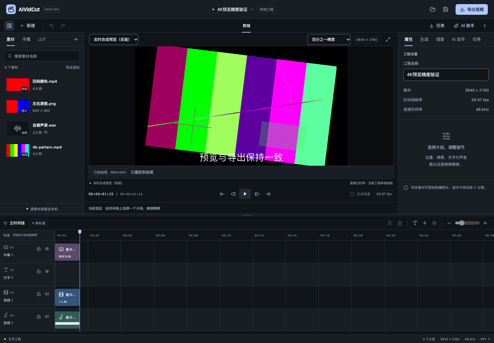

# LUT固定权重混合验收

日期：2026-10-25。关联FW-R01、FW-R06、FW-R11、FW-R15。当前为P0/P1持续实施；本轮减少部分LUT强度的明确逐帧热点，不改变UI、工程模型、源相位或音频。完整P0–P6、自然媒体/源代理/GPU、双端和真实模型/CLI目标保留。

规格见[LUT固定权重混合优化](../specs/2026-10-25-LUT固定权重混合优化.md)，逐项数据见[验收JSON](2026-10-25-LUT固定权重混合-evidence.json)。本轮没有子智能体、worktree、收费模型或真实CLI推理。

## 热点依据与变更

原生视觉图已有LRU复用，本轮没有将开销误归为每帧建图。先在同一4K工程、quarter精度、18帧观察LUT强度37%/100%/0：p95分别56.432/27.711/26.132ms；图build1/hit17，PCM CRC均3259531042。37%的visual filter累计655369335ns，全强度141862333ns，无LUT108539877ns，composite都约5.6ms。消融结果将额外成本定位到部分强度混合。

官方对应版本源码显示，旧表达式路径逐像素调用求值器，而normal路径直接计算固定加权；其opacity是上层A的权重。因此A为原画面、B为全LUT时使用opacity=1-intensity。两者计算精度和舍入不同，不能只凭代数同形宣称逐字节相同。来源为[FFmpeg n9.0.2表达式实现](https://github.com/FFmpeg/FFmpeg/blob/n9.0.2/libavfilter/vf_blend.c)及[normal实现](https://github.com/FFmpeg/FFmpeg/blob/n9.0.2/libavfilter/vf_blend_init.h)，核查日期2026-10-25，实际测试优先。

生产变更只在两个位置：原生Graph.configure的部分强度blend节点，以及原FFmpeg合成规划中的对应节点，均改为normal/all_opacity。0%仍不应用LUT，100%仍直接使用LUT结果；tetrahedral、DOMAIN、方向/缩放/旋转/透明度与顺序保持原有定义。缓存键、身份失效、工作面估算和线程预算没有扩大；没有以旧画面缓存替换运动内容。

## 独立正确性证据

实际FFmpeg对8位全部65536组A/B值、四个RGBA分量和10个权重做旧表达式/新normal对照，共2621440次分量比较，最大差1。权重包含0.000000001、0.000001、0.01、0.123456789、0.25、0.37、0.5、0.73、0.99、0.999999999；不是只检查整洁的0.5。该舍入差异如实保留，不能宣传全部权重bitexact。

另保存改动前的自有worker作为参考，使用同一SDK和同一RGBA/半透明场景，覆盖full/half/quarter、7个权重、30度旋转/位移/缩放、各3帧。最终合成分量最大差1（自动门槛2），0%/100%全部不变，位置、画幅、样本锚点和PCM都相同。此参考独立于当前media.PreviewFrame，避免两条新路径互相验证同一个错误。

原有NativeVisualRotationAndLUT、YUV视频先缩放再RGBA、源display matrix方向、ROI预算及实际变速/LUT/叠加导出回归继续通过，未放宽已有视觉MAE/p95/关键色块阈值。新穷举为永久自动测试；保存旧worker比较需显式AIVIDCUT_BASELINE_WORKER，否则清楚Skip，不当作通过。

## 同一固定4K工程的配对资源

环境沿用Apple M5 Pro、48GiB、macOS26.6.2、MLT7.42/FFmpeg9开发SDK。使用上一轮相同3840×2160 H264源、137ms入点、1.5倍速、37%LUT、中文字幕和声音的45帧工程。依次full前/后、half前/后、quarter前/后执行；每次前2帧不计pull统计，RSS每5帧和最后一帧采样。没有在配对测量期间并行CPU测试。

| 精度 | p95前→后ms | 最大前→后ms | worker采样RSS前→后字节 | RGBA CRC前=后 |
| --- | ---: | ---: | ---: | ---: |
| 全 | 597.382→177.318 | 600.571→185.230 | 626376704→626196480 | 4098797519 |
| 半 | 171.727→58.203 | 175.498→62.653 | 484687872→441106432 | 2666444159 |
| 四分之一 | 57.295→29.642 | 61.230→33.588 | 367607808→367624192 | 491931523 |

每档新旧都是45帧/72072样本、PCM CRC1878899869；本工程的整段RGBA CRC也完全相同。visual filter累计由全精度23650892207ns降为4437090838ns、quarter1641881912ns降为417323125ns，符合热点定位。内存没有普遍等比例下降，不据此宣称内存优化；RSS只是单worker离散采样，且存在不同阶段/缓存的差异，不是整个客户端峰值。

本样本quarter的p95进入29.97fps约33.37ms的帧预算，但最大33.588ms仍略超预算，full/half还明显超出。数据不证明任意4K、长素材、复杂图层或所有机器实时达标，也不完成源代理/GPU和整机资源验收。

## 真实浏览器音画消费

通过正常打开入口载入同一4K工程，使用既有允许的5174来源，进入实时模式并选择quarter。只给真实AudioWorkletNode增加消息观察器，没有替换节点、声音、网络响应或时钟，也没有改产品代码。点击真实播放按钮后，45帧到结尾，画布960×540，最后consumed位置44、sample72072/end=true。165条progress观测中累计实际消费72072，运行underrun=0、underrunEvents=0；启动等待3072帧（约64ms）单独保留，没有把启动等待误算或隐藏为零延迟。

当前Project完整JSON保持一致，dirty=false、revision0、3片段，pageerror为空。这个短固定样本验证了实际浏览器消费，不代替Wails WKWebView、Windows或更长自然素材。测试后通过界面离开实时，关闭独立浏览器及自己的联调服务，旧原生App继续保留。

## 检查与继续范围

完整Go竞态回归20个内部包和1个有测试命令包通过，3个命令包无测试；本轮显式带入旧worker参考，没有将相关比较Skip算通过。31文件219项前端测试、types/format/生产构建通过，前端未改，532.39kB体积提示保留。Release及ASan/UBSan worker均从本项目源重建，相关视觉/旧worker/精度/导出回归通过，无新增/变更诊断日志；detect_leaks=0，不宣称LSAN或未插桩SDK全部通过。

最终macOS自签名与Windows amd64交叉构建通过。Wails官方Go模块本轮最新仍v3.0.0-beta.34，Go/CLI/runtime一致。没有修改系统SDK或新增界面；系统控件、新完整构建双端原生、正式媒体SDK分发/许可与签名更新仍待。旧App88863没有因本轮被强杀、重启或当作最新构建证据。

仍需继续：自然长素材、源代理/多分辨率索引、GPU/硬件解码、完整字体色彩/HDR、复杂编辑语义、整机/跨平台资源，以及原规划字幕配音、四类模型、两种CLI和Skills/预设的真实账号与业务质量。当前改进不能替代这些完整需求或商业发布条件。
