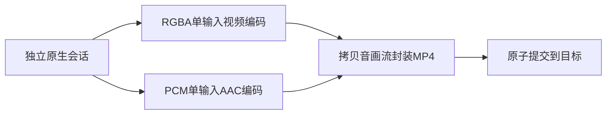
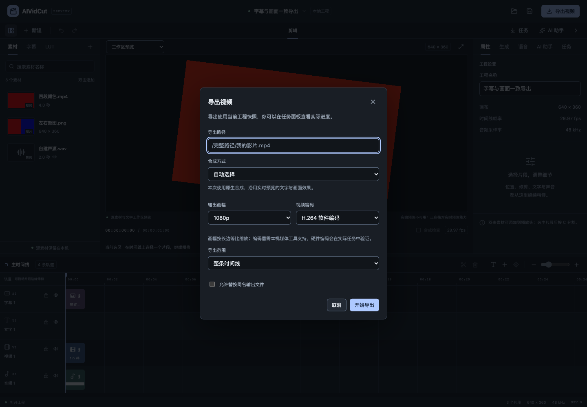
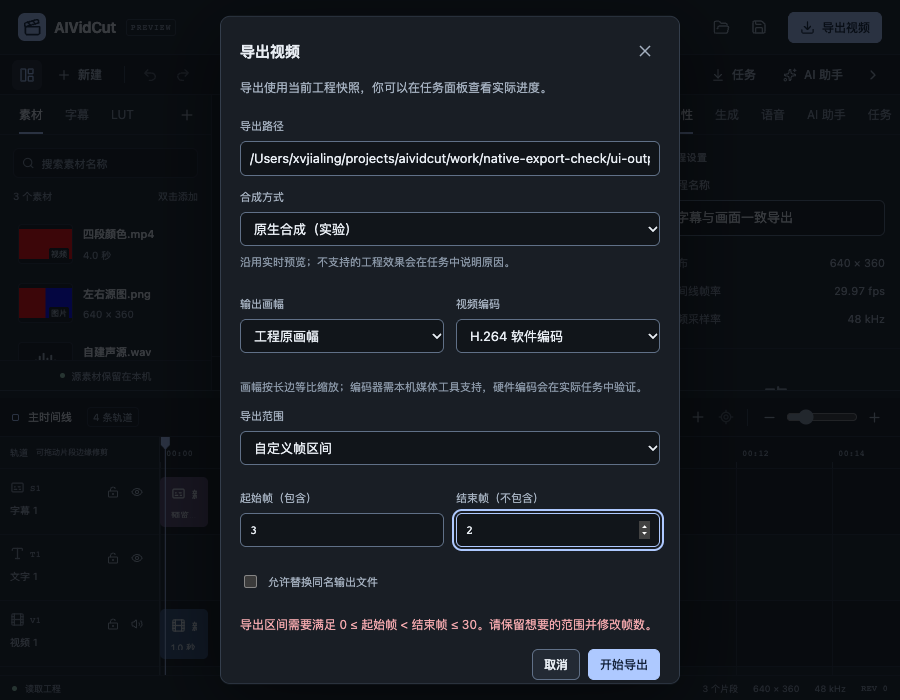
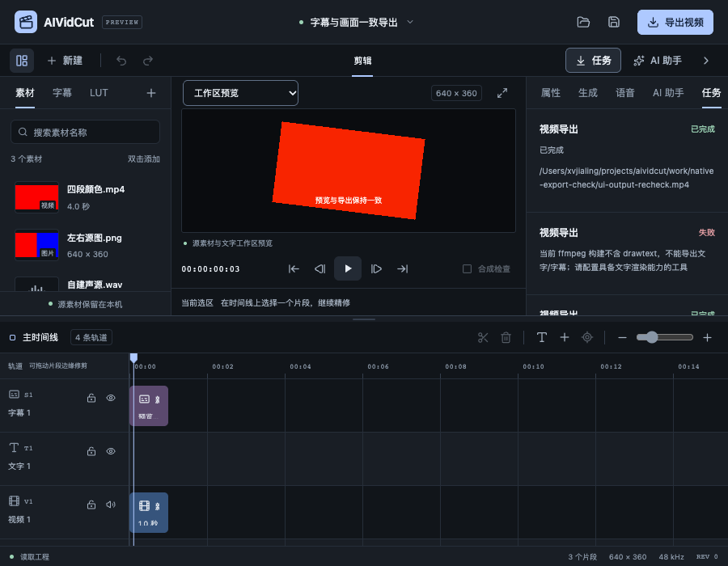
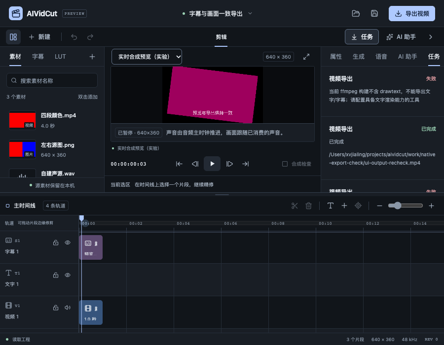
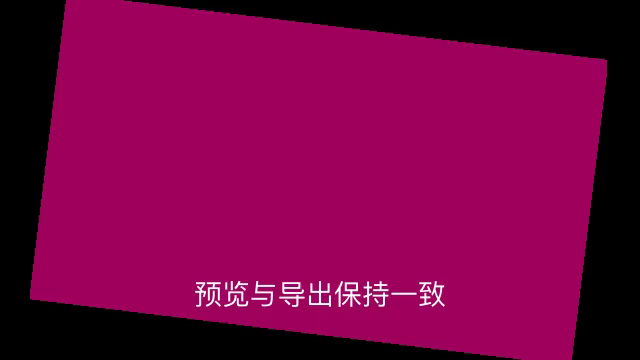

# 原生合成与一致导出验收

日期：2026-10-25。关联FW-R01、FW-R03、FW-R06、FW-R11、FW-R12、FW-R15、FW-R17。P0/P1继续实施，完整P0–P6目标保留。本轮解决原生预览已能合成文字/字幕、LUT和声音，但导出仍需FFmpeg drawtext的问题，新增复用原生帧流的导出路径。当前不是完整商业发布或双端实机完成的声明。

规格见[原生合成与一致导出](../specs/2026-10-25-原生合成与一致导出.md)，可核对数字见[验收证据JSON](2026-10-25-原生合成与一致导出-evidence.json)。本轮没有调用收费模型、真实CLI推理、子智能体或worktree。

## 使用方式与统一边界

导出窗口可选自动、原生合成（实验）和FFmpeg合成，提供工程原画幅、720p、1080p、4K、三个已有编码器，以及整条时间线/自定义整数帧区间。自动方式在配置原生worker时选择原生，其他情况使用原FFmpeg路径。已选原生任务失败会明确报错，不静默换引擎。原生FontPath覆盖及当前引擎未支持的效果会被拒绝，用户仍可明确选择原有合成方式。

自定义范围为起始帧包含、结束帧不包含。无效区间保留草稿、显示校正提示、关联并聚焦对应数字字段，正确路径不被标成帧数错误。已有目标在创建任务前提示，允许替换后才能提交；桌面系统保存对话框沿用既有替换确认。主按钮忙状态及即时引用防止重复提交。

普通UI、MCP/Agent请求仍共用ExportVideo。MCP准备阶段把自动选择解析为明确合成方式，存入待核对请求并展示，避免确认时含糊切换；JSON Schema列出方式、预设、编码器和非负帧参数，仍不接受模型传入输出路径。工程实例/revision检查先于目标预检，导出取不可变快照。实际测试证明导出期间继续删除字幕，成片保留开始时的字幕，当前工程的编辑正常存在。

## 管线与资源边界

`internal/exporter`只组合现有领域能力：独立playback Session载入相同受控图、字体测量、SourcePhase、LUT和真实混音；media承担编码与原子提交。没有通过WebView截图生产成片，也没有将低分辨率预览当作原画幅输出。

每次取一帧后，依次写入两个单输入编码器，写入背压控制下一次取帧；没有整片帧队列或整段未压缩PCM暂存。两个编码器分别输入，避免跨平台双输入管道的探测互等。临时目录仅持有编码后的视频、音频及待提交MP4；取消/失败清理自己的暂存和子进程，保留旧输出。提交复用原有跨平台无覆盖/原子替换和提交点取消规则，保护目录、符号链接、源文件和工程路径，SameFile识别源别名。

离线模式保持原Project坐标与尺寸，当前原生Project上限仍为3840×2160像素总量、单维8192、2–120fps和24小时，以及已有128同时有效片段上界。默认预览与WebView仍限1080，内部离线读包单独允许33177600字节RGBA；默认读包和EncodeFrame明确拒绝超1080帧。C++图窗口必须保持同一输出模式。CPU编码线程、PCM帧和诊断日志均受控，但尚未测量整个客户端、WebView、SDK和编码器的整机峰值。

音频沿原生ceil/AV_ROUND_UP的全局采样边界取窗，以实际48k双声道PCM连续写入；最终按Project采样率转换，以整数样本裁定有效输出长度。MP4/AAC使用采样率作为movie timescale，避免毫秒容器时基截掉有效音尾。进度区分原生合成与编码、封装、提交，提交成功才报告完成。有损编码不承诺像素或PCM逐字节一致。

## 真实媒体结果

- 中文与非零29.97fps区间：全局[3,17)导出14帧、22423个有效样本。与同一原生会话取样相比，RGB平均绝对差0.633333/255、白字像素511、声音RMS差0.00156857；视频帧数、音频time_base/duration_ts及当前工程不变均有检查。
- 原画幅：实际3840×2160导出1帧、1602有效样本；纵向1080×1920与44100Hz工程导出1帧、1472有效样本。没有用预览1280×720替代原尺寸。
- 图窗口：152片段工程完成150帧，最后一帧仍有512个白字像素；每帧位置与整数采样窗都由导出循环核对。
- 复合画面：真实25fps/B帧源，137ms源入点、1.5倍速、37%交换红蓝LUT、旋转和半透明源叠加；导出首尾对应全局3/16帧，RGB平均差3.556013/3.809774。比较对象是同一原生场景，不是示例图。
- 精确音尾：自建5777样本WAV，导出最后一帧；真实声音区域RMS0.184170，后部静音RMS0，未按整帧把源音频延长。
- 取消：编码开始时取消，旧文件字节保持，暂存目录清理。应用快照测试在任务开始后删除当前字幕，成片仍保留原字幕3132白像素，当前工程正常到revision1；导出没有把旧快照写回工程。

这些是明确样本的证据，不能推导任意素材容量、全部音色/格式、HDR或双端字体一致性。其他输出采样率已验证基本计数，连续/区间的最终采样率转换相位仍需专门验收。

## 真实界面与成片

自建工程由实际Probe、ValidateCube、DefaultClip与projectstore生成，640×360/29.97fps、3片段。浏览器通过正常打开入口载入，实际发现本机FFmpeg没有drawtext，而原生导出可用。窗口在900×700和减少动态设置下完整可见，实测460×652.375像素。非法[3,2)范围不发导出请求，保留路径/帧数并聚焦结束字段；已有目标预检不创建任务，勾选替换后双重submit只发出一次成功请求。

实际原生导出[3,17)得到640×360 H.264、14帧、48000Hz AAC；容器duration_ts和再次实际解码均为22423个声音样本。随后明确选择FFmpeg，同一有字幕工程按真实drawtext缺失失败，没有回退到原生。每次流程的三次请求分别为已有目标拒绝、原生成功、明确FFmpeg失败；当前工程保持dirty=false、revision0、3片段，pageerror为空。

又在预览服务原本允许的5174开发来源进入实时模式，通过键盘定位全局第3帧，等待客户端实际绘制后采集640×360 Canvas，与成片首帧的平均RGB差为1.0393547454/255，保留旋转、LUT及中文字幕。Canvas图仅用于验收比较，成片由独立原生会话生产。

中间验收记录也保留：最初自选5193来源被现有WebSocket白名单正确拒绝，改用已允许端口，没有放宽检查；最初依据后端定位完成就取Canvas，取到了清空期间的黑帧，改为等待实际绘制后才比较。无头系统Select菜单的展开截图与箭头选择未形成可靠证据，最终仅记录选择API与Tab焦点通过，原生弹出视觉/选择保留双端验收。没有把这些过程失败改成已通过的产品结论。

## 检查与未完成范围

完整Go竞态回归20个内部包、1个有测试命令包通过，3个命令包无测试；新增MCP Schema后相关应用回归通过。31文件216项前端测试、类型、格式和生产构建通过。主块531.64kB体积提示仍保留。ASan/UBSan的原生预览/导出测试通过，27秒左右，无新增/变更诊断日志；既有wrapper为detect_leaks=0，此证据不包括LSAN，也不覆盖未插桩第三方SDK的全部代码。

严格设计审计与designmd检查通过；最终macOS自签名、Windows amd64交叉构建通过。官方Go模块再次核对Wails v3最新仍为beta.34，Go/CLI/runtime锁定一致。源码、规格、交互契约和决策同步归档，原历史快照不改。

旧原生App窗口继续保留，没有为本轮验收关闭或重启；Mac没有新的可读取窗口证据。新导出对话框、系统Select及完整新构建仍未完成双端原生操作，Windows原生worker/SDK也未由交叉编译证明。第三方媒体SDK当前仍为显式开发依赖，不是自带完整运行时的发行包。

仍需继续：自然长视频和整机进程资源、GPU、完整字体/色彩矩阵和HDR、复杂编辑语义、代理与多分辨率索引、最终采样率转换相位、正式SDK分发/许可与签名更新，以及原规划四类模型和两种CLI的真实账号与业务质量。常规编辑、字幕配音、LUT、图片视频生成、Skills/预设和统一核心目标均保留；本轮不勾选完整P0/P1或商业发布完成。
