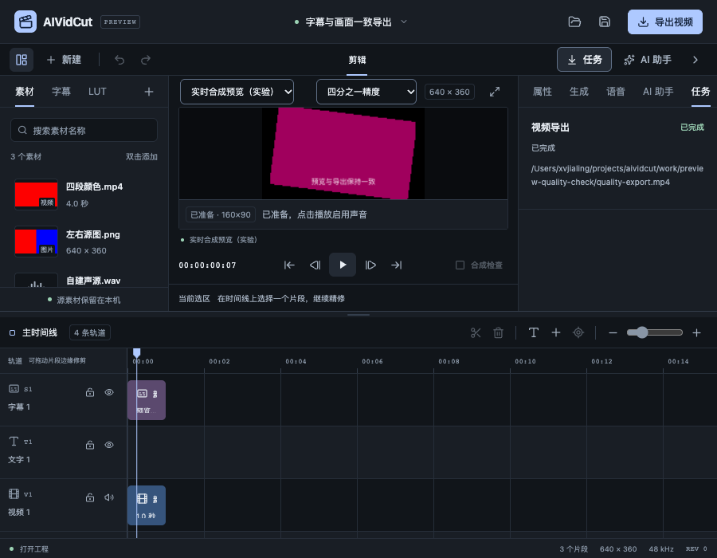
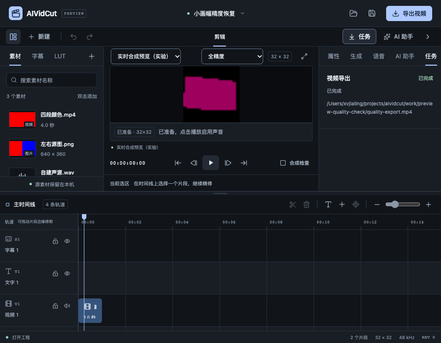

# 可调预览合成精度验收

日期：2026-10-25。关联FW-R01、FW-R11、FW-R12、FW-R15、FW-R17。本轮为P0/P1持续实施：此前仅最终输出被缩小，原生图仍按整个Project画幅合成；本轮允许用户主动选择全、半、四分之一的合成精度。完整P0–P6、源代理、自然媒体/GPU和双端交付目标不变，未将本功能替代完整媒体性能验收。

规格见[可调预览合成精度](../specs/2026-10-25-可调预览合成精度.md)，数字与界面证据见[验收JSON](2026-10-25-可调预览合成精度-evidence.json)。本轮单智能体，没有worktree、收费模型或真实CLI推理。

## 使用与权威边界

进入实时模式后，工具栏提供共享原生Select：全精度保持原默认，半/四分之一降低合成画幅。选择时先核对尚未提交的草稿、暂停并保留当前帧，再重新准备会话；不同工程默认回全精度。当前工程、revision、dirty、Undo和素材都不因精度选择变化。低精度用于近似预览，文字/色彩细节可回全精度检查，最终导出始终使用原画幅。

`playback.Config.RenderQuality`只接受full/half/quarter，空值等同full。应用在关闭旧播放前拒绝未知值，复制基础Config传给本次Factory，不污染独立导出设置。原生Load先完成原工程全部语义编译和真实字形测量，再从深复制生成派生画幅与位置；低精度也进行实际字形测量，无法保持完整时明确要求提高精度，避免qtext悄悄缩字。

派生仅缩放画幅、图像/文字平移、有效字体像素和固定边距：文字32/64边距与字幕48下边距都随比例缩放。图像相对Scale、旋转、LUT、源文件、源配方和所有时间数据保留。图窗口记录同一布局比例并持续使用派生Project，不能只缩首窗。帧率、AudioRange、SourcePhase、变速、混音和音频采样窗维持原值。

独立离线会话拒绝低精度配置；exporter.Native还主动重置full。实际测试故意向原画幅导出传quarter，仍得到3840×2160，以及1080×1920/44100Hz原项目输出。WebView上限和二进制协议仍为原预览边界，没有因性能模式扩大消息上界。

## 实际正确性

真实原生场景包含图片层、声音与中文，full320×180、half160×90、quarter80×45均输出30帧/48048个样本，PCM CRC都为3050924402。每帧位置与AudioStartSample连续相同，原工程JSON保持不变。未支持的原文字旋转仍在原工程验证阶段拒绝，不能由降低精度绕过。

中文有效字号变小后抗锯齿可能没有超过220的纯白像素。测试没有据此改生产字号，而是用同一场景移除字幕建立独立对照：全/半/quarter分别有273/81/23个变化像素，确认实际字形存在。小字号可读性与全精度不同，是用户选择的近似质量，不宣称同一像素结果。

153片段半精度图窗口完成150帧/240240样本，始终160×90并保留全局时钟。单元与应用测试还覆盖几何/有效字号/字幕边距、未知枚举、小于16像素的拒绝、当前播放不被错误请求关闭、精度不进入导出Config或工程历史。

## 固定4K资源观察

环境为Apple M5 Pro、48GiB内存、macOS26.6.2；原生worker沿用上一轮MLT7.42.0/Qt/FFmpeg开发SDK，C++本轮未改。自建3840×2160 H.264三秒testsrc2源，45帧工程包含137ms入点、1.5倍速、37%LUT、文字与声音。三档顺序执行，前2帧不计pull统计，余43次取p95；worker RSS每5帧和最后一帧采样。第一次测量与小测试有短暂交叠，最终报告使用其他测试结束后的单独复测。

| 精度 | 合成画幅 | 传输画幅 | 准备ms | 拉帧p95 ms | 最大ms | worker采样峰值RSS字节 |
| --- | --- | --- | ---: | ---: | ---: | ---: |
| 全 | 3840×2160 | 1280×720 | 337.668 | 604.133 | 615.195 | 626409472 |
| 半 | 1920×1080 | 1280×720 | 324.413 | 169.118 | 178.913 | 441024512 |
| 四分之一 | 960×540 | 960×540 | 322.834 | 56.506 | 60.855 | 367624192 |

三档都完整输出45帧/72072样本，PCM CRC均1878899869。这个负载显示降低合成画幅能减少CPU与工作进程内存，但四分之一仍无法达到其29.97fps帧预算，不标为4K实时达标。源解码仍读取原文件；源代理、硬件/GPU、自然媒体及更完整的优化仍需继续。RSS是单worker的离散采样，未覆盖Go、WebView、模型/CLI、瞬时峰值或整机总量，不能作为商业容量承诺。

## 真实界面与恢复

浏览器通过正常打开入口载入前轮自建640×360工程，在实时模式定位第7帧，按half→quarter→full→quarter切换。每次实际StartPlayback都包含正确精度，返回画布分别320×180、160×90、640×360、160×90，后端始终frame7/paused。选择器通过Tab正常获得焦点；900×700与减少动态设置下没有与模式控件重叠，宽126px，位于当前预览标题内。原生系统弹出菜单仍需双端原生验证。

在quarter预览下执行实际原画幅导出，最终MP4为640×360、30帧、48000Hz/48048有效样本。Project完整JSON与读取前一致，dirty=false、revision0、3片段，pageerror为空。初次视觉检查发现业务class覆盖了共享Select的基础class，已补齐input/select并重新验收，截图采用最终深色控件。

另通过普通打开入口载入32×32的自建小工程：默认full，quarter明确返回“小于16像素，请提高精度”；用户选择full后恢复32×32画面，dirty=false/revision0。这个流程没有调整工程画幅或偷偷替换用户选择。

## 检查与后续

20个内部包与1个有测试命令包的完整Go竞态回归通过，3个命令包没有测试。31文件219项前端测试、typecheck、格式及生产构建通过；主块532.39kB提示仍保留。既有ASan/UBSan worker测试新的派生图和离线原画幅保护通过，无新增/变更诊断日志；wrapper仍detect_leaks=0，不宣称LSAN通过，C++未变因此没有重建工作进程。

严格设计审计0问题，designmd无错误/警告，最终macOS自签名和Windows amd64交叉构建通过。Wails本轮官方查询最新仍v3.0.0-beta.34，Go/CLI/runtime保持一致。新UI和平台系统Select仍未完成双端原生操作；旧原生App保留，未为本轮强杀或重启，也没有重复要求用户解锁。

仍需继续：源代理和多分辨率索引、自然长素材与整机资源、GPU/硬件解码、完整字体/色彩/HDR、正式SDK分发/许可与签名更新，以及原规划字幕配音、四类模型、两种CLI、Skills/工作流的真实账号和业务质量。该固定样本与局部功能不完成整个P0/P1或商业发布。
