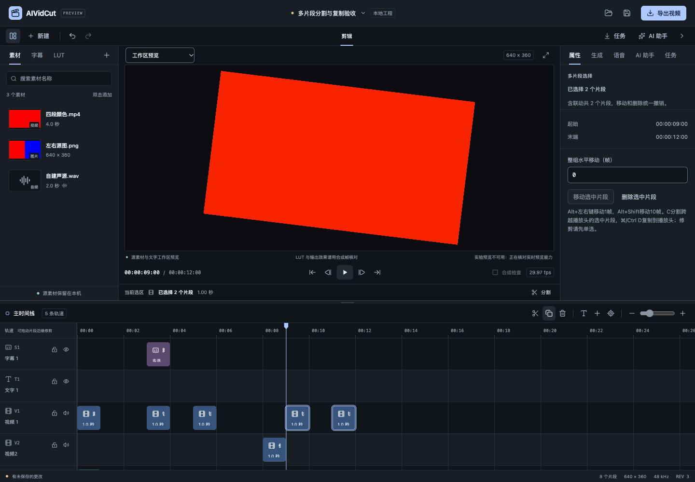
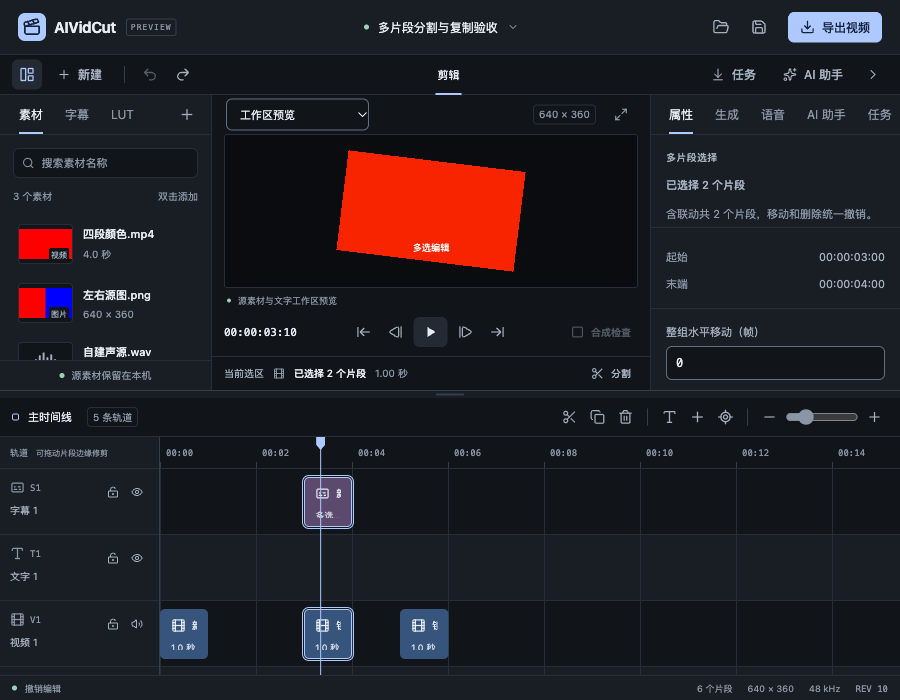

# 多片段分割与复制验收

日期：2026-10-25。关联FW-R01/02/07/08/11/12/17。本轮接续多选编辑，增加多轨同时分割与保持间距的即时复制，并补齐本地Agent规划契约。P0–P6完整目标继续；没有子智能体、worktree、收费模型或真实外部CLI推理。

行为见[规格](../specs/2026-10-25-多片段分割与复制.md)，结构化结果见[验收JSON](2026-10-25-多片段分割与复制-evidence.json)。

## 用户操作

C或时间线分割按钮会分割选中且跨越播放头的片段，未跨越的选择保持原样；没有交点时明确提示。选中视频、声音及静态字幕可以在同一帧切开，一次撤销恢复。默认展开音画关联且去重，切口前后各自成组；完全位于切口后的关联成员归右组，避免移动右半时又带动左半。

“复制到播放头”及Cmd/Ctrl+D将有效选区最早起点对齐播放头，保留各镜头间距及原轨道，创建新ID和独立关联组。成功自动选中新副本，失败保留原选区和工程。碰撞时整组拒绝，不自动挪到未提示的轨道。多选修剪继续禁用并说明先单选；多选分割已经解除上一轮的临时限制。

这属于提交时的即时复制。复制时保留快照、以后粘贴的剪贴板功能尚未实现；不会把当前对象ID引用伪装成不会变化的剪贴板。两种使用方式的后续范围仍保留。

## 统一核心与字幕

split_clips使用clipIds/atFrame；duplicate_clips使用clipIds/atFrame及可选trackDelta。核心仍按includeLinked默认展开且去重，显式ID必须存在且唯一，批量参数不得夹带单对象替换。锁轨、类型、负时间、溢出、最终碰撞和字幕冲突整体拒绝；保持baseRevision、idempotencyKey和一次Undo/Redo。原单片段分割/复制提取共享准备函数，SourcePhase/AudioRange没有另建一套实现。

分割和复制构造新的源ID时，内部明确记录新ID→原ID，再统一reconcile；父源映射不从JSON接受，不写Project。对同一素材的不同镜头，即使源入点、速度相同，也不能凭素材猜测字幕人工覆盖的归属。复制保留各自文字/样式覆盖与排除词；绑定字幕与源同时选中时只由源派生一次，单独操作绑定字幕需先解绑。人工阅读组被切口裁断时仍原子拒绝。

MCP声明两种新命令并直接调用相同核心。本地Agent规划白名单和Schema补齐move_clips/delete_clips/split_clips/duplicate_clips，摘要展示数量、目标帧及轨道行偏移。每条规划批量最多1000个ID；核心普通批量上限仍100000。这没有放宽原规划选区约束：只能引用授权对象，实际新增副本仍须位于选区时间窗内；全工程规划可按明确要求放到其它有效时间。规划继续禁止绕过联动、解锁或伪造素材/转写。

## 回归与真实媒体

新增核心回归覆盖联动去重、错开起点/完全位于切口后成员、非联动拆分、零交点、缺失/重复ID、锁轨、类型、碰撞、负时间、溢出和无关参数；请求失败没有撤销记录或部分变更。相同素材两个父源分别手改为甲/乙文案并删除其中一个词，批量副本仍各自继承，删除词没有复活。手改阅读组裁断拒绝，递归分割后复制保留源处理偏移5帧。

真实媒体回归使用原生worker、实际WAV、320×180及29.97fps。先对声音与文字一起在第2帧分割，再复制全部左右片段到第30帧：对应10帧的2304000字节画面与128128字节PCM逐字节一致，分割和复制各一次撤销恢复。该证据限定于固定样本，没有外推所有格式或效果。

实际loopback MCP连接也完成批量分割、复制、幂等与整组撤销。Agent快照校验分别验证合法批量、选区外对象、超出时间窗的新副本及全工程复制；Schema不暴露内部字幕父源。这些是本地协议/规划夹具，不代表Codex或Claude登录后的实际推理质量。

10000个文字片段通过一条duplicate_clips生成20000个，起点40000和末副本79996保持间距；同幂等请求不增加数量，一次撤销回10000。这验证工程核心构造规模，未测量万片段实际渲染或整机资源。

完整Go竞态回归20个内部包及1个有测试命令包通过；随后Agent及应用包完整竞态回归、构造核心含万片段的竞态回归通过。前端33文件231项测试、types/format及生产构建通过。C++本轮未修改，未重复计入原生消毒器结果；前端主包542.11kB提示继续保留。

## 真实界面与恢复

使用独立真实Go服务，通过正常打开入口载入6片段自建媒体工程。第100帧同时分割字幕和视频轨，生成两个右半；一次撤销恢复。原第90/150帧的两个镜头复制到第270帧后，新起点为270/330，副本保留LUT、变速、变换、源入点、声音及文字属性，且自动选中新ID。

工具栏和Ctrl+D、C快捷键均实际提交批量命令并可撤销。复制到原有片段位置产生碰撞，工程完整JSON不变且选区保留；锁轨后按钮禁用，数值输入中的C没有触发分割。另仅对GetBootstrap注入明确503核对失败，页面显示原因且没有发送编辑；随后恢复真实服务。没有替换工程、媒体或成功响应，没有未捕获pageerror；控制台保留注入503的预期网络错误。

最终revision10、6片段、dirty=false，完整片段内容恢复。900×700与减少动态效果检查通过，右侧面板沿既有独立滚动保持数字控件可访问。新构造操作的双端原生GUI仍待，浏览器结果不替代WKWebView或WebView2。

## 构建与仍需继续

macOS本地自签名及Windows amd64交叉构建通过。官方Go模块复核仍为Wails v3.0.0-beta.34，Go/CLI/runtime保持一致。Windows安装、SDK、系统菜单和实机不是交叉编译的结论。

剪贴板快照/粘贴、多选修剪、复杂NLE语义、源代理/GPU、自然长素材整机资源、字体色彩/HDR、SDK分发许可及签名更新继续。原字幕配音、四类模型、两种CLI及Skills/预设的真实账号与业务质量目标保持，完整P0/P1及商业发布未完成。
