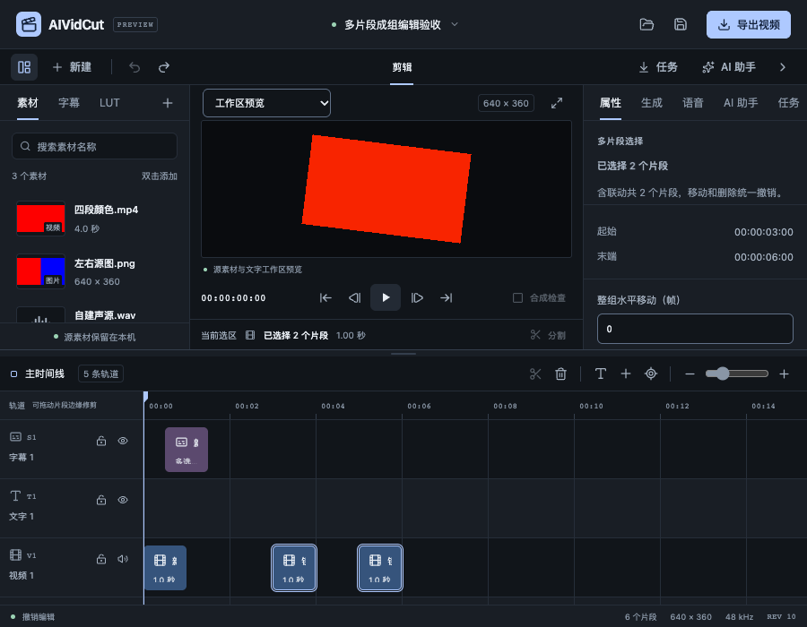

# 时间线多选与成组编辑验收

日期：2026-10-25。关联FW-R01、FW-R02、FW-R07、FW-R08、FW-R11、FW-R12、FW-R17。本轮补齐多镜头选择、成组移动和删除，属于P0/P1及统一编辑核心的持续实施。完整P0–P6仍在进行。本轮没有子智能体、worktree、收费模型调用或真实CLI推理。

行为范围见[规格](../specs/2026-10-25-时间线多选与成组编辑.md)，结构化结果见[验收JSON](2026-10-25-时间线多选与成组编辑-evidence.json)。

## 使用与实现

时间线普通单击替换选择；Shift、Cmd或Ctrl单击增删，空白拖动框选，修饰键框选合并。时间线内Cmd/Ctrl+A选择全部，Escape清选或取消当前手势。多个片段显示汇总属性，提供整数帧位移与Alt+左右移动1帧、Alt+Shift移动10帧的替代操作。选区保留活动片段用于定位和既有单镜头生成替换，工作流和Agent读取全部显式ID。素材库仍为单选。

按下已选片段保留整组，拖动保持相对时间及轨道行偏移；松开且未移动才恢复单选。多选修剪与分割明确禁用并说明先选择一个片段，避免只修改活动片段。多选复制、联动修剪、分割、批量属性不在本轮实现范围。面板沿用共享Field/Input/Button，错误关联数值输入，失败保留位移参数；锁定片段或联动成员使整组动作不可用。

新增move_clips/delete_clips，使用clipIds/frameDelta/trackDelta。默认按LinkGroup展开并去重，仍走Engine.Apply的baseRevision、idempotencyKey、工程克隆、最终校验与一次Undo；错误没有部分成功。每个显式ID必须存在且唯一，单片段或无关字段不能夹带到批量命令。移动复用SourcePhase/AudioRange准备逻辑，最终才统一检查碰撞，因此相邻选中片段移动过程中不会被中间状态错误阻止。

源片段与绑定字幕一并选择时，字幕继续由统一reconcile派生，避免重复位移；字幕单独时间移动需要先解除绑定。人工文字/样式覆盖、源相位、精确音频分数偏移及锁轨保护保持。删除显式字幕仍沿用原抑制规则。手动操作、MCP和既有工作流共用同一核心，没有增加第二份可写工程。

选区和框选只是界面暂态，不写Project、dirty或Undo。框选查询全时间线区间索引，绘制只更新可见元素；选中全部不会挂载全部片段。工程切换、对象被移除时清理失效ID。指针结束先撤销手势标记再交付框选，普通组内单击在click阶段导航，避免被尚未卸载的手势守卫拦截。稳定草稿仍提交输入，但保留时间线按钮焦点，使全选后Escape能够连续执行。

## 自动与真实服务验证

核心覆盖联动去重、唯一/缺失ID、负时间/溢出、类型/轨道范围、原轨与目标锁定、无关字段、幂等、一次Undo/Redo、最终碰撞及相邻片段整体移动。绑定字幕人工覆盖与精确音频/SourcePhase分割后移动均通过。

新增应用媒体回归使用真实WAV及原生worker，将整组平移30帧，取对应10帧：2304000字节画面和128128字节PCM逐字节相同，一次撤销恢复原起点。这证明该夹具的移动没有改变对应采样，不等于所有媒体格式与效果已验收。

真实本地MCP连接调用批量编辑，证明两个对象只增加一版、同请求重试不重复移动、一次MCP Undo恢复整组、碰撞后版本及两个起点均不变；只读作用域和旧统一编辑守卫回归也通过。没有将协议夹具说成Codex/Claude登录后真实推理。

完整Go竞态回归20个内部包及1个有测试命令包通过，其他3个命令包无测试；新增媒体与MCP测试在随后相关竞态回归中再次通过。前端33文件229项测试、类型/格式和生产构建通过。本轮未改C++ worker，不重复将旧消毒器结果当新增测试。主包540.47kB的Vite体积提示继续保留。

通过普通打开入口连接真实Go服务，实际鼠标/键盘完成：两镜头水平20帧、删除、跨到下一视频轨、数字10帧、Alt方向1帧，并逐项一次撤销。混合视频/链接声音的60帧位移碰到未选镜头时整体拒绝，失败前后Project完全一致；Escape取消拖动无提交。框选前清空旧选区，确实重新选出两个镜头。最终6片段、revision10、dirty=false，pageerror为空。实际请求只有批量命令，没有替换服务响应或工程数据。

万片段/200轨固定工程在真实Go服务中全选10000个，视区挂载28个片段，水平滚动实际换入新对象后挂载36个（含焦点固定对象），全部保持选中；Project完整JSON和revision0/dirty=false保持。该检查验证虚拟区不因多选全部展开，不构成所有大工程拖动延迟或资源指标承诺。

## macOS原生与构建

用户手动解锁后，使用独立数据目录启动Wails原生构建。通过系统文件选择器打开相同真实视频、图片、声音及LUT工程；Shift选中镜头2/3，汇总显示2个片段。整数10帧移动后时间码从03:00/05:00变为03:10/05:10，REV1；一次撤销回03:00/05:00，REV2。原生系统预览菜单与精度菜单均能展开，全精度准备640×360，四分之一准备160×90；真实播放达到09:00结尾，版本仍2。这里记录操作观察，没有量化原生音频欠载或主观音色质量。

正常关闭已恢复工程后，测试进程退出0。最终macOS本地自签名与Windows amd64交叉构建通过，Wails Go/CLI/runtime保持v3.0.0-beta.34。Windows结果只证明编译，不证明WebView2、系统控件、媒体SDK、安装与更新已通过实机。

## 仍需继续

完整多选修剪/分割/复制、复杂轨道交互、自然长素材整机资源、源代理/GPU、字体色彩/HDR及正式媒体SDK分发、签名更新与Windows实机仍待。字幕配音、Nano Banana/GPT Image/H3/Seedance目标、Codex/Claude和Skills/预设的真实账户及业务质量继续沿原规划验证。本轮不解除完整P0/P1或商业发布门槛。
