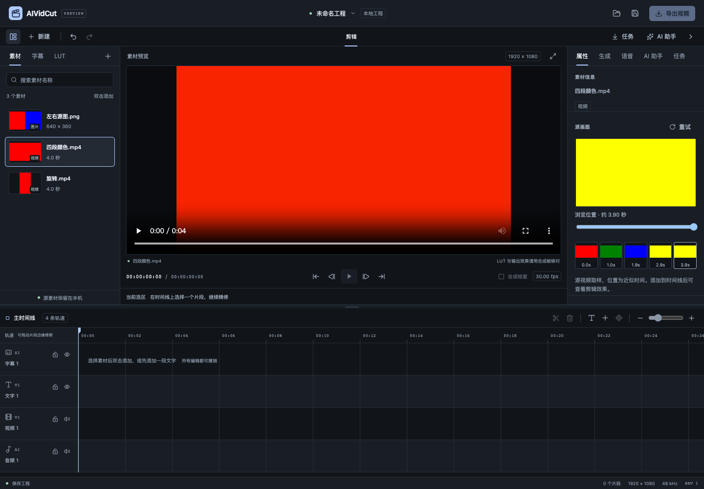
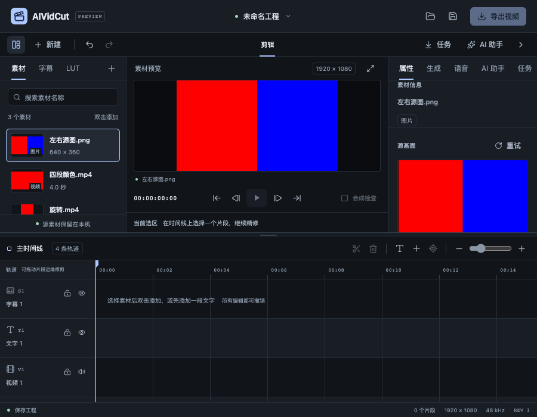
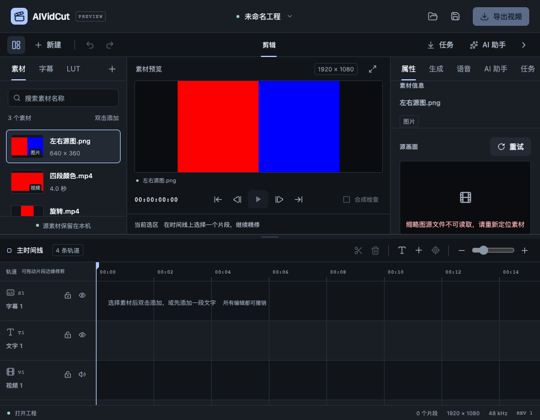

# 素材缩略图与源画面浏览验收

日期：2026-10-25。关联 FW-R01、FW-R04、FW-R11、FW-R12、FW-R15、FW-R17，属于 P0/P1 的持续实施。本轮补齐素材卡的真实画面，以及选中视频的源位置浏览，便于在上轨前判断镜头。完整多轨编辑、字幕配音、LUT、图片/视频模型、本地 Codex/Claude Code、Skills 和模块化目标全部保留；不据此完成整个阶段。

规格见[素材缩略图与源画面浏览](../specs/2026-10-25-素材缩略图与源画面浏览.md)，可核对数字见[验收证据 JSON](2026-10-25-素材缩略图与源画面浏览-evidence.json)。本轮未调用收费模型或真实 CLI 推理，没有新增子智能体或 worktree。

## 使用行为与实现

图片和视频素材卡在可见时读取真实缩略图，音频/LUT保留类型图标。选中图片可看源图；选中视频可查看五张取样，点击后切换详情画面，也能使用原生滑条及 Home/End 键调整源位置。滑条稳定180ms后才请求，点击取样即时请求；读取期间保留几何，失败显示原因并提供详情重试。滚出可见区会取消订阅并移除图片元素，返回时重新核对源；不依赖前端永久缓存。

画面属于源素材取样，不含时间线 LUT、字幕或合成效果，界面明确标注近似时间。FFmpeg输入定位会取到请求位置附近的可解码画面，例如0.975秒可能显示1.0秒的下一帧；不能将这些JPEG作为帧精确修剪证据。本轮源浏览独立于中央原有媒体播放器，不会自动定位中央播放器或添加时间线片段。

应用边界只接受当前工程ID、素材ID、指纹、sourceEpoch、源位置和请求ID，不能传任意路径/URL。sourceEpoch位于Bootstrap读模型，同一工程重开也变化，不进入Project或撤销历史。返回前再次检查工程实例、源身份和取消状态。JPEG通过本进程回环素材服务的能力URL读取，工程重开撤销旧图片能力；HTTP不缓存该JPEG响应。

波形和缩略图现在共用泛型只读源缓存，各自保留类型复制与独立预算。缩略图最多2个提取器、128在途条目和128完成缓存；已有波形独立维持2个提取器。相同取样共享在途任务，最后一个订阅者退出才取消，Close取消并等待提取器。源文件身份、大小和修改时间参与失效检查。应用还限制128个活跃请求，处理先到的取消消息，取消墓碑最多256个、保留30秒。

缩略图FFmpeg输出限制320×180、256KiB、10秒，解码、滤镜和输出编码均限制线程。静态PNG/JPEG在未配置FFmpeg时可用Go回退，源流最多32MiB、8Mi像素；含EXIF的JPEG明确要求FFmpeg，避免输出错误方向。流写入器未嵌入bytes.Buffer，回归证明io.Copy不能经ReadFrom绕开字节上界。后端JPEG源缓存最多约32MiB有效载荷，HTTP blob另限128张/32MiB；这些是局部载荷预算，不代表整个进程峰值内存或系统资源指标。

## 真实媒体与界面证据

自建四秒视频依次包含红、绿、蓝、黄四段，另有左右红蓝PNG、显示矩阵旋转视频、SAR=2宽像素视频及抽帧VFR视频。Go测试实际解码JPEG并检查颜色/尺寸：普通视频320×180，宽像素320×90，旋转100×180，VFR近末尾仍读取黄色。静态回退左右像素正确；无工具的视频、非法时间、取消、源变化、调用者污染缓存等分支均有回归。测试没有用示例图替代失败源。

真实浏览器通过普通导入和保存入口调用Go服务，导入3个自建素材，保存后浏览五张视频取样。1440×1000工作区检查位置0、0.975、1.95、2.925、3.9秒，五张图片均实际解码为320×180，近末尾详情显示黄色；Home/End控制浏览位置，Home还等待实际画面更换。旋转视频详情实际解码为100×180。900×700及减少动态设置下，源图通过属性区滚动可见，实测详情框219×123.1875像素。浏览前后revision=1、dirty=false、clips=0，未生成编辑命令，pageerror为空。

临时移动自建PNG后点击重试，实际返回“缩略图源文件不可读取，请重新定位素材”，工程仍为revision=1/dirty=false。恢复文件后重试成功，再通过正常打开入口重开同一工程：sourceEpoch从0变1，新图片URL变化，旧图片HTTP返回404，旧实例请求被拒绝。整个过程保持3素材、0片段、revision=1、dirty=false。

取样条采用可见读取。在默认较矮工作区中，属性区下方取样需滚动后才加载；最初测试脚本要求屏外所有图片同时完成，等待失败，随后按实际可见区和滚动复验。保存字段的可访问名称包含示例文本，测试也据真实快照调整定位。以上是验收脚本修正，没有替换服务响应或伪造工程。中间失败日志保留在work/thumbnail-check，归档JSON仅采用最终成功结果。

## 检查结果与继续范围

- 29个前端测试文件、210项测试通过，类型、格式和生产构建通过；Vite主块527.29kB的体积提示仍保留。已有jsdom Canvas未实现提示未导致用例失败。
- 完整Go竞态回归覆盖19个内部包及1个有测试的命令包，3个命令包无测试。随后新增实例隔离和最终流写入保护，重新运行media/application/localmedia的相关真实媒体竞态测试通过。共享缓存改动后的原波形真实媒体、取消和并发回归保留。
- 本地JPEG服务验证签名能力、范围读取、非法数据、ID冲突、128张淘汰、预算和Reset撤销；请求不接受任意路径，源读取不改变工程。
- 严格设计审计0问题，官方designmd lint无错误/警告；DESIGN.md和UX-CONTRACT.md已同步组件所有者、读取与重试行为。
- 本轮再次查询Wails官方Go模块，最新仍为v3.0.0-beta.34，工程Go/CLI/runtime保持一致。最终macOS本地自签名构建和Windows amd64交叉构建均通过。

最新“已解锁”回复到达后，原生工具仍报告Mac锁屏，无法读取窗口。本轮没有反复触发解锁、关闭或重启原生App；只读核对确认此前PID88863仍运行。磁盘最终构建已更新，运行中的旧窗口不能当作新缩略图界面的原生证据。浏览器成功不代替WKWebView和Windows原生验收。

仍需继续：双端新构建的原生交互和实际媒体资源；长素材分辨率索引、时间线视频缩略条/代理、完整格式与色彩矩阵；大工程自然媒体并发、GPU、字体、正式SDK分发与安装更新。字幕、声音与模型/CLI真实账号链路及质量仍按原路线图推进。当前没有自动语义分析结论、代理媒体或全产品发布结论。
