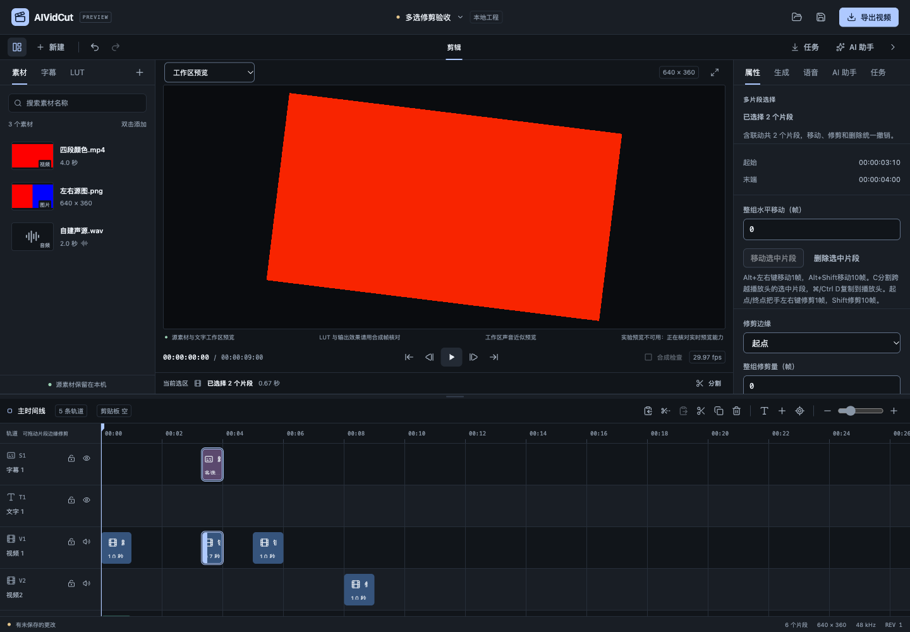
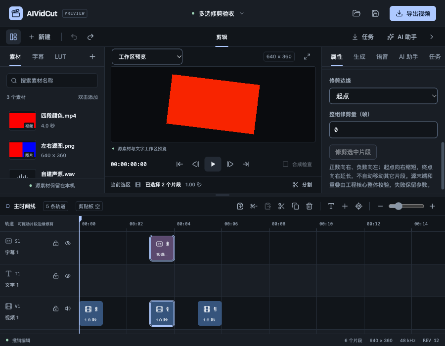

# 多片段同量修剪验收

日期：2026-10-26。关联FW-R01/02/03/07/08/11/12/17。本轮实现多选把手、键盘及数字同量修剪，解除上一阶段的多选修剪限制；完整P0–P6继续。没有子智能体、worktree、收费模型或真实外部CLI推理。

范围见[规格](../specs/2026-10-26-多片段同量修剪.md)，结构化结果见[证据JSON](2026-10-26-多片段同量修剪-evidence.json)。

## 编辑行为与实现

拖动已选对象的起点/终点把手，对整个有效选区的对应边缘应用相同整数帧量。起点向右缩短、向左延长，终点向右延长、向左缩短；保持另一端及原轨道，不自动波纹移动其它片段。把手左右键1帧、Shift10帧与汇总属性的“修剪边缘/整组修剪量”共用同一操作。正负方向及不自动移动的语义在面板说明。

新增trim_clips，使用clipIds/edge(start或end)/frameDelta/includeLinked?。默认LinkGroup展开去重，先准备全部候选，再统一字幕reconcile和最终ValidateProject；一次请求一版、一次撤销。锁轨、空片段、负时间/入点、整数溢出、源余量和最终碰撞整体拒绝，不按成员各自钳位。静态文字、字幕和图片没有无意义的媒体入点变化。

单选和多选UI均使用该命令，MCP及本地Agent规划声明同一契约；Agent仍验证授权对象和原有新增对象范围，不放宽不联动或锁轨保护。摘要明确“修剪量”和边缘，避免误称水平移动。

源更新复用prepareClipUpdate、SourcePhase/AudioRange。保留递归相位及分数样本，精确音频末样本的向上取整占位仍合法，不能通过延长纯音频无声占位越过真实声音末端。已有占位可收短；视频的声音载体可保留容器内静音区，真实AudioRange仍裁选已有样本，不生成不存在的声音。

绑定字幕与源一并选择时只修剪源，字幕统一派生；单独绑定字幕先解绑，手改阅读组被裁断仍原子拒绝。派生字幕锁轨会禁用整组选区修剪；Core继续最终保护。

## 高频暂态与输入恢复

沿用时间线可见区/区间索引，整组暂态直接绘制可见DOM的位置、宽度及波形平移，不逐帧写React工程，也不为多选挂载整个工程。关联字幕按源窗口做临时交集显示；移出窗口暂时隐藏，提交后的真实词/组仍由核心决定。滚动/虚拟区重新挂载时继续刷新当前手势。

松开、取消恢复位置/宽度/可见性/波形。Escape现共用于片段面与两端把手，停止指针捕获且不提交。松开先撤销手势标记再进入工程前置核对，避免被仍未卸载的暂态误拒绝。

汇总表单复用Field/Input/Select/Button，失败保留参数，成功复位0。未应用的命令参数不属于Project草稿；无效参数仅阻止对应提交，不污染关闭或其它导航的草稿保护。真正的属性草稿、外部冲突和工程上下文核对仍保持。

## 自动回归及真实媒体

核心覆盖不同起点/长度、联动去重、正负两端、一次Undo/Redo及幂等。缺失/重复ID、无效边缘、零量、至少1帧、负时间、源末端、溢出、锁定成员、无关位移和最终重叠均整体回滚；字幕手改/独立绑定拒绝、阅读组保护和相位恢复通过。真实音频末端上取整、已有静音占位收短、视频声音载体不伪造样本均有回归。

实际WAV/文字在320×180、29.97fps下整组修剪起点2帧，保留6帧的76872字节PCM和1382400字节画面逐字节一致；再缩短终点，保留1帧12808字节PCM与画面一致。各一次撤销恢复。

实际移动视频延续137ms入点、1.5倍速、37% LUT、7度旋转及已有2帧分割相位；起点再修剪1帧后相位3，终点缩短2帧，保留6帧1382400字节画面均与对应原窗口完全相同。这是固定样本证据，不扩大为所有格式、速度或平台结论。

真实loopback MCP验证trim_clips、重试不重复及一次Undo。Agent合法/选区外修剪与Schema回归通过，没有实际CLI账户推理。完整Go竞态20个内部包及1个有测试命令包通过，34文件244项前端测试、类型/格式通过。C++没有修改，不重复计入旧消毒器结果。

## 真实Go浏览器

通过正常打开入口载入6片段工程。选中同为第90帧/长度30的静态字幕和视频，起点拖动+10后两者100/20，终点拖动-5后两者90/25，键盘Shift右键也统一+10；每次一次Undo恢复。Escape后无修订。

终点+40与未选镜头重叠时完整Project不变；数字起点-2得到88/32，成功参数复位0。终点+100越过素材范围时整体拒绝并保留100。起点参数30会留下0帧，按钮禁用；仍可离开该参数选择别的镜头。单选关联视频把手-1也同时修剪声音，证明没有退回单片段替换。锁轨后整组把手/提交禁用。

最终6片段、revision12、dirty=false，片段JSON恢复基线，pageerror为空。900×700和减少动态效果下，右侧面板独立滚动可访问完整表单。只读/编辑均是真实Go服务，没有替换工程、媒体或成功响应。

## macOS原生与构建

干净构建在独立数据目录启动，系统选择器打开同一真实工程。选择字幕/视频后，把手Shift+Right得到两者03:10/20帧、REV1，一次Cmd+Z恢复。原生Select改终点，输入-5并应用后两者03:00/25帧、REV3，参数0。输入100越界后两个片段仍25帧、REV3不变且参数100保留；修正参数后一次Undo回30帧、6片段/REV4、无未保存标记，再正常关闭退出0。

macOS本地自签名及Windows amd64交叉构建通过。官方Go模块复核仍为Wails v3.0.0-beta.34，Go/CLI/runtime保持一致。主包552.49kB体积提示保留。原生检查证明本次键盘/数字行为，真实指针拖动及Escape证据来自浏览器，不能把两者混写为全部双端原生通过。

## 仍需继续

波纹/滚动/滑动及其它复杂NLE语义、跨工程/跨进程剪贴板、Windows实机、源代理/GPU、自然长素材整机资源、字体色彩/HDR和SDK分发/许可/签名更新仍待。此前偶发原生空白根因尚未确认；原字幕配音、四类模型、两种CLI和Skills/预设的真实账号及业务质量继续。当前局部修剪通过不代表完整P0/P1或商业发布完成。
