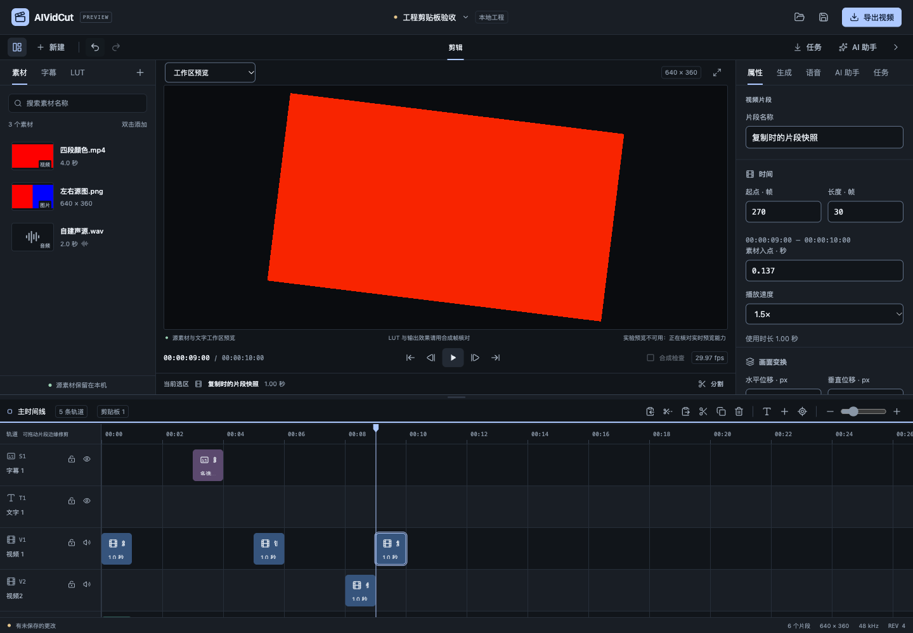
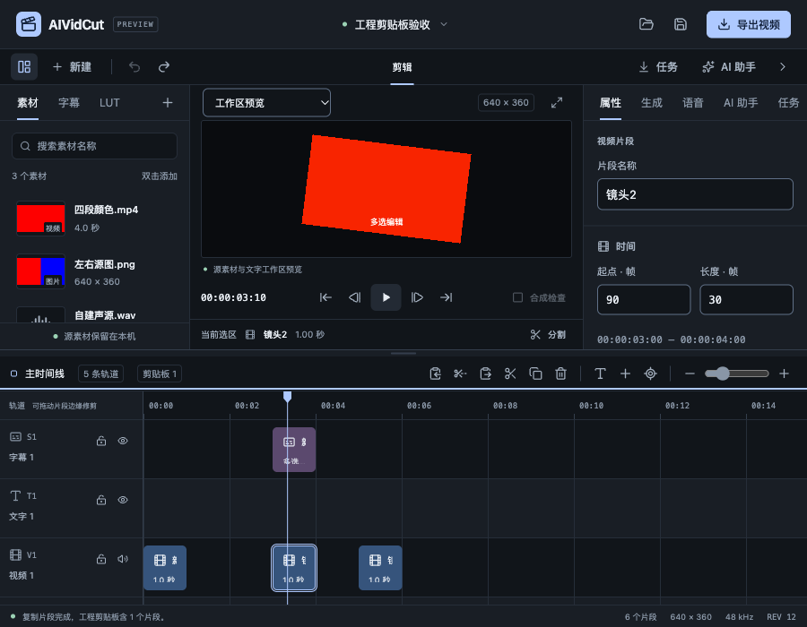

# 工程剪贴板验收

实施日期：2026-10-25至2026-10-26。关联FW-R01/02/07/08/11/12/17。本轮补齐保存复制时片段状态的工程剪贴板，支持复制、剪切和粘贴；完整P0–P6继续。没有子智能体、worktree、收费模型或真实外部CLI推理。

行为范围见[规格](../specs/2026-10-25-工程剪贴板.md)，结构化证据见[验收JSON](2026-10-26-工程剪贴板-evidence.json)。

## 用户行为

时间线Cmd/Ctrl+C复制、X剪切、V粘贴到播放头，工具栏提供对应入口和剪贴板数量。原片段后来被改名、调整效果、撤销或删除，仍能粘贴复制时的属性和间距。复制不改变Project、dirty或撤销历史；剪切先准备快照，只有原子删除成功才更新剪贴板。粘贴新建独立关联组，成功选中新对象，剪切/粘贴各一次Undo恢复。

锁轨可只读复制，剪切与目标粘贴仍按锁轨整体拒绝。字段草稿先稳定再复制；按钮按下时保留输入焦点直到明确提交，避免失焦提交把本次点击提前禁用。复制/剪切/粘贴后焦点回时间线，可连续使用快捷键；输入框、输入法、对话框和其它面板保留系统复制粘贴事件。数字字段错误文字原本会进入可访问名称，本轮稳定其名称并继续通过aria-describedby描述错误。

源片段与关联字幕一起复制时，保留复制时的字幕手改、样式和排除词；自动字幕仍由当前有效源转写派生，不伪造ASR原始证据。单独复制/剪切绑定字幕，粘贴为独立字幕，摘要明确说明。源转写被关闭/替换、手改依赖词被移除、资源身份、时基或目标轨不再兼容时明确拒绝，不静默丢失文案。

目前是同工程、当前进程内的剪贴板，不读写系统剪贴板，不复制媒体文件。同一工程重开且资源仍一致时可继续用；跨工程、跨进程保存和跨工程资源导入仍待。该范围没有替代原规划其它功能。

## 核心、权限与资源边界

Go仅持有一份不可变快照，包含有效片段、关联字幕和需要的资源身份/来源证明/排除词；不持有整个工程或媒体字节。编码内容上限64MiB，对象沿工程计数预算；这是编码预算，不能宣传成进程峰值内存。超过预算保留旧剪贴板。

受控paste_clips沿Engine.Apply提交，哈希包含clipboardId、目标及原请求，快照和父源数据只由内部构造。临时独立父源让旧对象不存在时仍可继承手改/排除词，复用已有SourcePhase/AudioRange与统一字幕reconcile。临时父源不进入Project；公开ApplyEdit和快照Agent计划不能注入原始快照。显式不联动复制不改原链接，副本也保持独立。

粘贴使用请求命名空间生成副本ID，同请求重试即使剪贴板已被另一次复制替换，仍可查找已存在副本且不重复构造。剪切幂等记录最多128条，不持有旧工程；撤销后重试不会再次删除，也不会覆盖较新的剪贴板。projectId/sourceEpoch/baseRevision保护操作上下文，clipboardId防止排队期间更换内容后误贴另一份素材。

摘要读取只查询工程身份和少量计数，不克隆Project；UI每2.5秒在可见时刷新，同一作用域共用在途读取，忽略旧工程、旧实例和低版本结果。MCP共用同一应用边界：摘要不含文本/路径或其它工程内容，复制、剪切、粘贴要求编辑作用域。MCP结果不返回完整Bootstrap；本地CLI规划不能伪造clipboardId。

## 回归与真实媒体

核心覆盖复制后原对象修改/删除、独立链接、字幕手改及排除词、当前自动字幕、独立字幕、资源/时基/锁轨/碰撞/缺失快照原子拒绝，以及手改词被移除时的保护。12000个6000字符文字片段构成超64MiB快照，实际被clipboard_budget拒绝。

应用回归证明复制无修订、锁轨允许复制、剪切失败保留缓冲、剪切一次撤销及幂等、同工程重开与旧sourceEpoch拒绝。真实loopback MCP调用复制/粘贴，验证只读工具集、结果过滤与真实工程变化。没有把本地协议夹具称为Codex/Claude实际推理。

实际WAV和文字在320×180/29.97fps下剪切后粘贴到第30帧，对应10帧2304000字节画面及128128字节非空PCM逐字节一致，剪切/粘贴各一次撤销。

另使用自建移动视频、2帧分割相位、137ms源入点、1.5倍速、37% LUT、7度旋转。复制后改变原片段的LUT强度/平移并删除，再粘贴到第32帧；对应6帧1382400字节画面完全一致，SourcePhase.OffsetFrames仍为2。这是固定样本证据，完整格式、长媒体、HDR、字体与整机资源仍待。

完整Go竞态20个内部包及1个有测试命令包通过；随后显式worker的视频对照和最终剪贴板核心竞态回归通过。34文件235项前端测试、types/format及相关最终字段/状态回归通过。C++本轮未改，不重复计入旧消毒器结果。生产嵌入资源处理器另验证入口、JS/CSS状态及MIME类型。

## 真实界面与竞争恢复

通过正常打开入口载入6片段自建工程，未失焦名称草稿直接点击复制，先提交属性再复制；一次Undo即恢复名称，证明复制没有新增历史。删除原镜头后Ctrl+V恢复复制时名称、LUT、变速、变换及源入点，并选中新ID。

视频、关联声音与另一镜头一起Ctrl+X，6片段变3，再不手动重新聚焦直接Ctrl+V；3个副本保持间距及独立关联组，分别一次Undo恢复。锁轨Ctrl+C成功、剪切禁用、目标粘贴整体拒绝。输入框的C/X/V事件没有被拦截；无效数字草稿不发送复制请求，修正后可重试。

在UI粘贴核对期间，第二个本地客户端实际复制另一素材；旧clipboardId被核心拒绝，Project完整JSON不变，没有误贴新内容。没有替换工程、媒体或成功响应。最终6片段/revision12/dirty=false，pageerror为空，控制台保留预期拒绝请求。900×700和减少动态效果复查通过。

## 构建、原生诊断与仍需继续

最终macOS本地自签名及Windows amd64交叉构建通过。2026-10-26官方Go模块复核仍为Wails v3.0.0-beta.34，Go/CLI/runtime一致；主包547.71kB的体积提示继续保留。

原生尝试观察到窗口外框与空白画面；嵌入资源检查通过，临时固定标记确认GetBootstrap、GetClipboardStatus和FrontendReady真实执行，随后仍能看到摘要轮询。未确定空白显示的原因。Dock自动化调用最终返回timeoutReached（-10005），本轮没有取得原生复制/剪切/粘贴的可靠操作证据，不能把Go就绪调用当作原生GUI通过。临时追踪源码已恢复，磁盘产物重新构建为干净版本；运行中的独立测试窗口保留，避免在长时间自动化中断后误关未知的未保存状态。

仍需继续：新功能macOS/Windows原生操作与空白窗口复查、跨工程/跨进程剪贴板、多选修剪、完整NLE、源代理/GPU、自然长素材资源、完整字体色彩/HDR、SDK分发/许可与签名更新，以及原字幕配音、四类模型、两种CLI和Skills/预设的真实账户与业务质量。完整P0/P1和商业发布没有因此完成。
