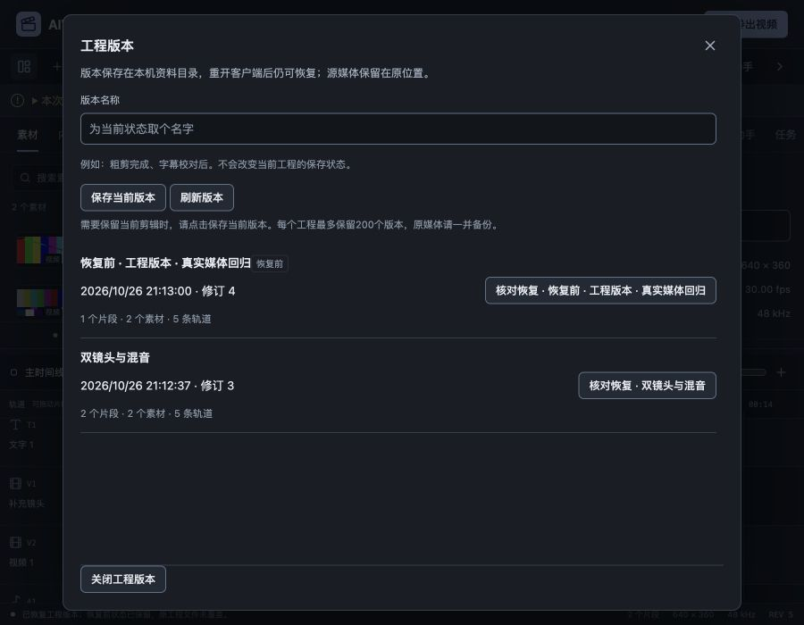

# 工程版本快照与恢复验收

2026-10-26，关联FW-R01/FW-R11/FW-R12/FW-R13，P1局部推进。[规格](../specs/2026-10-26-工程版本快照与恢复.md)、[数字证据](2026-10-26-工程版本快照与恢复-evidence.json)。用户要求的真实账户验收仍后置，本轮模型生成和CLI推理均为0；Wails latest再次返回v3.0.0。

## 可用行为

页头新增“工程版本”，先稳定属性草稿、暂停播放、等待在途编辑。可为当前工程保存具名版本，列表显示真实时间、修订、素材/轨道/片段数量和恢复前标记。创建版本不修改工程、dirty或撤销历史。版本保存在持久资料的`versions`，不放在预览缓存；媒体仍引用原位置，恢复不会重新提交任务。

核对恢复时明确整个工程将切换，当前未保存内容先保留为另一个“恢复前”版本。这个版本写入失败时停止恢复，当前引擎、实例、工程和原文件保留。成功恢复后修订继续增加、更换引擎和源实例、清除选区并定位0；旧MCP连接不能继续访问新状态。会话Undo/Redo从恢复点重新开始，要返回恢复前状态则再次选择该版本。恢复不自动覆盖已保存工程文件，后续保存仍由用户明确执行。

恢复使用共享`run`串行通道和工程解析器，不另造前端工程；未保存处理采用共享Modal的专用业务核对变体，因为恢复前备份已经是明确操作的必要步骤，不在此流程再叠一个泛用确认窗。错误在同窗保留原选择，成功关闭后焦点回入口，Escape也回入口。界面沿原石墨色及共享组件，760px业务宽度，正文有界滚动，底部操作保持可达。

截图记录浏览器流程中已保存双镜头版本和自动恢复前版本的时点；随后还进行了原生及长名称验证，最终夹具有7个版本。

## 持久化与边界

`internal/projectversions`按Project ID哈希分目录，每个版本为独立目录，包含完整`project.aividcut`和最多16KiB摘要。工程文件复用64MiB上限、原子保存、URL去除和工程校验。暂存目录中两项均成功写入并同步后，再通过同文件系统目录重命名发布；不会用两个分别可见的文件拼成已发布版本。没有改工程SchemaVersion 2，也没有引入第二份活动工程权威。

摘要列表每页20、最多50，单工程最多200个版本，不自动清理；达到容量后拒绝新建及恢复前备份，已有版本保留。列表仅读摘要，不复制当前工程数组或解码所有版本正文；损坏摘要计入不可读数量。版本ID是服务端生成的标识，API不接受外部版本路径，目录有系统单写入者锁。

恢复核对Project ID、当前revision、sourceEpoch和列表中的SHA256。完整文件只读一次，校验哈希后把同一批字节交给`projectstore.DecodeWithWarnings`，避免哈希与解析读到不同文件。摘要归属、数量和修订还需匹配正文；拒绝非法路径、符号链接文件、跨工程、损坏版本及同ID重开后的旧请求。已加载资产路径、人工文字、源取样配方、精确音频区间、LUT及其它工程字段随完整快照保留，缺失素材沿用重定位提示。

## 验证

- 新增4组存储与3组应用测试：不可变/重启/分页、内容证明/损坏摘要/路径隔离、系统锁/名称/写失败/会话URL、29.97fps和137000微秒源入点的SourcePhase/AudioRange/LUT往返、恢复和返回恢复前版本、同ID旧实例/原文件保护、备份容量拒绝保留当前状态。实际SDK旧MCP连接在恢复后读取被拒绝，不仅查看状态标志。
- 新增5项DOM和1项桥测试，覆盖空态/字段关联与焦点、失败保留名称/重复提交、核对/失败保留选择/成功关闭、旧列表响应、挂起恢复不能关闭。完整46文件312项前端测试、类型和格式检查通过。24个有测试的Go包竞态回归及vet通过，正式嵌入资源检查通过。
- 浏览器连接真实Go服务，加载640×360/30fps自建双镜头工程，保存“双镜头与混音”，删除候选后恢复：1→2片段、revision4→5；自动保留删除后的1片段。对测试版本正文注入一个空格，界面明确拒绝损坏版本，当前工程保留；还原夹具后恢复前状态得到1片段/revision6，再恢复双镜头得到2片段/revision7。
- 真实900×700视口中对话框760×668，底部操作可达。80字版本名保存成功，7条记录时内部滚动，横向没有溢出；操作文字有界省略，正文与可访问名称保留全名。Escape回“工程版本”按钮焦点。未将静态审计视为完整无障碍验收。
- 关闭开发服务后，以同一独立资料启动正式macOS Wails窗口，经系统Open重开工程，看到此前4条版本；通过原生桥保存“原生桥接复查”，并恢复“双镜头与混音”，得到2片段/revision4，持久版本增至6条。三个新Wails方法均实际调用。随后浏览器重启验证80字名称，最终7份正文哈希均有效，无会话token。
- 浏览器恢复后的工程经真实原生合成导出，90帧画面摘要与上一阶段已独立核验的成片全部相同；完整解码双声道48kHz浮点PCM为1152000字节，与原成片逐字节一致。输出仍为184100字节、3秒、640×360。此为实际媒体证据，不只是版本字段相等。

macOS本地自签名及Windows amd64最终构建通过。主JS约584.31kB仍有500kB告警，SDK对象/默认链接目标警告保留。版本界面按需加载；没有改媒体worker，不重复宣称本轮C++重验。

严格UI审计和DESIGN lint均为0错误/0警告；文档检查覆盖101份Markdown、498个本地链接、74份正文和17项需求，原始归档快照SHA256未改变。本轮未使用子智能体、worktree、提交或PR。

## 限制与仍需继续

这是具名版本，不是自动崩溃保存或跨会话完整Undo日志；没有版本删除、跨工程版本导入或源媒体收集打包。版本存在当前设备资料目录，需一并备份源文件及资料；原文件丢失后只通过该工程路径入口不能自动发现所有历史项目，恢复中心仍待规划。存储以现有原子JSON及文件同步实现，没有声称断电下的完整事务日志保证。

自然素材质量、模型账户、真实CLI推理、Windows实机、整机容量/色彩/字体及商业签名安装更新仍需继续。P1及FW-R01完整范围没有因本轮局部版本恢复而全部完成。截图、过程、真实导出和测试日志在`work/project-versions-check`；测试窗口/开发进程结束后已清理。
