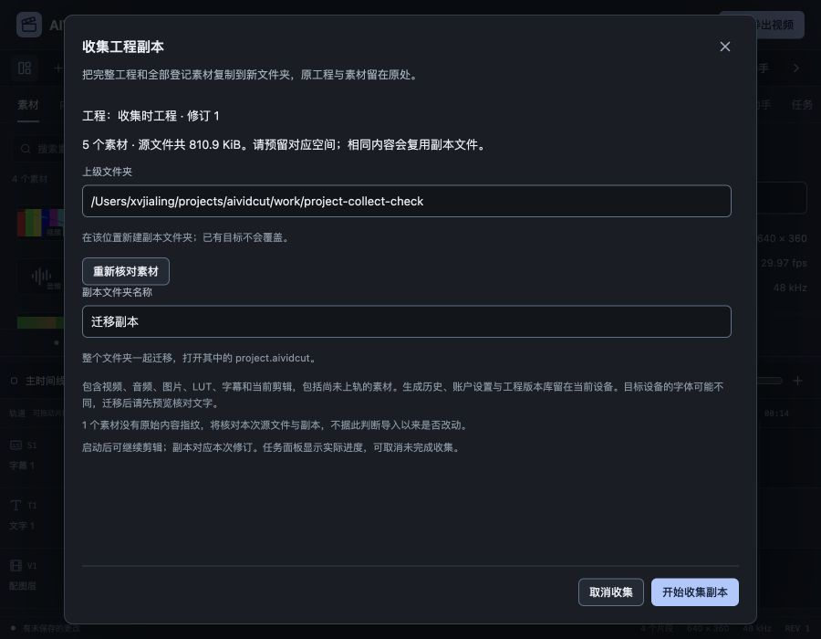

# 工程素材收集副本验收

2026-10-26，P1局部推进，关联FW-R01/FW-R06/FW-R11/FW-R12/FW-R14/FW-R15；既有字幕、图片及音频/视频素材共同迁移。[规格](../specs/2026-10-26-工程素材收集副本.md)、[数字证据](2026-10-26-工程素材收集副本-evidence.json)。真实模型及CLI推理为0，账户验收按用户要求后置。

## 行为与实现

页头新增“收集工程副本”。打开前提交焦点草稿、等待在途编辑并暂停播放；窗口核对全部登记素材数量与实际源文件总大小，用户指定上级目录和新文件夹名称。包括暂未上轨和已经导入的生成成品，重复内容在目标中复用。当前工程、dirty、Undo及源文件不改，任务消费启动时的不可变快照，后续剪辑不改变它。

成功后任务面板显示工程文件位置，并提供“打开工程副本”。打开走既有未保存保护，用户可继续编辑、放弃当前更改或先保存，再进入同一OpenProjectPath。没有用收集任务偷偷切换当前工程，也没有把副本当作已经导出的影片。

`internal/projectcollect`负责文件收集，应用层核对共享ProjectScope（projectId/projectRevision/sourceEpoch）后提交通用任务。版本功能也复用此范围检查，旧接口JSON保持不变。新增InspectProjectCollection只读文件元信息，CollectProject启动真实后台工作；Wails另有ChooseProjectCollectionDirectory，仅该选择器选择目录，原素材/工程选择器的默认行为保持。

目标必须是新目录，文件/目录/符号链接已经存在时拒绝。名称限制为双端可用的单段1–80字符，排除分隔符、常用Windows设备名和末尾点。父目录解析后使用os.Root约束目标操作，文件按SHA256和扩展名命名；全部素材保持原ID、源配方、音频区间、LUT及字幕。工程使用`media/...`相对路径，Encode复用普通保存/版本的完整工程校验、64MiB限制与会话URL清理，SchemaVersion仍为2。

复制使用256KiB缓冲，单个通用工作任务执行。核对源文件身份、大小和时间，以及已登记SHA256；没有原指纹的旧素材再流式读源复核，防止同大小、同时间戳的在途改写被接受。进度依据实际需读取的字节数，包括无指纹复核；不是按耗时猜百分比。清单保存每份唯一文件的字节数/哈希及工程文件哈希，不保存原绝对路径、凭据或服务配置。

工程文件在素材和清单写入、同步后最后提交；之前的失败/取消仅清理本次创建且目录身份仍匹配的输出。目录被改名或替换时不误删新目录，os.Root仍约束写入。最终提交成功后取消不回滚成品。整体目录不是一次原子重命名，强杀/断电可能留下未完成目录，不能据此声称断电事务恢复；重试拒绝覆盖该目录。

## 验证结果

- 新增5组收集器测试与1组应用测试：相对路径、同名不同内容/同内容去重、完整字段往返、原目录移走后的加载、取消/源改写/指纹不符/缺失/目标占用、目录替换不误删、双端名称、提交后取消、无指纹同尺寸/时间戳改写、排队快照、旧修订与同ID旧实例、原dirty/Undo及后续编辑保护。另核对原有版本恢复的共享范围回归。
- 新增6项前端组件/工具与1项桥测试，覆盖数量/体积读取不复制、字段校验/焦点、缺失后重试、目录选择取消、启动错误保留输入、重复启动、旧结果丢弃、Windows根路径和保留名。最终47文件319项前端测试、types/Prettier通过；后端完整竞态与vet通过，部分包为缓存。静态UI审计与DESIGN lint另见数字证据。
- 自建真实工程为640×360、30000/1001fps、4条片段、5个素材：137000微秒源入点视频及440Hz原声、880Hz模拟配音WAV、配图和同内容另一名称配图、0.37强度暖色LUT、人工中文字幕。全部在本机生成，模拟配音是测试音调，不是发音或音色质量验收。
- 浏览器实际提交未失焦工程名称，打开收集窗时已是修订1，核对为5素材、830343源字节；已有source-media目录被拒绝，输入保留。换新名后完成任务，原工程仍dirty、4片段、revision1。打开副本弹出既有未保存保护；先继续编辑，再明确放弃更改进入副本。
- 实际清单为4份唯一文件、829355字节，重复配图节省988字节。原工程文件仍revision0，副本为明确提交的名称/修订1；除名称/修订和素材路径外完整字段逐项相等。所有副本与清单SHA256相符，无会话token或原素材绝对路径；1份LUT未有原始指纹，按本次复核保留，没有伪称知道导入时内容。
- 将原素材目录整体改名，使5条原路径全部失效；又将整个副本移动到`moved/独立工程`。经真实打开入口重开，所有素材均在新包内、missing为0、dirty为false。原片全精度实时预览实际准备、播放并到结尾。没有用浏览器旧图像缓存充当迁移成功证据。
- 从迁移后工程经界面导出原画幅，H.264、640×360、90帧、3.003秒。全部90帧摘要与迁移前基线一致；完整解码双声道48kHz浮点PCM为1153152字节，逐字节一致。成片404945字节。独立查看第45帧，中文字幕可读；源相位、LUT及声音通过完整媒体比较保留。
- 900×700视口中对话框760×668，底部操作可达、没有横向溢出；表单和版本窗口统一补齐共享dialog-actions类，修正按钮间距与对齐。

Wails latest仍为v3.0.0，Go/CLI/runtime继续同版本、项目Go1.27.3。最终macOS本地自签名、Windows amd64交叉构建及正式嵌入资源测试通过；主JS约585.90kB仍有500kB提示，SDK对象/默认链接目标警告保留。

最终25个有测试包的竞态命令通过（部分缓存），严格UI审计与DESIGN lint均0错误/0警告。文档检查为103份Markdown、508个本地链接、76份正文、17项需求，归档快照SHA256保持不变。未使用子智能体、worktree、提交或PR。

## 待验与限制

启动最终macOS程序后，原生工具报告Mac锁屏，因此本轮没有完成真实文件夹选择及三项新Wails调用的GUI验收；没有反复请求解锁或用此前普通文件选择器结果替代。仅关闭本轮启动进程，开发服务/Vite/浏览器已结束，临时视口已恢复。Windows仍没有实机证据。

当前是目录收集，不是ZIP安装包；需要整个目录一起迁移。账户、生成任务历史、独立工程版本库、代理缓存及系统字体不随包复制，字体跨设备一致性仍需单独解决。关闭客户端会取消未完成任务，失败任务不自动续传；强杀留下的未完成目录需另取名称或人工处理。磁盘写满、设备拔出、网络文件系统、断电及整机资源未现场验收，文件系统调用阻塞不能由上下文强制中断；本轮不宣称这些商业门槛完成。

自动崩溃恢复、多Sequence、真实模型/两CLI、完整双端/色彩和商业发行仍需继续。本轮推进工程可迁移性，不将全部P1或原始目标缩小为这一个固定样本。
