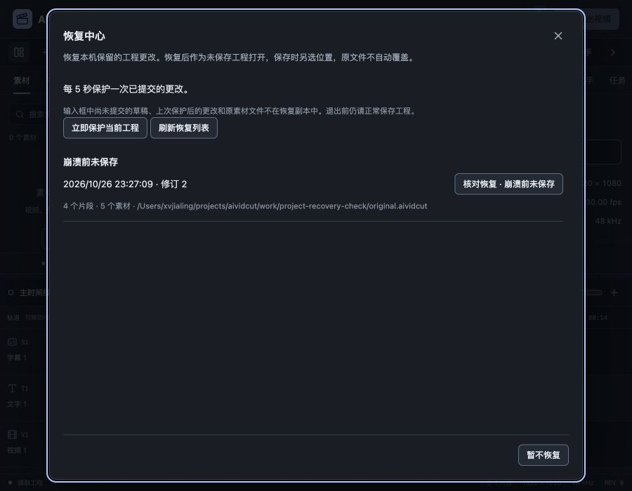

# 自动恢复副本与恢复中心验收

2026-10-26，关联FW-R01/FW-R11/FW-R12/FW-R13/FW-R15，P1异常退出恢复局部推进。[规格](../specs/2026-10-26-自动恢复副本与恢复中心.md)、[数字证据](2026-10-26-自动恢复副本与恢复中心-evidence.json)。Wails latest仍为v3.0.0，Go/CLI/runtime精确同版，项目Go1.27.3。真实模型及CLI推理0，账户验收继续后置。

## 自动保护与恢复

默认每5秒检查Engine身份、revision、保存基线与路径；无变化不构造完整快照。发现已提交dirty状态后，在编辑锁内捕获一次快照，锁外单写入存储。没有按编辑次数排队完整工程，也不依赖前端通知，因此手动、实际MCP、Agent及工作流共用保护。新建/打开、正常保存与明确放弃退役当前记录，存储退役标记阻止迟到旧写复活。

恢复中心显示来源工程、原位置、真实时间、修订和计数。当前活动保护点不重复列为待恢复；具名版本与恢复列表共用ProjectSnapshotList及既有Modal。入口显示保留数量；启动发现普通遗留副本提示一次，已有输入/草稿、切工程或其它对话框时不抢焦点。“暂不恢复”保留记录，恢复前备份可手动找回，但不触发新的异常启动提示。

恢复必须明确核对，后端再次检查当前ProjectScope和选中SHA256。当前有未保存内容时，先成功写入另一个恢复点，失败则保留当前引擎和编辑。目标成为未保存工程，projectPath为空，后续保存另选位置；修订递增、新Engine/源实例、清选区/定位0、撤销从恢复点重新开始，旧MCP能力失效，不重放任务。原工程文件不自动覆盖。

还补查了目标可读、但自动恢复目录暂时不能更新的情况：当前工作已安全保存或保留后，仍允许把目标读回内存，保持原恢复文件，显式提示自动保护异常并要求尽快另存。否则磁盘/目录写入故障可能把可读数据挡在恢复入口之外。此分支不绕过“当前dirty备份失败不得切换”的保护。

## 数据与生命周期

`internal/projectrecovery`保存单个原子替换文件，先放最多16KiB摘要、后放完整工程正文；摘要含格式版本1、来源/时间/计数和正文SHA256。列表只读有界摘要，恢复读同批字节并复用projectstore.DecodeWithWarnings的严格格式/迁移/缺失源处理。正文去除临时素材URL，不能夹带账户或任务凭据；恢复不把原位置用作写入目标。

单份正文64MiB、最多50份记录、512MiB已提交记录预算；只滚动当前实例恢复点，不自动删除其它遗留数据。达到上限或写失败保留旧点和工程，状态通过现有全局错误区与中心提示手动保存；每5秒有界重试。正常关闭在停止主要修改入口后尝试最后捕获，最多等待3秒，存储锁保持到实际写入退出。显式放弃会抑制相同状态的关闭捕获。

这是完整工程快照，不复制媒体，不是事务日志、持久Undo或零丢失承诺；编码仍沿SchemaVersion 2。临时写入和已提交预算不同，强杀/断电可能留下暂存文件，后续资料整理仍需处理。

## 实际证据

- 新增4组存储测试：滚动替换/旧证明拒绝/重启/退役、正文及摘要损坏/路径与会话URL、50记录上限/单写入者/分页、512MiB预算不删除旧资料。存储量测试用稀疏文件，不写满实际磁盘。
- 新增4组应用协调测试：写前/写后两阶段的保存与同ID重开竞争，写盘时普通编辑仍可提交；无变化不重复写、普通关闭最后捕获、明确放弃不复活；恢复前备份失败保护当前、原文件不覆盖；目标可读但更新失败仍可恢复内存并另存。还检查读模型时间不能修改内部状态、旧实际SDK MCP读取被拒绝。
- 另有真实独立辅助进程：父进程通过实际MCP SDK提交工程名和文字片段，完全没有前端；默认5秒周期写出修订1，随后使用该子进程句柄强杀，没有调用Close。重开存储重新取得文件锁后成功恢复未保存工程，原文件逐字节保留。辅助函数本身不算另一个独立验收组。
- 新增5项中心DOM、2项启动交互和1项桥测试；覆盖读取不写入、恢复核对/失败保留/成功关闭、手动保护重复阻止、旧实例响应、读失败刷新、不可读计数、挂起时Escape阻止；启动提示一次，晚到状态不抢正在输入的焦点/草稿。最终49文件327项前端测试、types/Prettier通过；26个有测试Go包竞态及vet通过（部分缓存）。
- 真实浏览器连接独立二进制服务，打开29.97fps、640×360、5素材/4片段夹具，修改名称为“崩溃前未保存”、字幕为“异常恢复验收”。只读取状态/列表，没有调用手动Checkpoint。默认周期写出修订2，完整工程与预设修改后状态完全相等。
- 控制器持有明确子进程句柄，PID24145被SIGKILL，退出-9；确认终态后才启动PID24269。重载工作台自动出现恢复中心，列出唯一修订2副本。旧浏览器页的离开保护使第一次重载观察超时，重新绑定并检查同一Tab，没有据超时重启服务；通过界面重新读取新服务空状态后重载完成。没有把工具超时当作产品已退出。
- 点击明确恢复得到修订3、dirty=true、projectPath为空、Undo=false和新源实例；除递增修订外完整字段匹配预期。原片全精度真实准备、播放到结尾，137000微秒源相位、0.37 LUT、音频及修改字幕保留。另选recovered.aividcut保存后恢复文件数为0、状态无错误，原original.aividcut仍修订0与旧字幕。
- 恢复后经界面原画幅原生导出，90帧/3.003秒、640×360、405954字节；全部帧摘要和完整1153152字节双声道48kHz浮点PCM与预设更改后基线一致。第45帧实看新中文字幕正确，不只比较摘要或数量。
- PID24269正常停止0后独立启动PID24715，恢复记录0，浏览器没有自动弹窗；打开中心为空，Escape回入口焦点，再正常停止0。全部进程事件、原文件证明、成片及日志保存在work/project-recovery-check。
- 900×700视口中中心760×668，无横向溢出，底部操作可达。具名版本回归也通过，未另造历史条目/按钮/弹层体系。

最终macOS本地自签名、Windows amd64交叉构建及正式嵌入资源检查通过；主JS约589.34kB仍有500kB提示，SDK对象/默认链接目标警告保留。没有修改媒体worker，不声称本轮新增C++或完整Windows实机验证。

严格UI审计与DESIGN lint均0错误/0警告，文档检查为105份Markdown、518个本地链接、78份正文和全部17项需求，原始归档快照SHA256未改变。浏览器Tab4已关闭、临时视口已恢复；控制器、独立服务、Vite和工程内媒体进程均无遗留，43110/5173端口无监听。没有使用子智能体、worktree、提交或PR。

## 仍需继续

本轮没有补做新Wails方法的原生GUI验收，最近一次原生访问曾因锁屏受阻，本轮没有反复要求解锁或自动重试启动默认资料实例。浏览器/Go方法与跨编译不能替代此项。

输入框未提交草稿和最近一次保护后的更改不在保证内，媒体仍依赖原文件位置；素材收集功能负责另行携带资源。回收/永久清理中心、全量断电故障恢复、真实磁盘写满/拔盘/网络文件系统、长期容量及整机资源仍待验，达到预算时优先保留旧资料并要求手动保存。真实模型/两CLI、Windows实机、字体/色彩/商业发行和完整P0–P6目标继续，不能把本轮异常退出恢复缩写为全部P1完成。
