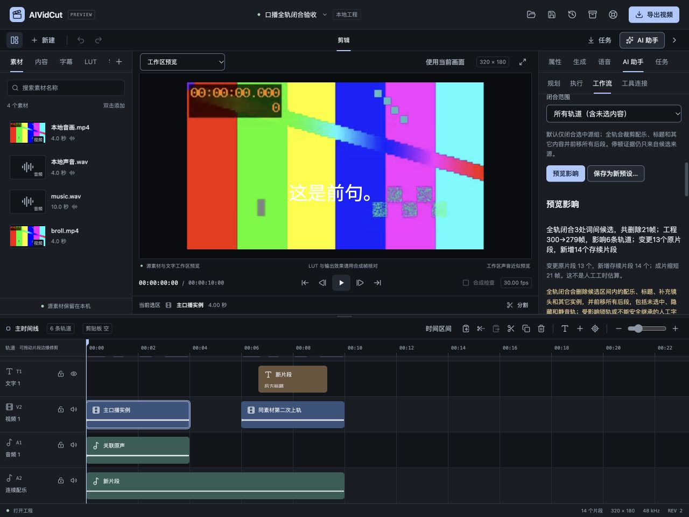

# 口播粗剪全轨闭合验收

2026-10-27，FW-R01/FW-R02/FW-R03/FW-R08/FW-R11/FW-R12，推进P1/P2/P4自动剪辑。本轮将已有接受词停顿候选与全轨区间删除组合，人工、参数预设及MCP共用核心；真实模型账户仍按用户指令后置，收费调用0次，不把人工词时间夹具称为ASR或语义质量证明。

## 行为与实现

原口播粗剪只闭合选中的完整音画组，未选配乐、标题和其它实例保留原位。新增显式`rippleScope=all_tracks`，默认/旧预设仍为selection。口播表单将原“操作范围”改称“停顿候选来源”，闭合范围单独选择：候选来源只决定哪些片段提供词证据，全轨选择则作用于全部轨道。表单和影响预览说明未选中、隐藏、静音轨也会被裁剪/前移，不能暗中扩大默认范围。

接受词证据、源指纹/时长、句末/说话人/词边缘保护和未接受原始词保护保持；首尾未知区间不删，32个不重叠完整组/128处候选上限保持。删除帧起点向上、终点向下量化，仍是帧级保守内缩，不声称音素精确或词间空隙等于静音。没有重新运行识别，也不根据词长度估计声音。

从原工程一次计算全部切口，再按原坐标倒序产生`ripple_delete_range`命令，避免前方删除改变后方坐标。命令作为一个EditRequest在核心副本上真实执行，人工确认后由同一核心一次提交、一次Undo/Redo。原生源相位、音频半开窗、音画链接和字幕继承复用已有区间核心，没有复制另一套切片算法。任何受影响锁轨、不能拆分的手改整句或无效源窗均整批拒绝；只在切口前且不受影响的锁轨不会阻断。

新的speechRippleSummary包含完整原/新帧数、切口/删除帧、影响轨道、原片段变更和新增存续片段。总影响标识最多返回2000、影响明细200，候选切口最多128因而全部保留；统计先按完整结果计算，界面不拿截断数组长度冒充总数。原/新标识并集也不冒充当前时间线片段数。

未选媒体被裁切时，同样加入来源指纹证明；缺失或无指纹的裁切源拒绝，纯移动/全删的离线占位无需读取。应用继续绑定工程实例、修订、内容和源文件，再核对来源。MCP只读连接只能预览，已授权连接才能应用，撤销后的旧计划不能重放。修改闭合范围或其它参数清掉旧界面计划。新枚举向后兼容现有默认参数，原方法版本和旧预设不改；这不承诺旧客户端能识别新全轨参数。

## 真实多轨音画

使用已有本地4秒合成音画、独立原声与人工接受词时间，加10秒660Hz配乐、独立testsrc2视频B-roll、后方标题、同素材第二实例和已导入中文OTF；均为本机夹具，无外部人物、账号或模型素材。最终工程6条轨道、300帧、320×180/30fps。

| 原工程候选半开范围 | 删除帧数 |
| --- | --- |
| [26,28) | 2 |
| [47,58) | 11 |
| [80,88) | 8 |

实际命令按80→47→26的起点顺序应用，共21帧；工程300→279帧，影响6条轨道，变更13个原片段、产生14个新存续片段。原片段中的退休标识与新存续段计数分开，最终时间线25片段。配乐切为4段并保留源位置，后方标题200→179帧，第二实例180→159帧，独立B-roll按全轨切口分成存续段；人工“人工字幕保留”的内容、字体与绑定覆盖保持，源接受词/原始词不改。

原工程和粗剪工程分别通过真实常驻原生引擎完整取帧。对每一个粗剪后帧，根据原工程切口推导对应原帧，比较RGBA与真实PCM的SHA；全部279帧画面和混音完全一致。每视频帧1600个双声道float32采样帧，合计3571200字节PCM，摘要f6eb1eb647bcc5651976e9e37cf19587be2eae49775dbeed597052956beba31b。比较发生在AAC编码前，不能声称有损成片解码后逐样本相同。

实际原生导出after.mp4经独立FFprobe确认320×180、30/1、279帧、9.3秒，音轨AAC；工程保存重开一致。此证据覆盖固定30fps短合成样本，多组/29.97帧切口由核心测试补充，不将短片通过扩张为自然语音、所有帧率或整机性能完成。

## 真实界面与权限

浏览器初始默认只闭合选中组；默认800ms条件无候选时显示具体错误且工程不改。明确调参数和选全轨才产生3处切口预览，显示原/新总长、原片段变更、新存续片段及所有轨道后果；未点击应用之前保持300帧和无Undo。

实际应用后变为279帧，一次撤销恢复300帧/14原片段，再重做恢复279帧/25片段；随后原片实时模式真实有声播放至结尾，通过保存窗口另存ui-edited.aividcut。独立脚本将生成ID、链接组命名和修订规范化后，比较源窗/精确相位/声音/文本样式/字幕绑定/链接成员/轨道及其它工程数据，界面结果与独立核心结果一致，没有只比总长度。旧源工程文件仍保留。

最终统计版本另独立重启服务和页面，确认6条轨道/13个原片段/14个新增段的摘要；再次把范围改回selection，旧影响和应用按钮立即消失。900×720视区document为900×720，无页面溢出，原生Select可展开并用Escape退出，右侧表单/明细按已有滚动区域到达。截图记录控件与说明；系统Select原生弹层的像素不由浏览器截图覆盖，展开状态另由AX记录确认。

## 检查与仍需继续

前端54文件357项、typecheck、format及生产构建通过。新增组件测试验证默认范围、候选来源名称、明确全轨参数、完整统计和改参数作废旧计划，不进行真实网络/CLI/收费调用。Go完整32个带测试包竞态/vet通过，最终统计和方法文档补充后相关包再验通过。新增核心测试覆盖不等长多切口、linked源/人工字幕、隐藏静音配乐、未选锁轨、无关前方锁轨、多组和3000个后方标题的有界预览；真实MCP测试覆盖只读拒绝应用、授权应用、Undo不重放和未选媒体源变化拒绝。

Wails官方模块latest本轮仍3.0.0，项目Go/CLI/runtime保持3.0.0，工具链Go1.27.3。最终macOS本地自签名、Windows amd64构建和production资源测试通过，已有JS包大小/SDK链接目标警告保留；新功能没有新增原生Mac窗口或Windows实机验收。严格设计审计、DESIGN lint与文档追踪检查一并归档。

仍需继续：自然口播/噪声/识别漏词、用户试听和节省工时评估、多通道内容的语义判断、剪口音频平滑与交叉淡化、完整跨平台媒体/性能及商业发行。全轨范围中的音乐和其它声音会被实际裁断，切口没有额外淡化，不能承诺所有切口听感自然。原始命名模型/双CLI/Skills、真实账户、双端SDK/签名安装更新与完整P0–P6目标均保留。

规格见[全轨口播规格](../specs/2026-10-27-口播粗剪全轨闭合.md)，数字证据见[本轮证据](2026-10-27-口播粗剪全轨闭合-evidence.json)。源夹具、逐帧验证器和日志在work/speech-ripple-check。
