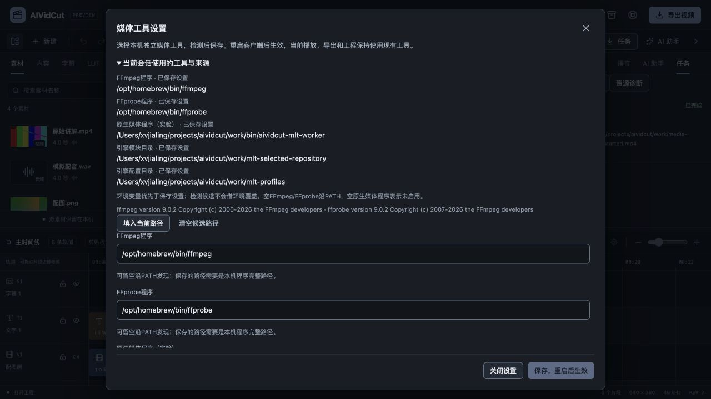
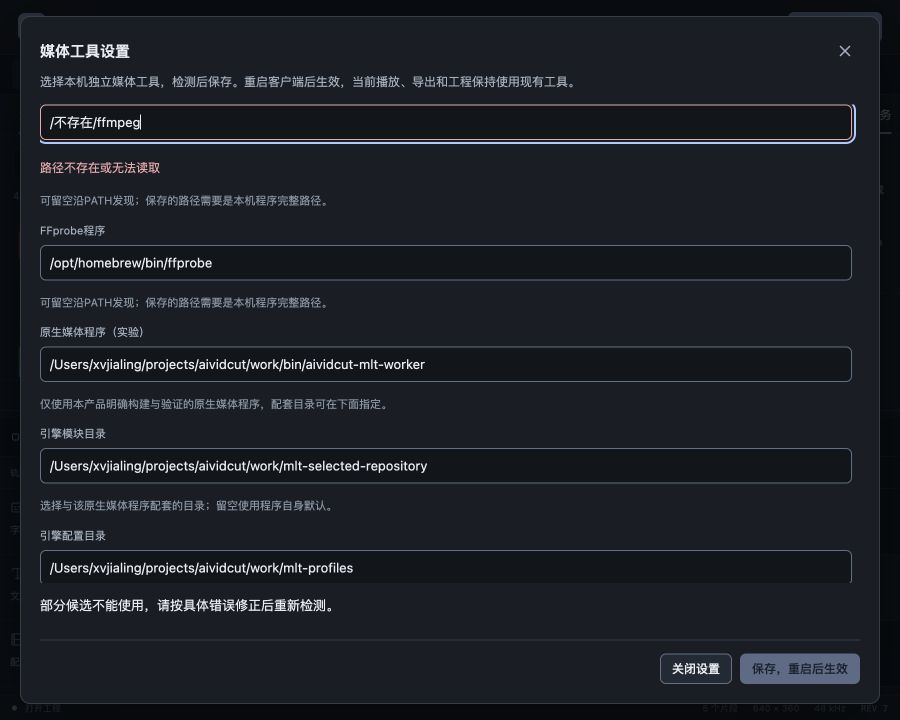

# 媒体工具持久设置验收

2026-10-27，FW-R01/FW-R11/FW-R12/FW-R14/FW-R16，推进P0/P1普通桌面启动。用户要求真实模型账户后置，本轮收费调用0次；Seedance适配和其它图片/视频、字幕配音、本地Codex/Claude与Skills目标保持。此阶段补本机工具配置，不将开发SDK变成商业发行包。

## 行为与边界

此前客户端只从进程环境变量或PATH发现媒体工具，Finder/开始菜单启动可能缺少开发终端配置。本轮在任务页新增“媒体工具设置”，保存FFmpeg、FFprobe、原生worker、MLT模块和profiles五类绝对路径。可填入当前路径、清空候选或在桌面选择文件/目录，先明确检测再保存；不会读取执行`.env`、下载依赖或扫描其它应用。

启动优先级按每项处理：显式环境变量、保存设置、PATH（仅FFmpeg/FFprobe）；界面展开显示实际启动路径及来源。候选检测使用输入本身，不借当前环境覆盖结果；空值含义在表单说明。保存后当前会话的工具、能力和播放服务保持，提示先保存工程并正常退出，下次启动才应用，不自动重启正在剪辑的客户端。

mediatools模块保存版本1的JSON，字段严格、32KiB、单路径4096字节上限，系统单写锁、0600临时文件、同步和原子替换。目录在用户应用数据下，不混入工程快照、素材收集或模型凭据。普通损坏JSON保留并显示启动警告，编辑器仍能打开，显式检测保存可修复；特殊文件、符号链接、超大或不可读文件需保留资料后手工修复，不能覆盖未知目标。不承诺已有目录权限自动修复或断电日志级持久性。

检测只调用固定用途的版本、滤镜、编码器和worker协议查询，20秒总预算；媒体查询输出受4MiB/尾部错误限制，取消沿已有进程组处理并限制等待。工具声明与实际工程准备、硬件编码实测分开显示。worker未检测时明确“未检测”，不会因另一个路径错误冒称未配置。

检测证明绑定候选、原始配置摘要及文件/目录身份、大小、mtime与模式，最多16份/10分钟；保存只接收检测ID，文件或配置变化拒绝旧证明。它不是二进制签名、依赖完整性、运行沙箱或许可证认证，目录中所有插件内容也没有逐一哈希。当前工具在后续使用中仍需原来的图/任务校验；没有给Agent增加设置或任意命令权限。

## 独立重启与真实媒体

使用单独编译的开发服务控制器，PATH严格为`/usr/bin:/bin`，移除五个媒体环境变量。首次PID52669的五项活动路径为空，导出说明未配置FFmpeg。实际浏览器填写已知Homebrew FFmpeg/FFprobe及本项目worker和配套SDK目录，明确检测得到FFmpeg/FFprobe9.0.2、MLT7.42.0和基础协议能力；FFmpeg缺drawtext按实际显示，原生文字路径仍可用。

浏览器保存后显示“当前会话未切换工具”，活动路径仍空。关闭旧页面，正常终止旧服务并独立启动PID52754，控制器使用同一精简环境和数据目录；五项活动路径均从已保存设置恢复，来源全部为saved，restartRequired=false。没有用浏览器刷新冒充后端重启，也没有在新进程补回环境变量。

新页面打开含五条轨道的font-ui.aividcut，原生原片准备并真实播放到90帧结尾；随后通过导出窗口以工程原画幅完成restarted.mp4。独立FFprobe验证640×360、30000/1001fps、90帧、3.003秒。解码双声道float32 PCM为1153152字节，与之前已验证的同工程基线完全相同；SHA256为d6f4b8f610aa37468d637ba88ca9fdbc451b956620944916c8e5d529262b124f。工程正文、dirty与canUndo均保持原值。此处只证明固定样本恢复后的可用性，未宣称有损编码逐像素一致或完整格式兼容。

实际界面另将FFmpeg改为不存在路径，检测显示对应错误、保留输入、聚焦FFmpeg且aria-describedby关联错误，保存禁用；候选未写入。再填入当前路径并Escape关闭，焦点回到任务页入口。900×720视区中对话框860×688、位置20/16，document为900×720，没有页面溢出，正文内部滚动且footer可达。复用既有Modal/Field/Input/Button及replacement-dialog，不新增主题或模态所有者。

## 自动检查与交付限制

前端54文件356项、typecheck、format和生产构建通过。新增四项组件测试覆盖只读打开不执行、来源说明、候选变更作废、保存仅ID、重复检测保护、错误焦点、保存失败保留输入及关闭不写入。Go完整internal/cmd共32个带测试包竞态与vet通过，新增设置持久/损坏保留/单写/链接拒绝/优先级，以及无环境重启、当前工程不变、工具或配置变化拒绝证明等测试；Unix固定shell夹具不冒称Windows实际执行测试。

Wails官方模块latest本轮仍v3.0.0，Go/CLI/npm runtime保持3.0.0，项目Go1.27.3。macOS本地自签名、Windows amd64构建和production资源测试通过；已有JS包大小与SDK链接目标警告保留。严格设计审计、DESIGN lint和文档检查结果随证据归档。

仍需继续：新设置的macOS原生选择器与Finder启动、Windows实机/开始菜单、SDK依赖打包/许可证/签名公证/更新、异常磁盘与长期并发、完整资源/色彩和自然素材。当前独立服务的精简环境验证不替代真实双端GUI交付。真实模型账户及CLI推理仍后置，P0–P6完整目标没有因本阶段通过而标为完成。

数字证据见[媒体设置证据](2026-10-27-媒体工具持久设置-evidence.json)，源规格见[媒体设置规格](../specs/2026-10-27-媒体工具持久设置.md)。原始过程、构建/测试和控制器记录留在work/media-tools-check。
