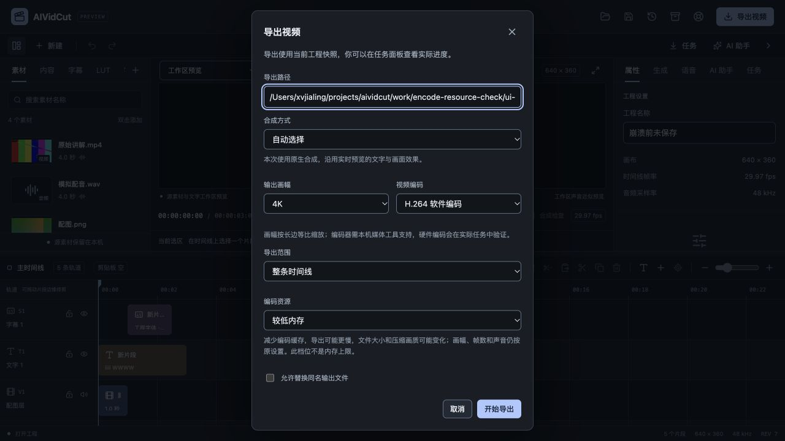

# 导出编码资源档位验收

2026-10-27，FW-R01/FW-R11/FW-R12/FW-R15，推进P0实测资源控制。完整多轨、字幕/配音、LUT、命名生成模型、本地Codex/Claude、Skills及双端目标继续；按用户要求真实模型账户后置，本轮收费调用0次。不把短样本的资源降低当作完整整机或商业发布验收。

## 问题与实现

上一阶段固定4K导出采样RSS约953MiB。本轮按进程细看，FFmpeg单进程峰约763MiB，worker约126MiB；视频编码本来已经2线程，码流SEI证明其标准设置为threads=2、rc_lookahead=10、CRF20/veryfast。因此先比较受控实验，而非凭猜测改线程数。

实验分别调整线程、预读队列及组合，组合在该样本中降低最多的同时仍有清楚的速度/压缩取舍。本轮将较低内存做成明确选项：H.264软件编码单线程、rc-lookahead=4、同步预读0。标准/缺省返回空附加参数，保留已有设置。它不改变工程、画幅、FPS、帧数、混音与声音编码，但文件大小和有损压缩画质可能变化，导出可能更慢，不是内存硬上限。

编码参数由media.EncodingResourceArgs统一白名单构造，两种原生/FFmpeg导出共用；不允许客户端传任意FFmpeg参数。较低内存只能配软件H.264，硬件/MPEG-4或未知档位明确拒绝，在建立任务或媒体进程前完成。StartRawVideo保留旧调用兼容，原生导出将本次参数明确传入，FFmpeg合成在对应输出应用相同策略。

界面初始标准，选择较低内存才启用。换到不兼容编码器恢复标准、禁用资源选项并说明，不丢范围/画幅等设置。MCP新增同一枚举，准备阶段拒绝不兼容，待核对摘要列出档位与取舍；模型只准备请求，人工仍选择输出并确认。取消与提交复用已有规则，原片与同名输出保护保持。

FFmpeg官方将预读定义为帧类型与码率控制的前看窗口，不能将减少预读描述成无条件画质不变的免费优化，参见[FFmpeg libx264官方选项](https://ffmpeg.org/ffmpeg-codecs.html#libx264_002c-libx264rgb)。本轮核查日期2026-10-27，码流信息也独立验证实际生效参数。

## 同源三轮实测

采用上一阶段640×360、30000/1001fps、90帧工程，含视频源相位、独立音轨、图片、0.37强度LUT、中文OTF与英文TTF，明确输出3840×2160/libx264。它是固定合成测试素材，不是自然长片。由同一产品API可执行文件交错运行标准/较低内存各3次，100ms进程采样，保存实际出生身份与计数；不将不同进程各自峰值相加冒充同时峰值。

| 指标 | 标准 | 较低内存 |
| --- | --- | --- |
| RSS合计采样峰值中位数 | 950.56 MiB | 642.31 MiB |
| 导出耗时中位数 | 1626.83ms | 3235.54ms |
| 最低SSIM，对同源无损YUV参考 | 0.998017 | 0.997717 |
| 视频帧/时长 | 90帧/3.003秒 | 90帧/3.003秒 |
| 双声道解码PCM | 1153152字节 | 与标准完全一致 |

该样本RSS中位峰值约降低32.43%，耗时接近翻倍，不能宣传为速度提升。RSS包含共享页重复，不是独占物理内存，也未覆盖独立浏览器/GPU/显存。采样100ms可能漏掉瞬时峰值；数字只能用于同输入/同机器/同编码参数的固定比较，不能外推所有电脑或编码器。

参考视频通过同一原生画面、缩放/格式链路生成CRF0无损YUV；标准及较低内存分别与之计算SSIM，不只拿两个有损结果互相比。较低内存存在实际画面差异，0.99只是本次样本的基本检查，不是用户素材质量门槛或观感证明。所有成片fps=30000/1001、3840×2160、90帧，原音频PCM一致。标准首轮成片SHA与功能加入前的同工程基线相同，证明新增可选档位没有改变该样本的旧标准编码。

三次成片的SEI实际记录threads=2/rc_lookahead=10或threads=1/rc_lookahead=4，拒绝仅按界面选择推断生效。原始记录、工具版本、机器/程序摘要、成片与SSIM日志在work/encode-resource-check；早期包装器矩阵在work/encode-memory-check，仅用于实验，不在产品运行路径。

## 应用与真实界面

实际浏览器初次导出为标准；明确选4K/较低内存后显示更慢及压缩变化说明。切到MPEG-4，资源档位回标准且禁用；切回H.264再明确选择较低内存，实际完成ui-lower-memory.mp4。ffprobe与SEI复核4K/90帧/实际线程和队列，工程正文、dirty与Undo仍和原font-ui.aividcut相同。

导出完成后下一次打开保留本会话用户选择，初次默认仍是标准。第二次只核对并取消，没有额外导出。900×720视区中窗口460×686.19、位置220/16.91，document不溢出，说明、覆盖选择与提交均可达，沿原Modal/Select/Field，不新增主题或自由参数编辑器。

前端53文件352项通过，新增真实控件切换/默认兼容/不兼容保护测试。Go完整internal/cmd竞态与vet通过，新增白名单、标准空附加参数、非法请求不创建任务/改工程、真实MCP保留参数且未确认不导出测试。真实原生预览/导出全部回归，包括较低内存取消保留原输出及清理暂存。取消不是远程停止模型，本轮没有模型请求。

## 构建与仍需继续

Wails官方模块本轮latest仍v3.0.0，Go/CLI/runtime一致，Go1.27.3。Mac本地自签名、Windows amd64构建和production资源测试通过；没有新增原生Mac窗口或Windows实机验收，交叉编译不证明Windows实际性能。已有JS包大小、SDK链接目标警告保留。

严格设计审计、DESIGN lint、文档/需求追踪及原始归档哈希保持通过。档位不写工程格式，不改v3，不改变原媒体路径/字体来源或字幕手改。新增参数用枚举，MCP/人工均经统一校验，没有新增可执行命令或扩张文件权限。

仍需继续：自然长素材、不同画幅/运动/噪点、跨设备/Windows与真实并发剪辑时的资源、主观画质和时延评估；软件H.264之外的编码器档位需各自验证，不能静默类推。完整WebView/GPU、媒体发行许可、双端安装签名、真实生成账户/CLI推理与原P0–P6目标均保留。本轮不以32%数字勾选完整资源门槛，也不将可选取舍作为默认隐式降质。

数字证据见[编码资源证据](2026-10-27-导出编码资源档位-evidence.json)。
