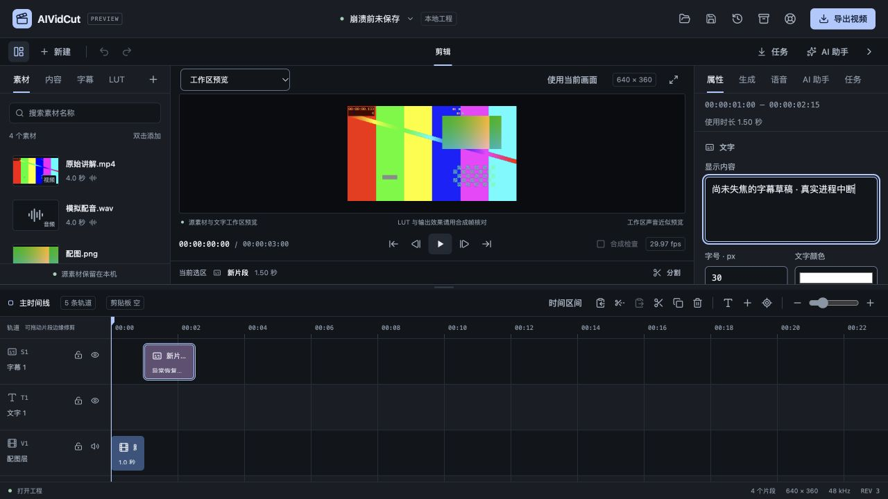
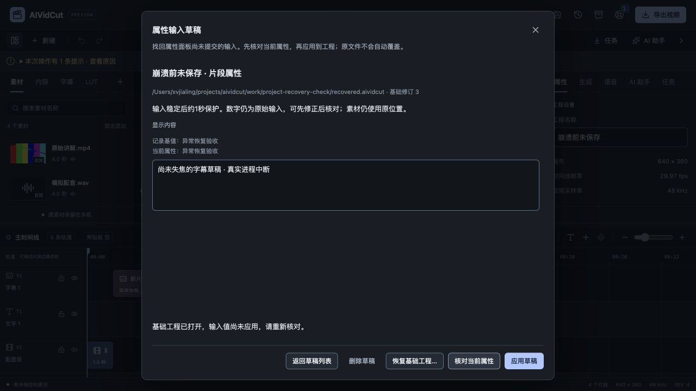
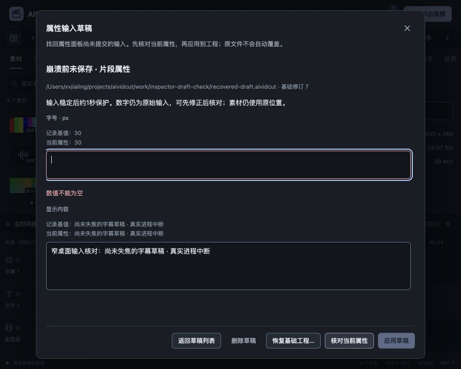

# 属性输入草稿恢复验收

日期：2026-10-27。需求FW-R01/FW-R03/FW-R11/FW-R12/FW-R15，推进P1异常恢复。本轮补齐尚未失焦的属性输入保护，不把模型账户验收或完整P0–P6标为完成。用户“账户验收稍后，先完成适配”继续有效，真实模型调用0次。

## 已实现范围

Inspector工程名、片段名、显示文字/字幕以及起点、时长、素材入点、字号、变换、音量和LUT强度采用显式字段登记。稳定输入1秒后合并，单在途且只排队最新值；IME组合中不保存半成品，重新输入同一舍入显示值不产生精度草稿，恢复显示值会清理该字段，输入不失焦，工程dirty/revision不因保护草稿而变化。原关闭/导航提交保护继续有效。连接密钥、生成提示词和任意表单不进入此存储。

新增inspectordrafts存储与应用边界。基础工程由Go首次捕获并保存为不可变base.aividcut，后续只替换小draft.json；会话素材URL沿用projectstore清理。单记录最多14字段，每个raw/base最多64KiB，小文件256KiB，基础工程64MiB，总计50份/512MiB。目录扫描4096条有界，容量检查读取元信息；os.Root限制路径，普通文件身份、内容SHA及进程锁参与核对。超限保留旧记录，链接/未知内容不递归清理。新测试覆盖数量及稀疏文件模拟字节上限，未把它当作512MiB实际写盘性能测试。

SaveInspectorDraft仅接受同Project ID/sourceEpoch的登记字段，允许较旧修订保护输入，未来修订拒绝；基础工程和原路径均由服务端决定。正常提交只清理本实例已与工程匹配的字段，旧崩溃会话的相同文字不会被新工程清理。目标删除后仍可保留迟到原始输入，预览明确报告不存在，不重建片段。

恢复中心显示草稿数量，并在初始干净空工程中提示；不抢占输入或其它业务窗口。进入“属性输入草稿”后，每页20份，核对记录基值、当前属性与可修正原始输入。空数字不转为0；微秒/百分比转为领域单位，有限指数与长度受限，避免任意精度扩张。核心校验在只读预览中执行，锁轨、删除目标、非法数值均阻止应用；当前属性变化需再次明确核对，然后单独应用。

应用预览最多32份、10分钟，绑定当前实例、修订、记录SHA和实际命令，只能应用一次。普通字段通过同一编辑核心形成一次撤销，保留其它属性、源相位与字幕保护。恢复基础工程为独立明确操作：dirty当前状态先写工程恢复副本，失败停止；成功只恢复内存，原文件不覆盖，撤销历史从新实例开始，输入值仍须重新核对并应用。

永久删除需要单独后果核对，默认聚焦取消。实际浏览器只验证了取消删除，未通过UI执行永久删除；正常提交/应用后的记录清理和删除边界由本轮拥有的Go临时目录验证。无法读取或包含未知内容的资料保留并提示检查，不自动丢弃。

## 验收证据

前端51个测试文件340项通过，含7项新增输入/对话框测试：稳定合并、密钥排除、焦点保持、IME、空数值、在途最新队列、失败保留、真实Inspector登记、冲突重新核对及恢复/删除取消。恢复中心旧文案断言随新入口更新。本轮早期构建暴露新测试未使用的类型导入，修正后typecheck、format与双端构建通过；不把该失败归入历史无关项。

Go完整internal/cmd竞态回归通过，新增存储测试后相关inspectordrafts/application再次竞态复验，vet通过。覆盖基础工程不可变、独立重开、SHA变化、超限保留、符号链接/未知文件、无效与精确微秒、正常提交只清理当前所有者、旧实例/修订拒绝、冲突重核对、锁轨/已删目标、撤销后旧请求不重放、恢复前当前备份及原文件保护。

真实浏览器打开已有640×360、30000/1001fps工程，在字幕输入仍有焦点时输入“尚未失焦的字幕草稿 · 真实进程中断”。隔离Go服务读取证明：工程仍为修订3、dirty=false，原字幕仍为“异常恢复验收”，草稿文字已在独立文件。随后控制器对自己创建的PID 32330执行SIGKILL，退出码-9，关闭旧浏览器页面；新进程与新页面读回同一草稿。数量提示补充后重建观察服务，新页面自动提示1份草稿，没有自动应用。

实际经恢复基础工程、再次核对、明确应用，工程到修订5并支持撤销；一次撤销到修订6恢复原字幕，重做到修订7找回输入。应用后草稿记录清理，当前工程作为未保存副本，另存本轮验收目录。没有重用旧页面的内存文本冒充磁盘恢复。

再用隔离服务准备含空字号的真实记录，900×720视区验证空值错误、应用禁用、错误焦点与修正后单独应用。对话框760×680、位置70/20，document为900×720，无页面溢出；修正后焦点回核对按钮，永久删除取消焦点安全。该额外核对记录没有应用，原已恢复工程保持。正文沿共享Modal内部滚动，截图不代替双端WebView测试。

## 真实媒体与构建

恢复后另存并实际原生合成导出recovered-draft.mp4，90帧、3.003秒。解码双声道浮点PCM与先前恢复工程完全相同，为1153152字节。工程结构在排除修订和会话URL后比较，只有目标字幕文字改变，素材、源相位、音轨、LUT与其它属性一致。原recovered.aividcut内容哈希不变。

新字幕导致视频编码结果变化，H.264帧间/码率分配也会影响后续解码帧；本轮不声称压缩视频只有字幕时间内逐像素变化。媒体数字与变更帧列表见[数字证据](2026-10-27-属性输入草稿恢复-evidence.json)。验收脚本第一次使用未支持的source预设，被正常拒绝；改用实际支持的project原画幅预设后通过，没有修改导出器兼容无效参数。

官方模块latest于本轮查询仍为Wails v3.0.0，工程Go/CLI/runtime一致，Go工具链1.27.3。macOS本地自签名构建、Windows amd64交叉构建和production资源测试通过。前端主包大小警告与本机SDK链接部署目标警告仍在，不能据交叉编译宣称Windows WebView2、安装签名或双端原生GUI已验收。设计严格审计与DESIGN lint通过，文档链接/需求及原始归档哈希另行核对。

## 仍需继续

- 最新草稿界面的macOS/Windows原生操作、自然中文输入法与完整无障碍矩阵仍待验收；本轮未启动或解锁原生客户端。
- 最后约1秒、写入尚未完成及IME未结束输入不保证恢复；未登记表单、草稿核对窗中的二次修正不另存恢复记录。仍须正常提交并保存工程。
- 首份基础工程编码/同步仍在服务编辑锁内，最大工程首次保护延迟、断电目录持久化和损坏资料的自动修复未证明。损坏/未知条目保留供人工检查，尚未纳入上一阶段通用回收站。
- 真实生成账户、CLI真实推理及权限、语音/视觉质量、字体/色彩和商业发行资源门槛继续按路线图推进，不因此项恢复功能完成而删去。

工作日志与复验脚本保留在work/inspector-draft-check；源代码和数字证据为实现状态依据，历史归档未改写。
