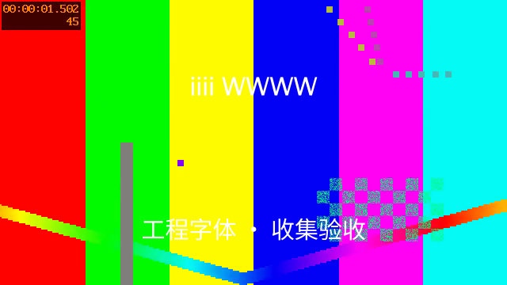
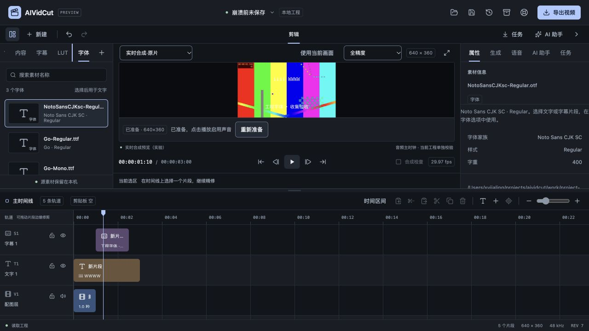
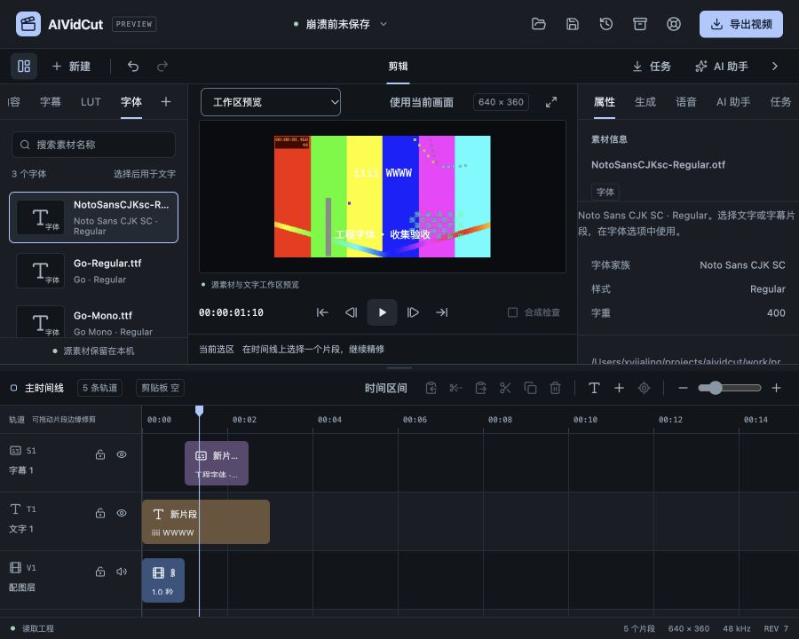

# 工程字体资源验收

日期：2026-10-27。关联FW-R01/FW-R03/FW-R11/FW-R12/FW-R15，推进P0/P1/P2。用户要求的完整模型、CLI、LUT、多轨、模块化与双端目标保留；真实账户验收继续后置，本轮收费模型调用0次。本文只确认已验证的静态工程字体链路，不据此关闭完整阶段。

## 实现与格式

新增font Asset及TextStyle.fontAssetId，字体选择仍通过统一update_clip、锁轨与一次撤销。人工绑定字幕选用字体后标记样式覆盖，重新生成字幕保留该字体。字体不是视频或图片，不双击上轨；素材库新增字体页，显示家族/样式与资源数量，Inspector显示字体元信息、原文件位置、同内容重定位和文件内声明。

工程格式明确升级SchemaVersion=3。v1/v2没有新字体数据的工程在内存无损迁移，打开提示保存兼容性，原文件不自动改写；v1不能偷带画面分析，v1/v2不能偷带有效字体资源和引用。新格式由projectstore、具名版本、恢复和收集共用。旧客户端不应读取或改写v3；这不是继续把新字段写进v2。

Go官方x/image v0.47.0的sfnt解析器用于静态单字体TTF/OTF结构、名称表和字形索引。单文件32MiB、单工程最多使用32份/128MiB；字体集合、可变、彩色和CFF2暂不支持。校验完整SHA和登记元信息，缺字或缺失明确拒绝，不按同名字体代换。保留字体文件内部版权/许可文字及URL供核对，不安装系统字体。

只有实际被文字引用的字体才获得会话读取URL；未用资源只检查文件状态，不读取大字体或加载FontFace。字体读取沿原能力令牌，返回前重新验证SFNT、大小和SHA，仅此分支允许CORS。普通媒体及未授权请求不增加权限，字体被替换为其它内容后返回失败，不泄漏替换文件内容。浏览器再次核对字节SHA后加载FontFace，单在途、容量有界；仍被引用的字体保持，不因切换另一个标题字体而重复读取。换工程/实例或不再引用时取消并释放，失败有明确重试入口。

原生进程显式加载文件、核对SHA与实际Qt字体表，再检查字形运行是否仍使用所选字体，避免只凭家族名称信任默认回退。测量与qtext合成使用相同家族、样式和字重，原生导出复用同一路径；实际字体实例核对缓存最多8个，减少对大型字体表的重复比较。旧worker没有fontFiles能力则明确拒绝。FFmpeg备用路径按实际字体分别复制文件并校验，单次FontPath不能覆盖已指定工程字体；不同排版引擎不承诺逐像素相同。

Qt将字体请求与实际物理字体区分，本轮采用实际字体表和字形运行检查，依据为[Qt QRawFont官方文档](https://doc.qt.io/qt-6/qrawfont.html)；qtext使用的家族、样式、字重与测量关系按[MLT 7.42源码](https://github.com/mltframework/mlt/blob/v7.42.0/src/modules/qt/filter_qtext.cpp)核查。来源核查日期为2026-10-27。

## 自动化与真实媒体

前端52文件347项通过，新增7项覆盖字体字节/SHA、卸载释放、缺失/内容变化、迟到加载、属性选择/锁轨、sourceEpoch重开能力刷新和仍被引用字体的复用。Go完整internal/cmd竞态29个有测试包通过，相关包、最终校验顺序和人工字幕保护又单独复验；vet通过。新增权限测试覆盖无令牌拒绝、普通媒体不放宽、变化文件不返回其它内容及Reset后旧地址失效。

实际使用Go Regular/Go Mono TTF及Noto Sans CJK SC静态OTF。中文字体16437364字节，SHA256为2c76254f6fc379fddfce0a7e84fb5385bb135d3e399294f6eeb6680d0365b74b，取自[Noto官方字体仓库](https://github.com/notofonts/noto-cjk/tree/main/Sans/OTF/SimplifiedChinese)，其[OFL原文](https://github.com/notofonts/noto-cjk/blob/main/Sans/LICENSE)另保留在验收目录。此来源记录不代表对用户其它字体的授权判断。

真实工程沿用上一阶段640×360、30000/1001fps媒体，含视频源相位、独立音频、图片和0.37强度LUT，新增英文标题及明确中文字体的字幕。工程登记3份字体、实际使用2份；导出前完整读取90帧，累计82944000字节RGBA及1153152字节PCM。收集工程后将本轮原字体整个目录移到fonts-offline，3个原字体路径全部不可访问；原工程字体解析明确失败，收集副本从相对路径成功恢复。

迁移前后全部90帧RGBA和原始PCM哈希相同：RGBA为d10502684847665be6a7a0d7c0c834e4b6c928315aded250a196dbc02b66179e，PCM为645053ec9f8e09f46741b88484b2e13a279a2c7f0825f336c99ed14f919be38d。前后都实际通过原生合成导出MP4，不以字体文件存在替代播放证据。两份真实TTF另经独立原生会话验证不同字形，预览/导出相关真实回归通过。

## 实际客户端复查

浏览器开发桥复查了缺失原字体的明确提示、收集副本加载、字体库/属性、标题Go Regular→Go Mono、一次撤销/重做及独立另存font-ui.aividcut。实际DOM可见字形采用与文件SHA对应的专用字体家族；保存文件为v3、标题引用Go Mono、无会话URL。原生合成在同一界面准备到第40帧，显示中文及英文，不依赖系统安装这些字体。

900×720视区初次发现新增页签挤出侧栏，本轮修复为侧栏内横向滚动，保留导入动作，选中页签自动可见。复查document为900×720；侧栏右边212px、页签区域9–170px、选中字体页签约126–170px，未越界。Home/End实际切换素材/字体并返回焦点，字体元信息没有展示无意义的0×0媒体分辨率。

联调还修复两项真实问题：原素材服务只有显示能力、字体fetch缺CORS；同ID/同修订重开后旧预览能力未按sourceEpoch刷新。前者增加字体专用校验响应，后者补实例键及回归。开发中改变Hook结构导致过一次热更新旧状态错误，最终以新页面冷加载复验、页面错误日志为空，不把旧热更新页面当作正式结果。

## 构建、边界与后续

官方Go模块本轮latest仍为Wails v3.0.0，工程Go/CLI/runtime保持一致、工具链Go1.27.3。字体依赖固定后，x/text/x/sync/x/sys按其模块要求更新锁文件；没有切换客户端路线。macOS本地自签名、Windows amd64交叉构建和production资源测试通过。已有JS包大小及本机SDK链接部署目标警告保留；本轮没有启动新的原生macOS窗口，不能把浏览器桥或交叉编译当作双端实机证明。

严格设计审计、DESIGN lint和文档链接/需求检查通过，原始归档哈希保持。早期本轮引入的schema断言、测试调用名/类型、异步测试刷新及明确SDK路径错误均已修正，未当作历史无关失败忽略。一次自动权限审核超时未启动命令，后续已保存脚本并完成测试，没有遗留审批阻塞。

仍需继续：Windows原生字体/WebView2、macOS新字体选择器、任意复杂语言/组合字形、集合/可变/彩色字体和完整色彩管理；系统默认字体不随工程固定，工作区仍为近似布局。字体字节预算不等于Qt/WebView总RSS预算，整机资源仍需按路线图测量。字体外部附带许可文件不自动识别/复制，文件内声明不能替代授权。真实模型账户/CLI推理与商业媒体分发、签名安装及完整P0–P6目标继续，不因本轮字体链路通过而关闭。

数字证据见[工程字体证据](2026-10-27-工程字体资源-evidence.json)，复验脚本和日志保留work/project-font-check。
