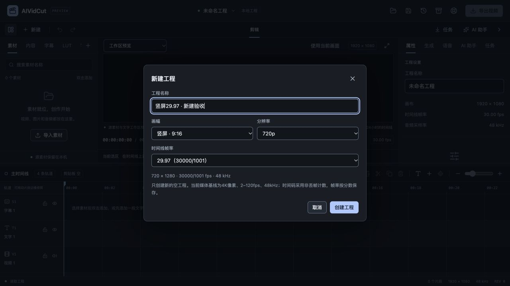
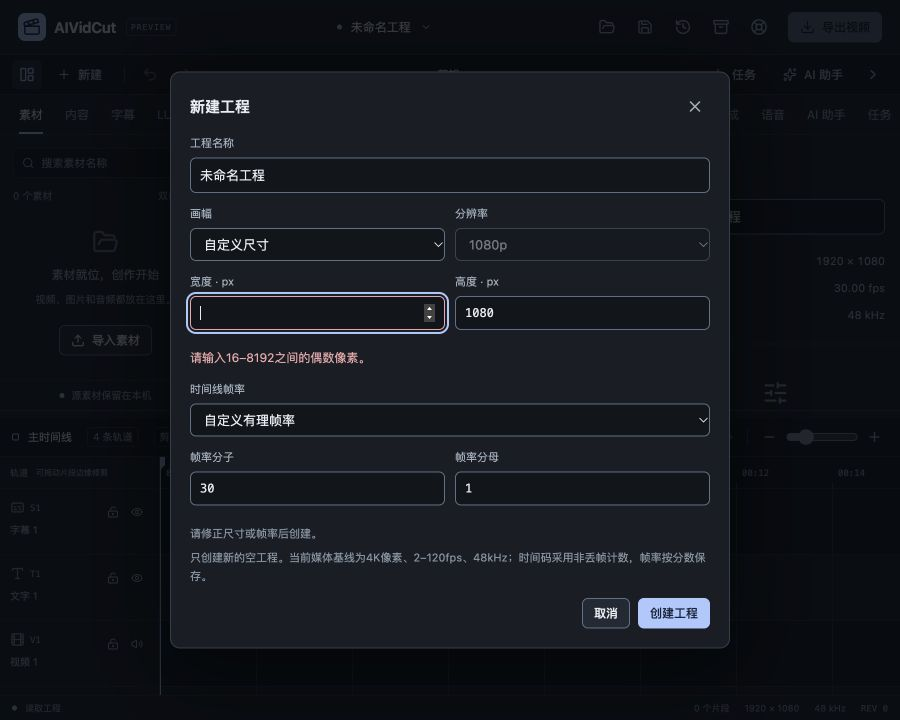

# 新建工程规格设置验收

2026-10-27，FW-R01/FW-R11/FW-R12/FW-R14/FW-R17，推进P0/P1常规建项。原新建只有名称、固定1920×1080/30fps；本轮加入可选择规格的新建入口，不修改已有工程帧率、素材或时间映射。真实模型账户与Claude启动策略仍按前轮状态后置，本轮收费调用0次。

## 用户行为与范围

新建窗口沿原Modal/未保存确认，增加横屏16:9、竖屏9:16、方形1:1和自定义尺寸，720/1080/2160级预设及常见帧率。默认仍1920×1080/30fps/48kHz，不继承刚打开的旧工程；取消/Escape不创建工程，焦点回“新建”入口。

预设摘要显示实际宽高、准确fps分数及采样率。23.976用24000/1001、29.97用30000/1001、59.94用60000/1001，支持自定义整数分子/分母，等比输入约分保存，不以小数四舍五入替代。时间码仍为现有非丢帧计数，不因支持29.97就声称有丢帧时间码。方形2160显示2160×2160，不冒充3840×2160；切自定义带入当前实际尺寸/帧率。

客户端新建范围按当前媒体路线收口：宽高16–8192偶数，总像素不超过3840×2160，帧率2–120、分子最多240000/分母最多120000，音频固定48kHz。核心Settings模型仍有更宽范围，不能以能保存字段推导8K/HDR或任意采样率已验证。现有未公开的宽范围工程不会因本入口限制被改写。

## 核心与状态保护

editor.NewProjectWithSettings使用已有Settings校验、约分及完整工程校验；生成新ID、四个默认轨道、空素材/时间线和v4格式。application.NewProjectWithSettings先校验名称/媒体建项边界，再核对打开窗口时的projectId/revision/sourceEpoch，最后进入原新建重置通道。名称、设置或作用域无效时，不退役当前恢复点、不清资源/剪贴板、不改dirty/Undo或工程路径。

已有NewProject(name)兼容入口保持原默认，内部调用与旧测试不被强迫传新参数；客户端Wails/开发HTTP桥走新方法。新方法没有注册给MCP，不扩展Agent切换或清空工程的权限。手动建项与导入/编辑仍使用同一个核心模型。

界面先走原guarded流程提交/核对属性输入与未保存状态；新窗口保存其时的范围，而非提交时偷偷替换为最新范围。若窗口期间收到其它工程编辑、同ID新实例或修订变化，后台明确拒绝，用户关闭窗口后重新核对，不用旧的放弃确认清空新的工作。

原始字符串和空数值不变成0。错误关联具体字段并聚焦首项；设置错误不会把工程名称错标为无效。忙碌禁用字段/关闭按钮，重复请求沿原串行通道；IME组合期提交不创建工程。新窗打开重置组合状态，防止其它表单遗留状态阻断新建。输入或后端失败保留参数，成功清选区并定位0，原未保存确认与保存窗口保持。

## 实际原生音画

独立Go服务经新入口创建两种规格，再导入已有本地4秒合成音画，添加90帧视频及英文文字，保存重开、真实原生拉帧/声音与原画幅导出。素材是本机测试媒体，不代表自然素材/所有设备容量或模型质量。

| 工程 | 原画幅 | 帧率 | 帧数 | 实际时长 | 原生声道采样帧 |
| --- | --- | --- | --- | --- | --- |
| 竖屏 | 720×1280 | 30000/1001 | 90 | 3.003秒 | 144144 |
| 方形 | 1024×1024 | 25/1 | 90 | 3.600秒 | 172800 |

原生Preview取得对应原尺寸画面，Play从0连续取到末端，有真实音频采样；文字通过当前qtext测量/合成。保存重开Settings完全一致，MP4由独立FFprobe验证相同宽高、准确帧率、90帧和AAC音轨。没有把元数据创建成功当作实际媒体可用，也没有声明有损成片逐像素/逐样本相同。

早期夹具在Preview45后直接循环90次Next，触发预期的末端paused；修正为先回到0再Play后完整通过，没有放宽产品播放终点约束。

## 真实界面与并发编辑

实际浏览器首次显示原默认，切自定义宽度为空后提交，输入保留空字符串、首错焦点为宽度、aria-describedby关联错误。900×720视区中对话框560×577.04、位置170/71.48，document900×720无页面溢出，说明与操作可达；Escape关闭后原工程仍1920×1080、0片段、REV0，焦点回到新建按钮。

再次新建，明确选择竖屏/720p/29.97并输入名称。实际创建为720×1280、30000/1001、48kHz，空工程干净、无Undo，界面画布与帧率更新。再次打开新建窗口仍回1920×1080/30默认，不默默继承上一工程。

窗口打开期间通过真实开发服务给当前工程加入文字“新建窗口期间的当前工作”，再从旧窗口点击创建。服务端拒绝并给出原工程变化错误，新建窗和输入保留；当前标题进入未保存状态。关闭旧窗再次点新建，仍出现未保存保护，选择继续编辑不会丢文字。随后另存ui-project.aividcut，独立读取验证720×1280/30000:1001规格与该文字都在，dirty=false、Undo保留。

这组实测同时验证失败不会清当前工作、旧窗口授权不能作用于新编辑，以及原保存/未保存保护仍有效。没有自动放弃、覆盖原文件或把名称默认值当成新建成功。

## 检查与仍需继续

前端56文件366项、typecheck、format及生产构建通过；新增真实控件预设/自定义、空值/首错关联和约分/边界检查。Go完整32个带测试包竞态/vet通过，新增新规格/约分/四轨/干净重置、重复旧请求、无效设置不改原状态、修订变化与同ID新实例、旧入口默认兼容检查。

Wails官方模块latest仍3.0.0，Go/CLI/npm runtime一致，项目工具链Go1.27.3。macOS本地自签名、Windows amd64构建和production资源测试通过；已有JS包大小与SDK链接目标警告保留。严格设计审计、DESIGN lint、活动文档与需求追踪检查一并归档。

仍需继续：已有工程画幅/帧率调整的明确映射策略、多Sequence、丢帧时间码、更多色彩/音频采样率、自然媒体/目标设备性能和原生双端交付。此入口只创建空工程，不能把它替代已有工程重采样/时间重映射；Windows实机、模型真实账户/CLI推理、商业SDK签名安装和原FW-R01–17/P0–P6目标均保持未完成项。

规格见[新建工程规格](../specs/2026-10-27-新建工程规格设置.md)，数字证据见[本轮证据](2026-10-27-新建工程规格设置-evidence.json)。本地夹具、成片、UI状态和验证日志在work/new-project-check。
