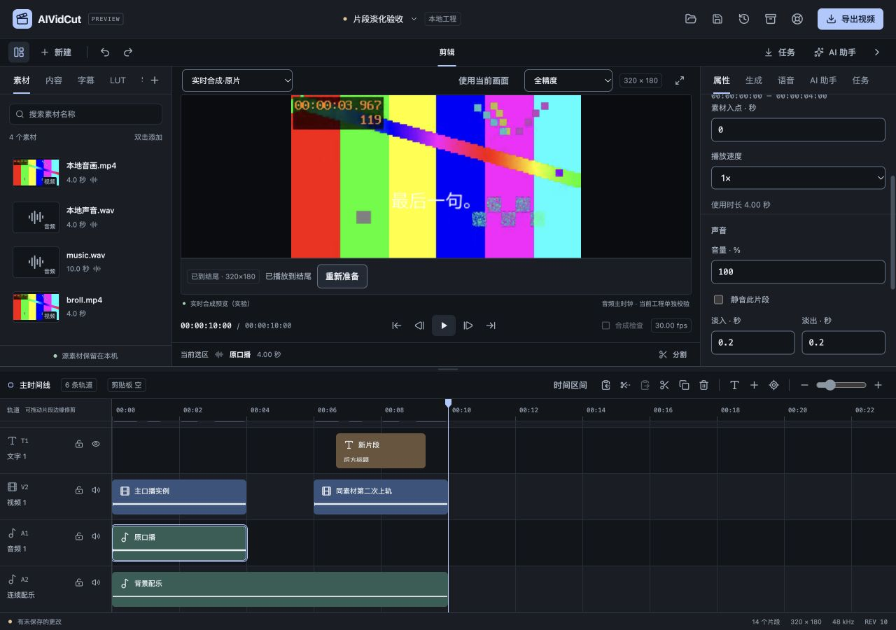
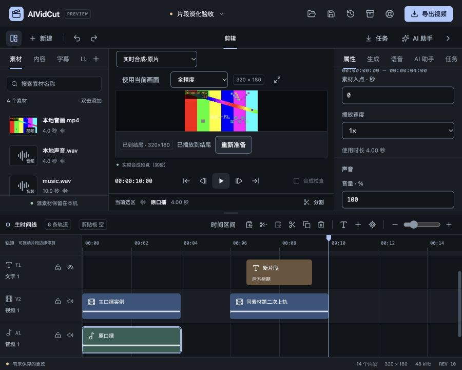

# 片段音频淡入淡出验收

2026-10-27，FW-R01/FW-R02/FW-R05/FW-R11/FW-R12，推进P1/P2声音精修。新增可编辑线性淡入/淡出，人工、草稿恢复、Agent编辑及候选替换继续使用统一核心。默认没有淡化，也未自动给上一轮粗剪改声音；真实模型账户按用户要求后置，本轮收费调用0次。

## 工程与剪辑语义

工程升级为SchemaVersion=4，Clip.audioFade保存整数微秒inUs/outUs和原包络spanFrames/offsetFrames。只用于具有声音的音频或视频，时长非负、两端总和不超过原范围、保留窗不越界，原包络最多24小时。全部验证在核心，不能借新字段写自由滤镜或命令。无字段不产生额外淡化处理。

v1/v2/v3打开只在内存升级，保留原文件并给兼容性提示，明确保存才写v4；旧版本夹带有效淡化对象拒绝。原有字体/画面记录迁移规则保留，旧工程与历史快照仍经统一解析器读取。新增深拷贝、Undo/Redo和JSON保存包含淡化数据，不使用可变共享指针；按Clip值比较的字幕/承载逻辑一并排除指针地址差异，防止误判同一内容已修改。

曲线绑定输出时间，作用于变速后的逐路PCM，随后再混音。分割、递归修剪、复制保留段、剪贴板和波纹裁窗沿用原曲线对应位置，不让每段重新淡入；移动保留相对包络。速度、素材或处理配方重建、或扩展到原包络外时，以当前长度重建，长度不足则同比缩短两端。显式改数值按当前片段重设，另一端过长会缩短，实际读模型更新数值。

保留原声的候选镜头替换会把原淡化复制给真实同源音频承载，原来的输出映射保持；新候选声音不继承旧源包络，预览给出说明。Core会补全客户端未带的原声淡化，并拒绝借新承载改曲线；复用已有承载按值比较，不能因深拷贝指针地址不同被误判为修改。普通新视频/图片上轨仍是默认无淡化。

## 渲染链路

原生worker声明audioFades能力，旧worker遇到有声淡化明确拒绝。Go按工程有理帧率将虚拟包络映射到采样坐标，worker读取每路真实声音后，在本路新输出缓冲逐采样乘0–1线性权重；固定音量和原混音随后处理。共享源PCM/解码器状态不存淡化结果，同一素材的另一路可以保持原声音。Seek、图窗口和原画幅导出使用同一规则。

FFmpeg把有淡化的声音纳入精确输出窗，先解码/重采样/变速及实际裁窗，再aeval逐采样乘同一坐标公式，随后沿原音量/延迟/混音与编码。参数只有经核心核验的数字；非零导出范围和负虚拟起点都有真实PCM测试。实现参数另以本机FFmpeg9.0.2的filter=aeval帮助与实际执行核对，不以滤镜枚举冒充效果实测。

浏览器工作区复用现有近似媒体边界，按当前输出时间更新音量；它仍受HTML媒体与刷新时机限制，不等同原生采样级渲染。真实声音的晚起/短音尾不被补长，淡化不会移动声音来迁就显示片段边缘；极短曲线可能没有覆盖实际可听端点，需要试听。半开范围末端趋于0，不承诺最后一个离散样本严格为0，更不承诺去除所有爆音、降噪或交叉混音。

## 真实音画与成片

固定六轨工程为320×180/30fps/300帧/10秒，含原视频、独立原声、连续660Hz配乐、B-roll、后方标题、字幕和中文工程字体。素材为本地合成音画，词时间为人工夹具，不代表自然语音、识别准确率或模型生成质量。

| 处理对象 | 淡入 | 淡出 |
| --- | --- | --- |
| 原口播音频 | 200ms | 200ms |
| 连续配乐 | 1s | 1s |

分别取单独口播和单独配乐的原生PCM，再用独立线性权重计算预期混音；与最终淡化后的原生混音逐采样比较，最大绝对误差7.178750816017043e-9。输出3840000字节双声道float32，SHA256为c22c42c6b8d7f7c37c761329d93c12b2433df52499437243cfbbebfae3cfd2f8。将配乐在淡入区间内分割后，完整PCM与未分割版本逐字节相同；全部300帧RGBA与未淡化画面相同。没有把改变声音说成音频完全不变。

实际导出faded.mp4，经FFprobe核对320×180、30/1、300帧、10秒，AAC音轨；保存重开v4工程保留包络。PCM精确比较在AAC编码前，有损文件解码后不承诺逐样本相同。另一组真实测试覆盖29.97fps、非零源入点/位置、1.5倍速、随机Seek、图窗口、分割以及同源未淡化轨混音；FFmpeg独立验证权重、非零范围和移动后负虚拟起点。没有仅验证界面数值或命令字符串。

## 实际界面与检查

Inspector声音区沿共享NumberField/Field/Input/Button增加秒数输入和清除，两端毫秒步长，静音仍独立。字段进入原输入草稿登记/恢复；空值和非法数保留，具体范围错误关联字段。分割段显示沿用旧曲线的提示，修改才重设。源包络值超过当前保留段长度时，初始数值可读，等价格式重输不制造提交、错误或舍入丢失；新输入仍按当前长度限制。数值Enter不打断IME组合。

实际浏览器从无淡化工程开始，配乐设置1秒/1秒，撤销淡出为0再重做；口播设置0.2秒/0.2秒。输入999秒被拒且工程修订不变，改回后清除两端，再一次撤销恢复；属性草稿数量最终回到0。原生原片有声播放到10秒结尾，通过保存窗口另存ui-faded.aividcut；独立比较除修订外完整工程与核心生成的faded.aividcut一致，保存后dirty=false且Undo仍在。

900×720视区中document为900×720，两个输入范围x=666–770.5、780.5–885，均在视区内且有效；右侧正文沿既有滚动区可达，无新弹层或主题。截图只证明相应界面状态，不代替原生桌面或完整无障碍验收。

前端55文件361项、typecheck、format与生产构建通过；新增真实控件、清除/非法值、派生窗重设/等价格式和近似权重检查。Go完整32个带测试包竞态/vet通过；新增迁移/注入拒绝/克隆/分割/变速/波纹/Undo、草稿恢复、真实MCP只读拒绝/授权编辑、原声承载和候选清理规则检查。真实原生全包回归通过，包含字体、源时间、图窗口及一致导出。

Wails官方模块latest仍为3.0.0，Go/CLI/npm runtime保持一致，工具链Go1.27.3。最终macOS自签名、Windows amd64构建和production资源测试通过；已有JS包大小和SDK链接目标警告保留。本轮没有新增原生Mac窗口或Windows实机验证，交叉构建不证明Windows媒体运行。

严格设计审计、DESIGN lint与文档追踪检查归档。仍需继续自然口播/配乐的主观试听、切口推荐/批量预设、真正交叉淡化、更多格式和平台、资源与商业SDK/签名交付。真实模型账户、Codex/Claude推理、Skills完整流程及原FW-R01–17/P0–P6目标保留；不因本轮固定样本通过而宣布项目完成。

规格见[淡化规格](../specs/2026-10-27-片段音频淡入淡出.md)，数字证据见[淡化证据](2026-10-27-片段音频淡入淡出-evidence.json)。可复现夹具、权重比较、成片和日志在work/audio-fade-check。
