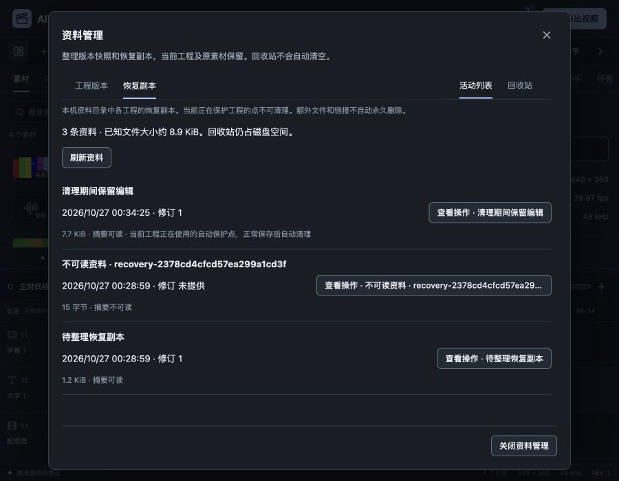

# 版本与恢复资料回收站验收

2026-10-27，关联FW-R01/FW-R11/FW-R12/FW-R13/FW-R15，P1资料管理局部推进。[规格](../specs/2026-10-27-版本与恢复资料回收站.md)、[数字证据](2026-10-27-版本与恢复资料回收站-evidence.json)。前阶段记录仍保留，真实模型/CLI推理0，账户验收继续后置。

## 实现与使用

工程版本增加“管理版本资料”，恢复中心增加“管理恢复资料”，切换到同一资料管理窗口。类型分当前工程版本和本机全局恢复副本，位置分活动列表与回收站。读取不改工程；移至回收站保留原字节，之后可还原到活动列表，不立即替换时间线；永久删除需要独立核对名称、时间、文件大小和不可撤销后果，初始焦点在取消。

回收站不会自动清空，也不把移动伪装成释放磁盘空间。回收释放活动条数/预算，实际文件仍占用空间；永久删除才释放相应文件。当前自动保护点被标记锁定，正常保存后沿原生命周期清理。摘要损坏的普通记录仍可在管理列表检查、回收和还原，不被伪造为可打开工程，修订显示“未提供”。

## 边界与一致性

`internal/snapshotstorage`集中处理有界扫描、目录/文件身份凭据、可还原移动和已知文件清理。列表不读取全部正文，元信息来源于各存储所有者；资料位置、文件ID和内部FileInfo不直接接受客户端值。应用层签发不透明token，绑定当前ProjectScope、类型/位置及文件身份/大小/时间，10分钟有效、最多512份缓存，客户端只提交token、动作和明确永久确认。操作前再次校验；过期修订、同ID新实例、文件变化和占用目标拒绝。

版本存储仍按Project ID隔离，活动和回收站各200条。活动计数只统计版本记录ID，不将回收站或无关目录误计入200条；恢复前版本备份容量保护原断言保留，夹具改用真正的版本ID槽位。恢复存储的活动/回收站各50条及512MiB逻辑文件预算，回收站另计，达到边界要求先整理，不自动删除未知工作。永久清理仅处理普通恢复文件或版本目录中明确的metadata.json/project.aividcut，不递归删除额外文件、子目录、链接。

恢复资料变更取得同一周期写入互斥，再核对当前scope及activeID；退役标记避免在途旧写复活，还原后解除标记。已完成token不重放动作，重复回执标记alreadyApplied，界面只说明此前已处理并刷新，不假称目标仍在原位置。

活动工程路径与素材路径通过实际路径规范化保护。在回归中发现macOS临时目录的`/var`与`/private/var`别名导致最初保护判断不一致，现对源路径和受保护路径同时解析后比较；当前打开的版本文件和被引用资源不能移走或清理。工程、dirty、Undo、媒体、当前实例不因资料管理而改变。没有增加MCP文件清理权限。

## 验证

- 新增3组通用存储测试：回收/还原/永久清理及目标不覆盖，旧文件身份拒绝与额外文件保留，空损坏目录可整理、链接不跟随。新增5组应用测试：版本重复回执/永久确认/原工程保持，恢复资料原样还原及当前保护点锁定、损坏内容可管理，旧scope/超时/直接打开版本保护，200条满额后回收释放槽位，512MiB稀疏损坏记录回收后恢复自动保护。使用自建临时数据，没有写满实际磁盘。
- 后端临时夹具实际验证确认后的永久删除，缺少confirmPermanent不得执行；包含未知文件时保留数据。永久删除是明确丢弃动作，不承诺文件系统失败下的多文件删除事务回滚；若部分删除失败，剩余文件保留并可刷新检查。
- 新增5项DOM及1项桥测试：只读类型/位置/大小、回收取消和成功刷新、独立永久核对与安全焦点、锁定/额外内容/损坏修订、不重复提交、错误保留和旧响应忽略。最终50文件333项前端测试、types/Prettier通过；27个有测试Go包完整竞态及vet通过（部分缓存），旧版本/恢复流程回归通过。
- 真实浏览器连接独立Go资料：打开5素材/4片段真实工程，未失焦名称更改被稳定提交为“清理期间保留编辑”修订1，进入版本→资料管理。活动有2版本；查看回收操作后取消，没有移动该记录。
- 为还原验收预先复制创建一份回收站样例，原活动版本均保留。界面进入回收站、打开永久删除核对，安全焦点在“取消永久删除”，随后取消；没有通过UI执行永久删除。点击“还原到活动列表”后活动变3条，回收站0，正文SHA256仍有效。回收/永久删除实际文件路径由后端临时夹具验证，没有把取消界面当作已完成删除证据。
- 恢复资料显示旧工作、15字节损坏记录和当前自动保护点；损坏项不猜修订，当前点“移至回收站”禁用。整理前后完整Project、dirty、Undo、sourceEpoch和projectPath逐项一致，原fixture文件仍为修订0/原名。
- 900×700窗口中Modal760×668，列表正文内部滚动、无横溢出、底部操作可达。Escape关闭回最初版本入口焦点，没有嵌套窗口；期间不会再弹启动恢复提示覆盖资料管理。
- 关闭管理窗口后，原片全精度实际准备、播放到结尾，经界面原画幅导出after-storage.mp4。90帧/3.003秒/640×360、405954字节，全部帧摘要和完整1153152字节双声道48kHz浮点PCM与基线相同；字幕/0.37 LUT/源相位/音轨保留。

Wails latest仍为v3.0.0，Go/CLI/runtime精确3.0.0、项目Go1.27.3。最终macOS本地自签名及Windows amd64交叉构建、正式嵌入资源检查通过；主JS约590.20kB仍有500kB告警，旧SDK对象/链接目标提示保留。媒体worker没有修改。

严格UI审计与DESIGN lint均0错误/0警告，文档校验覆盖107份Markdown、528个本地链接、80份正文与17项需求，归档快照SHA256不变。浏览器Tab5关闭且视口恢复，Go/Vite与工程媒体进程无遗留，43110/5173无监听；没有子智能体、worktree、提交或PR。

## 仍需继续

本轮新Wails方法没有补原生GUI实机验收，Windows仍只有交叉构建。最近一次原生访问曾锁屏，本轮没有反复要求解锁或启动默认资料实例。

资料回收站不是操作系统回收站，不做自动过期/批量清空。活动记录与回收站分别设限，历史版本跨工程总量、文件系统剩余空间和长期整机资源仍待完整验收。未知额外内容、链接、非记录命名的未提交暂存等不自动永久清理；只有已知资料布局可处理。真实拔盘/断电/共享锁/磁盘满和跨设备字体、全部P1、多Sequence、真实账户/两CLI与商业发行仍未完成，原完整目标继续。
