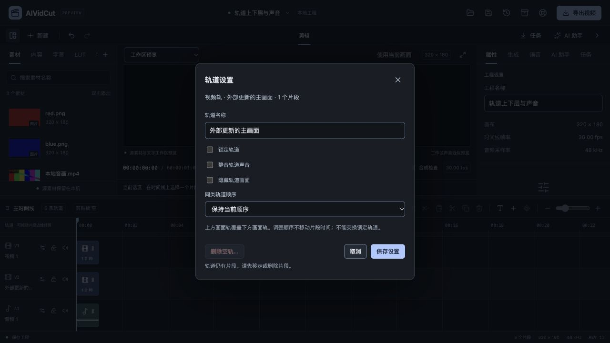
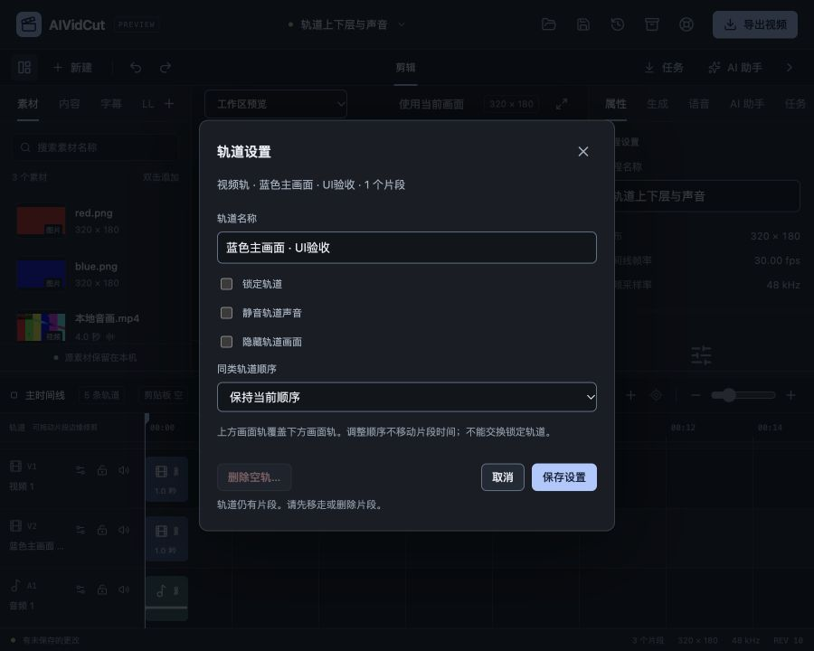

# 轨道管理与同类排序验收

2026-10-27。范围：FW-R01/FW-R07/FW-R11/FW-R12/FW-R17，推进P1手动编辑。当前源码已有锁定、静音、隐藏和空轨删除，原界面仅有部分快捷开关且不能改轨道顺序；本轮接通逐轨管理、同类交换及原子保存，保持原FW-R01–17/P0–P6目标。模型账户按用户要求后置，收费调用0次。

## 操作与核心

时间线每条可见轨道增加设置按钮，沿已有虚拟化挂载，不为管理入口挂载全工程。共享Modal显示轨道类型、原名称及真实片段数；可改名称、锁定、静音和画面隐藏，音频仅声音、视频声音/画面分开、文字/字幕仅画面。顺序采用原生Select，可保持或与同类上一/下一轨交换，边界和锁定邻轨禁选。名称输入保留错误原值，关联具体说明并将焦点移回名称；组合输入期间不提交，忙碌阻止重复提交。

名称/开关与move_track共用一次Engine.Apply事务，一次Undo/Redo。新命令使用trackId、trackDelta=-1或1，交换相邻同类位置，其它类型位置不变，不修改任何片段时间、声音配方、源相位或音画链接。未知轨、边界、任一交换轨锁定、非法位移或夹带片段集合整体拒绝；即使前面有改名也不部分保存。新建/改名校验1–120字符及控制字符，遗留长名只切开关仍可使用。

上方视觉轨具有覆盖优先级，顺序是实际工程数据。轨道ID不变，原片段、生成候选位置和字幕来源继续按ID引用；工程格式仍v4。新增ScopedEditInput/ApplyScopedEdit冻结projectId/projectRevision/sourceEpoch与原请求修订，应用锁内先验证作用域，再走原public edit限制和统一核心。普通公开路径限制不被新桥绕过，不接受未经导入的素材路径或伪造字幕。Wails及开发桥分别接同一个方法。

窗口打开前等待已有属性草稿和挂起编辑；不会随着后台新Bootstrap将旧字段配新修订提交。外部编辑后保存失败仍保留输入，关闭重开才读取新状态。成功/取消回轨道设置按钮；删除后按钮消失，回到可聚焦的时间线滚动区域。轨道设置未保存内容仍为窗口草稿，不加入工程快照或自动恢复，取消会放弃该窗口修改。

删除沿原delete_track，只开放未锁定空轨，至少留一轨，被源字幕引用的轨不能删除。有内容/锁定/最后一轨/字幕绑定分别解释原因，先点“删除空轨…”再明确确认，默认焦点在“返回设置”。返回保留参数，确认只删除原空轨、不保存其它草稿、不删除媒体文件；可一次撤销。不新增含内容轨道的级联删除或永久清理。

## Agent与真实MCP

本地规划Schema允许move_track，提示说明同类交换和全工程范围；已有选区规划明确拒绝整轨排序。锁定轨的解除仍沿原规划限制。公共aividcut_apply_edit描述新增参数，沿原allowEdits、实例和修订检查，不新增工具权限或外部执行路径。

官方Go MCP SDK通过真实HTTP连接测试：只读会话拒绝编辑；允许编辑后提交“改名+上移”，真实核心顺序/名称变化且片段不变，再通过aividcut_undo一次恢复全部轨道。这里证明传输/权限/命令应用，未调用已登录CLI或模型推理，不作为真实Agent质量完成。

## 实际媒体与隐藏原声修复

本机生成红/蓝PNG，导入已有4秒合成音画，建立320×180/30fps工程：两层图片视频轨和独立原声音轨。排序前红画面，上移蓝轨后蓝画面，隐藏蓝轨后恢复红画面。每个场景实际拉取30帧、48000声道采样帧并输出H.264/AAC成片，独立FFprobe核对尺寸/30fps/30帧，再完整解码90帧检查三组画面主色；三份解码音频SHA256完全一致。原生未压缩PCM摘要同样一致，片段集合未变化，改名与排序一次UndoRedo、保存重开轨道数据完全保持。

进一步将同一个实际视频作为唯一有声片段，比较画面可见/隐藏两份原生输出：隐藏后为黑画面、原声PCM保持，验证没有用独立音轨代替视频自身原声。

复查发现工作区近似预览原先在clipAt中直接排除隐藏轨，后续播放判断也混用画面可见与媒体活动。新增视频画面隐藏入口会暴露该差异。本轮修复为隐藏且仍可发声的视频/音频继续挂载媒体，画面可见与声音活动分别判断；隐藏的无声/静音媒体不增加解码负担。既有相关测试预期随明确语义更新，并新增实际Preview控件回归，未将本次失败当历史失败忽略。

真实浏览器读取仅含隐藏有声视频的工程后点击播放，媒体元素存在、computed visibility=hidden、paused=false、muted=false，currentTime实际推进；界面显示没有可见画面、播放头继续。这仍是工作区近似预览，不声称WebView音频与原生合成逐样本一致。

## 界面与并发证据

真实浏览器将蓝轨改名并下移，保存后序号/名称一起变化，焦点回相同ID的设置按钮；一次撤销同时还原，再重做。空文字轨删除核对默认焦点在返回，确认后轨数5→4且焦点回timeline-grid；一次撤销恢复5轨，媒体与内容保持。

900×720视区中窗口460×454.89、位置220/132.55，document900×720无页面溢出。原生顺序菜单已展开检查，边界选项禁用，保存与说明可达；沿新建/保存窗口相同Field/Input/Select/Modal和状态反馈，不增加主题或滚动所有者。

窗口输入“保留的过期窗口草稿”期间，通过真实后端把当前轨道改名为“外部更新的主画面”。旧窗口保存被拒绝，旧输入保留，当前工程的新名称保持；取消后焦点回当前轨，另存ui-final.aividcut。独立文件读取验证新名称、5轨、3片段、原顺序及原素材保持。测试页和临时视区在结束后清理，不改用户已有工程。

## 检查与仍需继续

前端57文件371项测试、typecheck、format、生产构建通过；Go完整32个带测试包竞态/vet通过，随后新增真实MCP测试及命令说明变更又通过application/localagent/mcpserver竞态/vet。覆盖核心保持/原子失败/锁轨/命名、旧修订与同ID同修订新实例拒绝、公开路径限制，以及控件错误、重复提交、删除核对与迟到失败。最新Mac本地自签名、Windows amd64交叉构建和正式资源检查按最终源码执行；旧JS体积和本机SDK链接目标警告保留。

Wails官方模块查询最新仍v3.0.0，Go/CLI/npm runtime保持一致，工具链Go1.27.3。设计静态审计、DESIGN lint、文档链接和原始快照摘要检查随数字证据归档。无子智能体、worktree、提交或PR。

仍需继续：跨类型层级策略、轨道分组/独奏与含内容轨道处理、多Sequence、已有工程时基调整、更多自然素材/设备性能、Windows实机及完整双端商业SDK/签名安装。真实模型账户和CLI推理、完整FW-R01–17/P0–P6保持未完成；本轮不将局部排序与工作区修复当作完整客户端交付。

规格见[轨道管理](../specs/2026-10-27-轨道管理与同类排序.md)，[数字证据](2026-10-27-轨道管理与同类排序-evidence.json)。本地媒体、夹具和日志在work/track-management-check。
