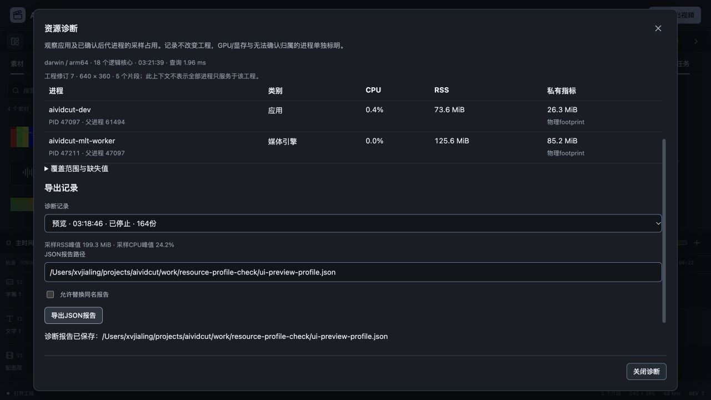
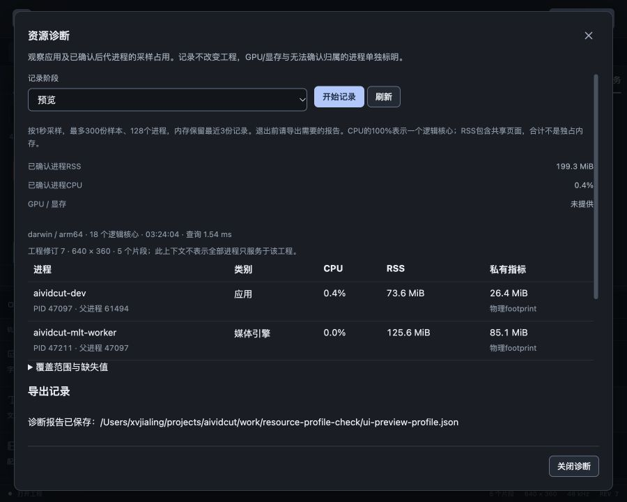

# 进程资源诊断验收

日期：2026-10-27，FW-R01/FW-R11/FW-R12/FW-R14/FW-R15，推进P0实际负载资源验收。完整多轨、字幕配音、LUT、命名模型、本地Codex/Claude及Skills目标保留，真实账户继续后置，本轮收费模型调用0次。资源诊断并不代表完整整机资源与商业发布门槛已完成。

## 实现范围

新增processstats与resourceprofile，应用、Wails和开发桥共用。固定当前应用为根，按父子关系、出生身份及确认历史收集后代，捕获媒体worker和FFmpeg等辅助进程；PID复用或读到不同身份不归入旧应用，曾确认且身份不变的孤儿可继续观测。最多65536枚举项/128明细，失败/权限/退出如实记录。只输出程序名/PID/类别，未读取或导出命令行、环境、密钥、素材路径；界面不能传任意PID扩大范围。

macOS公开libproc提供身份、RSS、物理footprint和累计CPU；Windows Toolhelp/GetProcessTimes/GetProcessMemoryInfo提供出生时间、工作集和私有提交。它们内存语义不同，界面分开标示。RSS含共享页，合计不能当作独占物理内存。CPU按同身份的累计值/单调时间差计算，100%为一个逻辑核心，可超过100%；首样本、身份变化或无权限用null/原因，不补成0。

实测发现本机Apple Silicon原始ri_user_time/ri_system_time不能直接标成纳秒，独立200ms负载最初仅为POSIX的0.0241。增加Mach时间基准、128位中间值及线程安全初始化后，报告200857000ns、POSIX200156000ns，比值1.0035。新增独立150ms CPU回归，避免Intel常见1:1时间基准掩盖换算问题。依据[Apple XNU的rusage填充实现](https://github.com/apple-oss-distributions/xnu/blob/main/osfmk/kern/bsd_kern.c)并用本机独立计数验证；Windows工作集包含共享和私有页的定义见[Microsoft官方文档](https://learn.microsoft.com/en-us/windows/win32/procthread/process-working-set)。核查日期2026-10-27。

诊断窗口按需1秒读取；显式开始后后台记录，最多300份/5分钟，内存只留最近3份。停止、失败或达到上限保留已有样本，JSON由后端记录生成，客户端只提供记录ID和人选择的路径；原子提交、同名覆盖选择以及工程/素材路径保护共用现有提交工具。退出前需导出报告，不承诺诊断内存持久恢复。记录包含规模/修订、人工阶段、Go/平台/逻辑核心与当前磁盘程序文件SHA，没有采集工程正文。应用Context只读Shape，不逐次克隆整条时间线。

## 覆盖与未覆盖

仅统计已确认的应用进程树，不以名称将其它应用的WebKit进程纳入。Mac独立WebKit XPC、GPU/显存及外部独立启动CLI目前无法可靠归属，均明确列为未覆盖；未使用私有API。开发浏览器本身也不属于Go开发服务树。因此本轮不是完整Wails窗口/整机资源结论。

首个样本及刚启动进程可能没有CPU窗口；短命进程可能在采样间隔内完全错过。报告峰值只表示观测到的峰值，不是精确瞬时最大值。全部进程都可读时才给完整树RSS/CPU合计，部分不可读保留已知RSS、缺失数量及原因。程序名的类别仅供识别，资源不自动专属于当前工程。

## 真实负载数据

使用上一阶段640×360、30000/1001fps工程，5片段/8素材，包含视频源相位、独立混音、图片、字幕/TTF/中文OTF及0.37强度LUT。它是固定合成验收素材，不冒充自然长口播或任意容量测试。复验命令与代码在work/resource-profile-check/media.go，预览按帧时间节奏消费90帧，4K导出明确使用project原工程与4k预设/libx264。

| 场景 | 实际采样 | 已见程序 | 采样RSS合计峰值 | 采样CPU合计峰值 | 最大查询耗时 |
| --- | --- | --- | --- | --- | --- |
| 原生节奏消费预览 | 1秒、4份 | 验收程序/MLT worker | 173.36 MiB | 28.21%，单核为100% | 1.49ms |
| 4K/90帧实际导出 | 明确100ms、17份 | 验收程序/MLT worker/FFmpeg | 953.06 MiB | 359.41%，约3.59核心 | 1.10ms |
| 真实浏览器准备/播放/后台记录 | 1秒、164份 | Go应用/MLT worker | 199.27 MiB | 24.19% | 3.25ms |

4K导出实际3840×2160、90帧，ffprobe验证；不因为占用数值高低推断质量/稳定性已通过。原始报告的出生身份、时间与null保留，表格只是本机固定样本摘要，不能直接与不同平台、编码参数或软件空窗口比较。初轮1秒短导出只有2样本，部分进程无CPU窗口；后用明确100ms开发采样获得有效窗口，没有把缺失值改成零。开发工厂的100ms至1秒间隔写入intervalMs，产品界面仍固定1秒。

## 实际界面与工程保护

任务页新增“资源诊断”。实际打开、开始预览阶段、关闭窗口继续记录，入口显示经后台状态核对的“记录中”；准备并播放有声原生工程到结尾后，重新打开能看见Go/MLT两进程，停止于164样本并从界面导出ui-preview-profile.json。原工程正文与原文件比较相同，dirty=false、CanUndo/CanRedo=false保持，说明诊断没有通过编辑命令修改项目。

900×720实际对话框860×688、位置20/16，document仍900×720。阶段、未知GPU值、进程表、私有指标及固定底部关闭操作可达，正文自己滚动；覆盖说明明确展示未计入的独立WebKit XPC。开始前等待首次状态，防止将未知记录状态呈现为可以立即新建。表格20份追加，最多128，读数使用制表数字和文字单位，不用装饰性百分比。

前端53文件351项通过，新增4项真实DOM测试：打开不自动记录、缺失值/覆盖说明、开始停止/单在途/后台关闭、导出失败保留参数及晚响应；旧编辑测试继续通过。Go完整internal/cmd竞态与vet通过，新增身份树、PID复用、孤儿、权限/计数倒退、128上界、真实自身/子进程、POSIX CPU单位、样本上限/失败保留/最近记录、关闭和导出保护测试。Windows原生读取分支额外交叉编译成功。

## 构建与仍需继续

Wails官方Go模块latest本轮仍为v3.0.0，Go/CLI/runtime一致、Go1.27.3。Mac本地自签名、Windows amd64构建和production资源测试通过。已有JS大小警告和SDK链接部署目标警告保留；Windows读取仅有编译证据，本轮没有新增原生Mac窗口验收，不以浏览器桥或交叉构建代替实机。

严格前端审计与DESIGN lint、文档链接/需求追踪通过，原始归档哈希保持。新增测试类型、summary控件点击和报告间隔字段的本轮错误已修复，未按历史失败忽略。旧preview-benchmark的两个PID/ps格式未在本轮改写，新的模块与报告可供后续统一；不将两个不同采集器的口径混在一张性能提升表中。

仍需继续：完整WebView归属、GPU/显存、Windows实测、自然长素材/高并发与目标设备上的p50/p95/音画/整机资源；当前报告没有自动记录全部导出业务参数，需保留相同操作设置或复验脚本。4K采样约953MiB是后续资源优化依据，不构成已达到用户设备预算。真实模型账户、CLI实际推理、商业媒体SDK/许可、安装签名及完整P0–P6目标保留。本轮不勾选完整资源门槛，也不自动杀进程或调整编辑质量。

数字见[资源诊断证据](2026-10-27-进程资源诊断-evidence.json)，原始采样和换算验证保留work/resource-profile-check。
