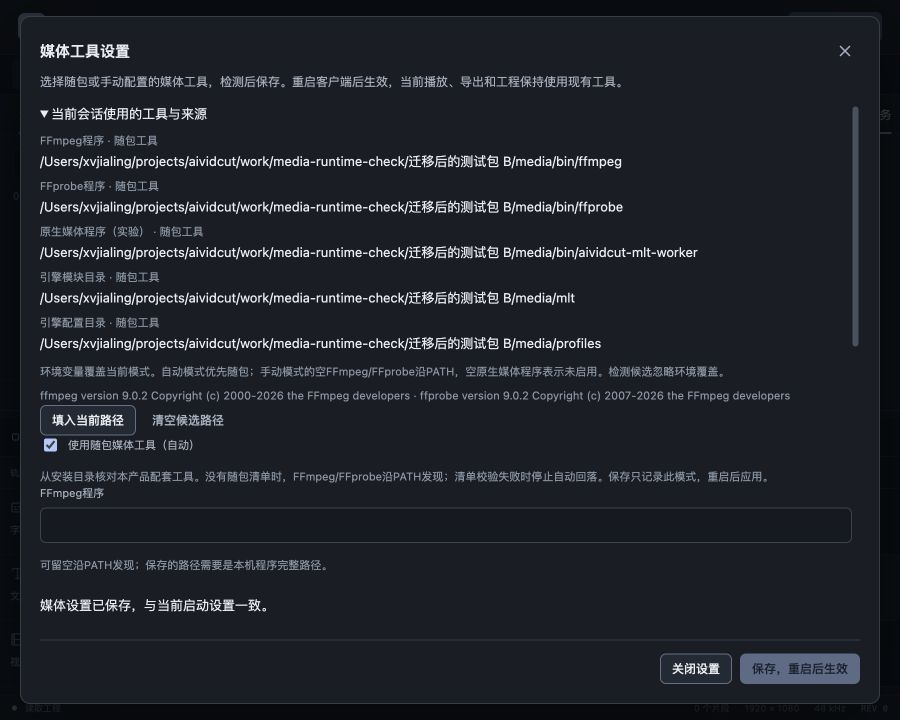

# 随包媒体运行时发现与校验验收

2026-10-27，FW-R11/FW-R14/FW-R16，推进P0随包集成。上轮发现SDK链接仍指向开发机，本轮完成真实客户端的产品相邻发现、完整内容清单与设置模式接入；完整SDK重定位、许可闭包和双端交付门槛继续保留。真实模型账户按用户要求后置，本轮模型/CLI推理和收费调用0次。

## 工程接入

新增internal/mediaruntime，以运行程序真实路径计算候选。Mac `.app/Contents/MacOS`程序对应`Contents/Resources/media/runtime.json`，普通程序/Windows对应相邻`media/runtime.json`。不扫描Homebrew或其它应用，不把解析出的安装绝对路径写入用户设置/工程；复制/迁移安装目录后下一进程重新计算。

清单schemaVersion=1，含ID、版本、目标OS/架构、三类可执行文件及repository/profiles两目录、全部payload。普通文件核对字节和小写SHA256，内部symlink核对相对target并经os.Root封闭解析，支持framework目录的Versions/Current链接。缺失/重复/多余文件、错平台/版本/类型、越根、绝对链接、指纹不符、清单/目录/内容在核对期间变化均拒绝。物理目录全部内容登记，清单本身不自引用；日志与缓存应放用户数据目录。

上限2MiB清单、8192 payload、32768节点、单文件512MiB和总计2GiB，64KiB流式哈希、支持取消。哈希仅证明内容一致性，不是发布者身份、许可或可加载能力认证。验证后仍沿原media能力检查和原生Inspect，不用文件存在取代实际插件/编解码验证。

设置保存升级v2，可读v1/v2。新增useBundled自动模式，首次无设置文件默认开启；旧v1无论路径是否为空仍为手动，原生空值保持停用。损坏设置保留原环境/PATH回退和修复流程；未知版本不自动改写。自动模式只保存true及空路径，手动模式仍存用户明确路径。

环境覆盖优先。自动模式没有相关原生环境覆盖时成组使用worker/repository/profiles；明确自定义其中任一环境项时，不暗中混用随包剩余原生路径。自动清单缺失时沿PATH发现FFmpeg/FFprobe，原生未配置；清单存在但无效时阻止自动PATH回落，显式手动/环境配置保持独立，错误可见。

## 候选与界面

媒体设置沿原共享Modal、Field/Input、checkbox-field和状态反馈，增加“使用随包媒体工具（自动）”。自动模式禁用五个手动输入，切回可保留本窗口手动草稿；“清空候选路径”为手动空值，仍可明确停用原生引擎。“填入当前路径”明确变成手动候选，保存仍需检测。当前来源增加随包工具/校验失败，原环境/保存/PATH来源保持。

候选检测忽略环境覆盖，核对本次实际选择；保存绑定原始设置摘要、工具证明及随包指纹，自动保存时重新完整验证，不热切换当前工具。模式/路径变化即清检测；保存失败也清除旧检测与“可保存”旧提示，输入保留，要求重检。安装目录与清单状态变化不能借旧检测提交。

真实界面在没有媒体环境和PATH的隔离服务中，五类来源均显示随包，路径指向迁移后的测试包。手动输入“/manual/保留的草稿”，自动/手动往返后该值保留；切自动后五字段禁用。检测得到真实FFmpeg9.0.2及MLT7.42.0，普通原生图仍需实际工程准备。

已有可保存检测后，在私有SDK加入本次未登记夹具，再点击保存，真实后台拒绝。最初观察到旧“可保存”提示仍在，随后修复perform清提示与保存失败清检测，并在最终浏览器重新验收：auto仍true、saveDisabled=true、error=true、staleReadyNotice=false；不是只靠模拟测试推断失败反馈。

同一未登记内容再检测时显示具体runtime错误并禁用保存。移除仅本次夹具后，“清空候选路径→检测→保存”成功，明确提示重启；独立GetMediaTools核对saved为手动空值、restartRequired=true、active/origins仍是原随包工具。再切自动、重检保存，恢复与当前启动设置一致。项目始终空工程、revision0，配置不进入工程。

900×720视区中窗口860×688、x20/y16，document900×720无页面溢出，原有滚动体和固定操作区可达。关闭后焦点回media-tools-trigger，临时视区已复位、测试页关闭。没有新增Select/弹层或改变主题；与原媒体设置/轨道设置保持同一字段和反馈语言。

## 实际程序迁移与音画

在work私有测试目录复制明确选择的FFmpeg、FFprobe、worker、7个模块及profiles，生成86条payload、2077605字节清单。没有修改原SDK，没有上传/发布这些第三方文件；测试清单覆盖这个目录内容，未声称复制完整的传递动态库。

编译独立程序到测试包旁，调用真实NewWithMediaSettings，使用os.Executable发现，而非测试注入安装路径。运行进程移除媒体环境/MLT/DYLD覆盖，PATH=/nonexistent。首次检测与保存自动模式后，导入现有本机4秒合成音画，建立320×180/30fps工程，90帧视频、英文文字、0.6音量及100ms淡入淡出，实际原生播放取帧/声音并H.264/AAC导出。

退出后把整个包移动到含中文与空格的新目录，启动同一程序第二次，仍从新位置解析运行时。两轮均90帧、144000采样帧，完整RGBA与未压缩PCM的SHA256一致；设置v2只含useBundled=true和空路径，不含新旧安装位置。独立FFprobe核对两个成片320×180/30fps/90帧，再完整解码，两轮视频与声音摘要一致。

该证据证明产品相邻发现、移动重算、模式保存与所测真实媒体链路。私有测试二进制仍直接链接Homebrew动态库；再用发行检查得到46个blocker、4个review，主要外部导入仍未解决。开发机上能迁移不等于干净机器可用，不把清单校验当动态库重定位或许可闭包完成。当前正式`.app`没有因此自动附带SDK，未复制这些文件进入正式发行产物。

## 验证与仍需继续

前端57文件372项、typecheck、format、最终生产构建通过。新增自动模式、手动草稿、禁用字段、runtime错误及保存失败后重检覆盖；原两项使用“第一个input”的测试因新增复选框而错选，已改明确FFmpeg标签。没有忽略本次回归失败。

Go完整34个带测试包竞态/vet通过；最终旧异常配置回退和framework目录链接补充后，相关包竞态/vet再次通过。覆盖内部文件/目录链接、迁移、额外/缺失/重复/越界/平台错误、限额/取消、v1空设置、PATH不误调用、环境三项不混配、保存仅模式与清单存在性变化。Mac临时路径/var与/private/var规范化的测试期望已按真实程序路径修正，产品没有放宽边界。

最终Mac本地自签名、Windows amd64交叉构建、production资源检查通过，Wails官方latest仍v3.0.0，Go/CLI/runtime一致、Go1.27.3。新增设置字段经双端编译，Windows实际DLL/路径加载和GUI仍未验。既有包体和SDK链接目标警告保留。严格设计审计、DESIGN lint、文档与需求追踪同步归档。

仍需继续：完整SDK装配与manifest生成流水线、动态库/插件重定位、内部签名后生成清单及外层签名、公证/安装更新、Windows实机、干净机器与自然媒体资源验证。真实模型账户和CLI推理、完整FW-R01–17/P0–P6目标不据本轮局部实现勾选完成。无子智能体、worktree、提交或PR。

[规格](../specs/2026-10-27-随包媒体运行时发现与校验.md)、[模块说明](../../internal/mediaruntime/README.md)、[数字证据](2026-10-27-随包媒体运行时发现与校验-evidence.json)。本地夹具/日志/私有SDK在work/media-runtime-check。
