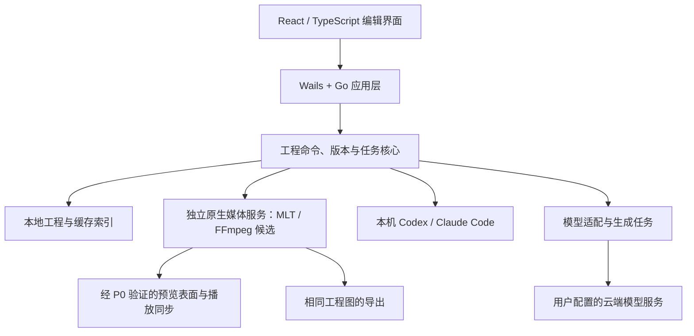

# 桌面客户端技术栈评估

评估日期：2026-10-24。项目：AIVidCut。关联需求：FW-R11、FW-R12、FW-R14、FW-R15、FW-R16。

用户补充背景：主要熟悉 **Go + 前端技术**；需要为后续 Windows/macOS 商业交付、视频剪辑资源占用及代码保护作选型。本文依据官方资料进行架构评估，未运行各方案的对照性能测试，未确定采购合同或最终技术栈。

后续决策更新：用户已确认采用 Wails + Go 客户端方案。本文保留框架比较与回退条件，具体 Wails 版本和媒体集成仍需验证；前端新一轮推荐见 [前端展示层框架评估](前端展示层框架评估.md)。

## 1. 当前建议

**优先验证 Wails + Go + React/TypeScript，使用独立原生媒体服务承担解码、合成、混音和导出。Electron 作为跨端渲染与交付风险的备选；Tauri 2 作为愿意投入 Rust 时的候选；Python/Qt 不作为当前主客户端首选。**

Wails 的优势是与用户现有能力匹配、后端可编译为原生程序、无需随主壳捆绑 Chromium，适合组织本地项目、模型请求、任务和 CLI。此结论不是“Go 比 Rust 更适合视频算法”，也不意味着系统 WebView 一定在所有任务中占用更低。

商业基线优先评估 Wails v2 稳定线。官方同时维护 v3 Beta，v3 提供更明确的多窗口、绑定和分发能力，但尚非最终稳定版。若首版需要独立预览窗口、双屏、多窗口或依赖 v3 的更新能力，要在选型阶段直接验证，不能把未来升级当作零成本假设。[Wails v2 介绍](https://v2.wails.io/docs/introduction/)、[v3 Beta 说明](https://v3.wails.io/blog/wails-v3-beta/)、[v3 当前状态](https://v3.wails.io/status/)

**具体版本与集成条件：**用户已选择 Wails 家族；继续在 Windows 和 macOS 上验证预览链路、定位响应、色彩与文字一致性、资源占用和安装更新。此前 Electron 仅为建议，不是已经确定或实施的技术栈。

## 2. 先区分三个技术层

| 技术层 | 责任 | 主要影响 |
| --- | --- | --- |
| 桌面壳与 UI | 窗口、菜单、时间线交互、素材面板、系统集成 | 启动、基础内存、前端兼容、交付与维护成本 |
| 工程与应用核心 | 时间模型、命令、撤销、数据库、任务、CLI 和模型适配 | 正确性、响应速度、业务代码分布和保护边界 |
| 媒体引擎 | 解码、帧缓存、GPU 合成、LUT、字幕、混音和编码 | 播放流畅度、显存、CPU/GPU、功耗和导出速度 |

Electron、Wails、Tauri 主要解决前两层的一部分。Qt 的原生图形体系还可以承担预览视图，但同样需要媒体引擎。换壳无法直接解决多轨实时合成、精确定位、音画同步和编码。

已有 MLT/FFmpeg 路线保留为媒体候选。选择 Go 或 Rust 不要求重写成熟媒体算法；应先验证引擎能力、编译分发和预览桥接，再决定包装方式。

## 3. 方案对照

以下为基于架构的定性判断，不是实测内存或性能排名。

| 维度 | Electron | Wails | Tauri 2 | Python + Qt |
| --- | --- | --- | --- | --- |
| UI 技术 | Web UI + 随应用分发的 Chromium | Web UI + 系统 WebView | Web UI + 系统 WebView | Qt Widgets 或 Qt Quick/QML；可选 WebEngine |
| 应用后端 | Node.js，也可调用原生模块/进程 | 编译后的 Go | 编译后的 Rust | Python 调用 Qt/C++；关键部分可原生实现 |
| Windows/macOS | 支持，浏览器内核版本可随应用统一 | 支持，需管理系统 WebView 差异 | 支持，需管理系统 WebView 差异 | 支持，需处理 Qt/Python 和原生依赖 |
| 壳与依赖分发 | 包含 Chromium/Node，基础负担较明显 | 不捆绑 Chromium，完整体积仍取决于媒体/运行库 | 不捆绑 Chromium，完整体积仍取决于媒体/运行库 | 取决于 Qt 模块、Python 和打包工具；加入 WebEngine 会带入浏览器依赖 |
| 实际剪辑占用 | 主要看媒体链路与缓存 | 主要看媒体链路与缓存 | 主要看媒体链路与缓存 | 主要看媒体链路与缓存，逐帧经过 Python 要特别避免 |
| 编译后核心逻辑 | 可放到 Go/Rust/C++ 模块中保护 | Go 原生核心较自然 | Rust 原生核心较自然 | 默认 Python 分发暴露逻辑较多，可用编译工具或原生扩展提高门槛 |
| 前端资源保护 | JS/HTML/CSS 应视为可提取 | JS/HTML/CSS 即使嵌入程序也应视为可提取 | JS/HTML/CSS 即使嵌入程序也应视为可提取 | Python/QML/资源也需分别考虑；打包不等于保密 |
| 对当前团队的实施成本 | 前端容易复用，需维护 Node 与原生桥 | Go + 前端匹配度最高 | 需增加 Rust 与相关原生集成维护能力 | 需增加 Python/Qt/QML 和打包维护能力 |
| 在本项目中的位置 | 交付与 Web 兼容性备选 | 首选原型验证 | Rust 路线备选 | 算法工具/辅助模块候选，主壳非首选 |

Electron 官方说明其基于 Chromium 多进程架构，主进程运行 Node.js；Wails 使用平台 WebView 并可将应用与前端资源打入原生程序。Tauri 使用 Rust 和 WebView，Windows/macOS 默认分别为 WebView2/WKWebView。[Electron 进程模型](https://www.electronjs.org/docs/latest/tutorial/process-model)、[Wails 原理与分发](https://v2.wails.io/docs/introduction/)、[Tauri 架构](https://v2.tauri.app/concept/architecture/)、[Tauri WebView](https://v2.tauri.app/reference/webview-versions/)

### 3.1 Electron

适合快速实现复杂的时间线、图形、聊天和素材界面，前端生态及桌面开发工具较成熟。内核随版本统一，可以减少 WebView 能力漂移；字体、GPU、系统色彩和输入法仍需双端测试。

主要代价是应用需承担 Chromium/Node 和进程资源，以及持续升级浏览器安全依赖的维护成本。它并不天然无法做高性能剪辑：若媒体计算在原生服务内，UI 仅控制任务，主要瓶颈仍在媒体系统。官方也要求按实际场景剖析占用，不能仅由框架判断性能。[Electron 性能说明](https://www.electronjs.org/docs/latest/tutorial/performance)

若后续高度依赖任意 HTML 动效、统一 Chromium 渲染、Node 插件或现成 Node ACP 适配器，Electron 的维护和兼容优势可能超过轻量壳的收益。要用完整流程衡量，而非只比较空窗口。

### 3.2 Wails

与当前 Go + 前端背景最匹配。Go 适合项目与任务管理、网络 API、数据库和子进程组织；应用逻辑可留在编译后的 Go 层。React 等前端仍承担时间线和面板交互。

Wails 不等于用纯 Go 逐帧处理视频。MLT/FFmpeg 封装可在独立原生媒体进程中承担重计算，避免高频跨 Go/C 边界、海量帧缓冲进入 GC 及 UI 主线程被阻塞。

需要验证的代价包括：系统 WebView 差异、原生预览视图嵌入、层级与透明叠加、高 DPI、Windows GPU 驱动，以及多窗口/更新的具体版本能力。Wails v2/v3 需分别评估；v3 Beta 的功能不能计入 v2 已有能力。[Wails v2](https://v2.wails.io/docs/introduction/)、[v3 Beta 与 v2 差异](https://v3.wails.io/blog/wails-v3-beta/)

### 3.3 Tauri 2

同样能复用 Web UI，Rust 可以承担核心状态与任务；低层内存与原生库封装的控制能力有价值。它与 Wails 都具备减少捆绑浏览器依赖的路线，但这不构成播放/导出必然更快的证据。

对当前团队，额外成本是 Rust 开发、异步任务、FFI、跨平台插件及原生预览维护。若长期准备将媒体系统和工程核心投入 Rust，这一成本可能值得；仅为了“更难反编译”而改写现有能力不够充分。

Tauri 已提供更新插件，更新包签名与 Windows/macOS 应用签名承担不同职责；不能把这些能力等同于加密业务代码。[Tauri 更新签名](https://v2.tauri.app/plugin/updater/)

### 3.4 Python + Qt，以及需要单列的原生 Qt

Python/Qt 可以调用高性能 C++ 媒体库，不能因为 Python 就断定所有播放性能差。问题在于是否把逐帧计算、缓存和高频 UI 更新放在 Python，以及完整运行时和依赖怎样交付。

Python 适合算法实验、离线分析及某些本地 AI 工具；对当前 Go 团队，它增加 Qt/QML、Python 打包、原生扩展和升级维护，而未明显改善业务代码保护，因此不作为主壳首选。

**C++ + Qt/Qt Quick 应作为另一条路线单列。** Qt Quick 使用场景图，并可通过 Metal、Direct3D、Vulkan、OpenGL 等图形接口渲染，原生预览集成有其价值。若 Web 壳与原生预览在核心编辑体验上无法达标，原生 Qt 值得评估；但开发和许可成本需一起计算。[Qt Quick 场景图](https://doc.qt.io/qt-6/qtquick-visualcanvas-scenegraph.html)

## 4. Windows/macOS 商业交付

### 4.1 两端支持需要完整交付矩阵

至少评估 Windows x64、macOS Apple Silicon；是否同时覆盖 macOS Intel、Windows ARM64 以及最低系统版本，尚需用户和产品范围决策。框架提供某目标支持，不等于我们组合的媒体库、GPU 和打包工具全部通过。

首期建议分别在 Windows 和 macOS 环境构建、签名和验证，尤其要纳入原生媒体库与辅助进程，不假定跨编译可以取代目标平台测试。

| 交付项 | 核查内容 |
| --- | --- |
| 安装与运行时 | WebView2 是否需要安装/更新；应用包含哪些媒体、字体、CLI 适配器和模型文件 |
| macOS | Developer ID 签名、公证、辅助可执行文件、文件/麦克风等权限和卸载 |
| Windows | 应用/安装包签名、SmartScreen 行为、运行时、GPU 驱动、安装目录与权限 |
| 更新与恢复 | 可信更新、断网/断电/失败恢复、工程数据迁移与兼容策略 |
| 产品体验 | 输入法、快捷键、拖放、大目录、长路径、高 DPI、双屏、睡眠唤醒及音频设备切换 |
| CLI 集成 | 程序发现、版本、登录、打包后环境变量和路径；限定可执行文件与参数 |

macOS 签名与公证、Windows 签名与信誉需要独立处理；Windows 新签名版本仍可能出现 SmartScreen 提示，不保证购买某类证书就立即消除提示。[macOS 签名](https://v2.tauri.app/distribute/sign/macos/)、[Windows 签名与信誉](https://v2.tauri.app/distribute/sign/windows/)

官网安装包与应用商店分开评估。特别是调用本机 CLI、访问任意素材目录和运行辅助进程，要验证分发渠道对应的沙盒与审核要求，不能仅依据框架“支持商店”作结论。

### 4.2 商业许可需要看完整发行物

| 方案 | 官方许可事实 | 对本项目的含义 |
| --- | --- | --- |
| Electron | 框架为 MIT | 可评估闭源商业分发，仍需履行通知及依赖许可义务 |
| Wails | 框架为 MIT | 壳本身许可较直接，Go 依赖与媒体发行物仍需核查 |
| Tauri | MIT 或 Apache-2.0 | 需确定项目采用的许可路径并核查插件、依赖 |
| PySide6 / Qt | Qt for Python 提供 LGPLv3/GPLv3 和商业许可 | 闭源使用存在可行路径，但须按模块、链接和分发方式履行相应条件 |
| PyQt | GPL 与商业许可，不能按 PySide 的 LGPL 路径理解 | 与 GPL 不兼容的专有分发需符合 Riverbank 商业授权要求，Qt 本身另需正确许可 |

依据：[Electron 许可说明](https://www.electronjs.org/docs/latest/why-electron)、[Wails LICENSE](https://github.com/wailsapp/wails/blob/master/LICENSE)、[Tauri 许可](https://v2.tauri.app/concept/architecture/#license)、[Qt for Python](https://doc.qt.io/qtforpython-6/)、[Riverbank 许可 FAQ](https://riverbankcomputing.com/commercial/license-faq)。

Qt 的 LGPL 路线并非简单“免费闭源且无需处理”。官方列出许可证与通知、库对应源码、替换/重新链接等权利；部分模块仅有 GPL 或商业选项。希望保护自有业务代码时，仍需尊重第三方库赋予用户的权利；发行方案按最终模块和构建方式审查。[Qt LGPL 义务](https://www.qt.io/development/open-source-lgpl-obligations)

对视频软件，**媒体依赖的选择可能比壳许可更影响商业发行。** FFmpeg 默认整体适用 LGPL 路线，但启用 GPL 组件或某些外部库会改变构建结果的许可；官方还标明某些 nonfree 组合不可再分发。MLT 及其实际插件、字体、编码器、模型运行库和模型服务条款同样需列入清单。独立进程有利于技术隔离，却不能自动证明许可问题已经解决。[FFmpeg 许可与构建选项](https://github.com/FFmpeg/FFmpeg/blob/master/LICENSE.md)

不在尚未明确模块、开发人数、渠道和合同前估算固定商业授权金额；更新、安全维护、测试设备和跨端缺陷修复也是持续成本。

## 5. 视频编辑资源占用怎样控制

总资源需要同时计入：壳/UI、解码器和帧缓存、GPU 纹理、音频缓冲、代理与磁盘缓存、ASR/本地模型、CLI/适配器及导出。系统 WebView 的子进程不能因为不属于主可执行文件就从统计中忽略。

一个示例计算：3840 × 2160 × 4 字节的 RGBA 帧约 **31.6 MiB**，仅 8 帧就约 **253 MiB**。每秒 30 帧的数据量约 949 MiB。这是单路未压缩像素的理论规模，不是任何框架的实测占用；它说明帧复制和缓存策略可能远大于空窗口差异。

### 必须落实的设计

- UI 与 Go 之间传命令、时间戳、片段信息和有限预览结果；不通过常规 JSON/Base64 桥逐帧搬运正式预览。
- 低频缩略图与波形摘要使用独立缓存；高频播放采用经验证的原生表面、纹理或共享缓冲路径，具体方案在 P0 实测。
- 根据设备生成代理、降低交互预览分辨率；导出按交付参数读取正确源素材。
- 统一播放时钟与音频同步，定位时只保留有效请求；快速拖动时取消旧任务。
- 有界帧缓存、纹理和任务队列；对 CPU、GPU、磁盘和本地 AI 并发设独立预算。
- 视频硬解/硬编、GPU 效果及数据传输整体测量；启用硬件编码不意味着滤镜和拷贝已经全部留在 GPU。
- 区分本地生成与云端生成。云端生成时仍可能占用下载、转码和缓存，本地 ASR/AI 可能显著挤占剪辑资源。
- 界面列表/时间线按可见范围绘制；将 UI 流畅度和播放/导出速度分别测量。

Wails 或 Tauri 若另行捆绑 Node、Chromium 动效渲染器或大型本地模型，必须计入完整包体和活跃资源；“薄壳”优势不会自动覆盖这些运行库。调用已有 CLI 与分发 Node ACP 适配器是两种不同的运行依赖方案。

## 6. 源码保护的实际边界

### 6.1 分开定义需要保护什么

| 内容 | 主要风险 | 建议 |
| --- | --- | --- |
| React/JS/HTML/CSS、QML 和静态资源 | 提取、格式化、根据行为重建 | 默认可读取，避免放置关键秘密；发布时不携带无用源映射 |
| 自有 Go/Rust/C++ 业务核心 | 反汇编、反编译、动态分析和行为复制 | 编译核心、清理非必要调试信息、最小接口；按收益考虑混淆 |
| 交给本地 CLI 的 Skills 和提示词 | 被用户、CLI 或本地进程读取 | 当作公开执行协议设计，专有服务凭据和秘密策略不放入其中 |
| 平台自有 API 密钥、签名私钥 | 解包、内存或日志泄露 | 保留服务端或发布系统；客户端使用受限授权 |
| 用户自备凭据 | 本地提取及误传 | 使用系统凭据存储、最小授权和日志脱敏；不能承诺抵抗本机管理员 |
| 付费授权与配额 | 客户端补丁、伪造状态 | 服务端校验商业权益，必要时使用有期限的签名离线授权 |

任何需要交付用户设备并在本机执行的代码，都不能承诺绝对无法逆向。AI 也可以根据可见产品行为辅助重新实现；编译和混淆提高成本，不能替代服务端边界、发布安全和持续产品价值。

### 6.2 四种方案的差异

Electron 的 ASAR 是归档机制，官方提供了读取和列出其内容的接口；它不是源码加密。敏感逻辑可以放进编译后的独立核心，因此 Electron 本身并不排除较高的业务代码还原门槛。[ASAR 文档](https://www.electronjs.org/docs/latest/tutorial/asar-archives)

Wails/Tauri 将 Go/Rust 核心编译为本机代码，比直接交付同等脚本逻辑更难恢复为接近原文的实现，但前端资源、字符串、协议和程序行为仍可研究。不能声称 Rust 绝对不可逆，也没有本项目实验证明 Go/Rust 哪个“防逆向倍数”更高。

PyInstaller 官方说明打包内容包含 Python 字节码，原则上可以反编译；它并非普通意义的源码保护。PySide 官方 `pyside6-deploy` 使用 Nuitka 编译 Python，也可用原生扩展提升门槛，但不能由此得出完整应用不可分析。[PyInstaller 源码保护说明](https://pyinstaller.org/en/stable/operating-mode.html#hiding-the-source-code)、[PySide 部署工具](https://doc.qt.io/qtforpython-6/deployment/deployment-pyside6-deploy.html)

### 6.3 本项目建议采取的保护分层

1. 前端专注呈现与交互；工程规则、任务协调及自有本地算法放在编译核心，保持模块化和可测试性。
2. 少量真正需要保密且适合联网的专有策略或服务放在服务端，按用户隐私和离线目标决定数据边界；基本剪辑不因此强制依赖云端。
3. API 主密钥、更新私钥和服务器凭据不进入客户端。界面、日志、工程文件与 Skills 中不嵌入这些秘密。
4. 发布构建清理非必要调试产物，符号与 source map 在内部保存用于定位崩溃；混淆需验证性能、杀软误报、兼容和维护成本。
5. 对安装包、辅助程序和更新链路做可信签名与校验；签名提供来源与完整性保护，不提供源代码机密性。
6. 保留第三方许可要求的资料和用户权利，不用“保护源码”作为删除所需许可证、库源码提供方式或不兼容许可义务的理由。

## 7. 推荐架构及回退条件

应用进程管理生命周期和有限数据；媒体进程负责像素、音频和资源预算；稳定协议让 UI 壳更换时仍可复用工程与生成服务。该进程边界需要实际验证，不能仅画出架构就视为已解决纹理跨进程传递。

| 条件 | 取舍 |
| --- | --- |
| Go + 前端团队，常规时间线与 AI 面板，Wails 媒体预览达标 | 优先 Wails 路线 |
| 原生预览在 Wails 内效果/输入层级难达标，Electron 同样本通过 | 考虑 Electron，接受可量化的资源成本 |
| 任意 HTML/MG 及统一 Chromium 是核心需求 | Electron 优先级提高；避免另带浏览器后仍宣称原壳极轻量 |
| Rust 能力已具备，准备长期开发原生核心 | Tauri 2 优先级提高，仍须验证系统 WebView 与媒体接入 |
| 两种 Web 壳都无法满足原生专业预览需求 | 将 C++ + Qt/Qt Quick 与媒体引擎纳入专项评估 |
| Python 算法是核心交付且有 Qt 团队 | 重新评估 PySide6，而非只因 AI 库流行就采用 Python 主客户端 |

## 8. P0 对照原型与决策门槛

用户已确定 Wails，先验证其具体版本、前端 WebView 与媒体链路。只有实际出现需要调整客户端方案的阻塞，才提出备选壳对照；届时复用前端和同一媒体工作进程，保持样本、缓存预算、预览质量和编码参数一致。

| 场景 | 记录内容 |
| --- | --- |
| 冷启动、空工程、普通时间线 | 就绪时间、完整进程树内存和 CPU、完整安装体积 |
| 1080p 与 4K 多轨，字幕和 LUT | 掉帧、音画同步、CPU/GPU、内存/显存、功耗 |
| 连续拖动定位、缩放和修改效果 | 定位延迟 p50/p95、交互响应、取消旧请求与峰值缓存 |
| 播放同时分析/生成素材 | 剪辑响应、任务并发、队列和资源回收 |
| 导出、导出同时操作工程 | 同参数导出耗时、峰值占用、预览导出一致性 |
| 长时工作、睡眠唤醒及切换音频设备 | 内存走势、恢复、设备重新同步与崩溃日志 |
| 安装更新、运行时缺失及辅助进程退出 | Windows/macOS 全流程、签名验证和错误恢复 |
| 发布物检查 | 是否含源映射/秘密、前端提取边界、自有核心保护与依赖许可 |

同机比较，记录 OS、架构、GPU、驱动、媒体编码和版本，分开冷/热缓存与硬/软解。Go、WebView 和媒体子进程不能只统计主进程；macOS 统一内存与 Windows 的统计口径也要说明，不把不同机器的绝对数直接比较。

最低通过条件：目标设备满足双方约定的播放、定位和交互指标；没有未处理的无限缓存；字幕/LUT 和导出可验证一致；双端安装更新可复现；保护措施符合依赖许可。阈值依据样本和设备确认，当前不编造“省内存百分比”或“导出快几倍”。

P0 报告通过后记录具体版本、媒体集成与代价。本文评估后用户已正式确认 Wails 客户端方向，不再将重选桌面壳作为默认前置工作。

## 9. 评估限制与资料维护

本次未进行框架原型、包体对照、GPU 互通或逆向成本实验；没有根据流行度直接打分。框架版本、系统最低要求、许可模块和分发规则在实际构建发行时重新确认。此前用户完整需求与原始研究快照保留；本次补充需求见 [归档](../archive/2026-10-24-技术栈评估补充需求.md)。
